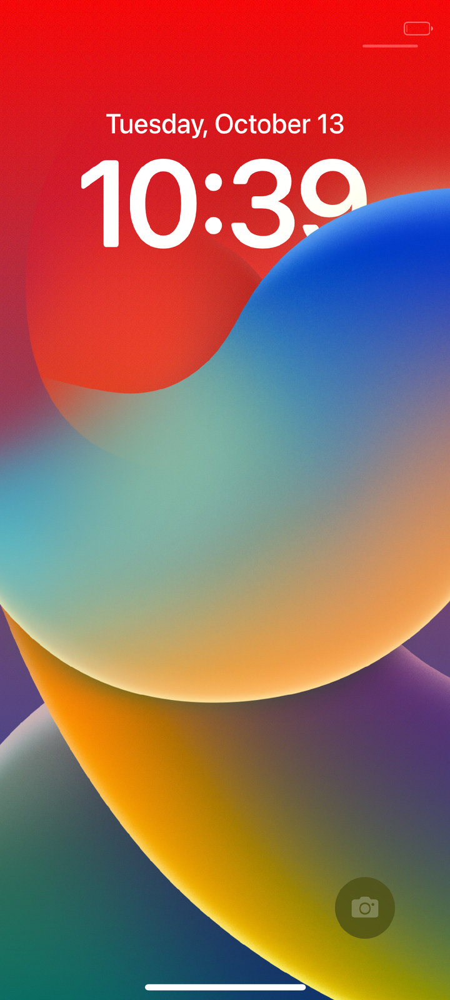
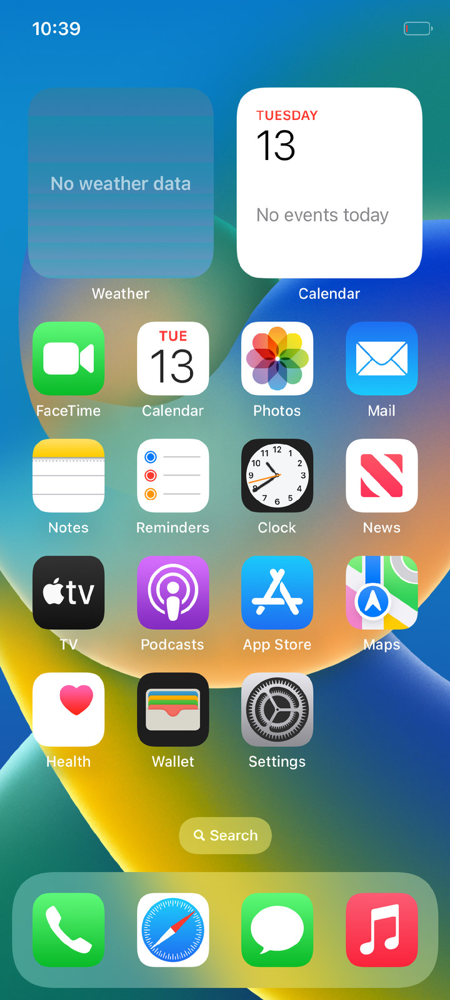
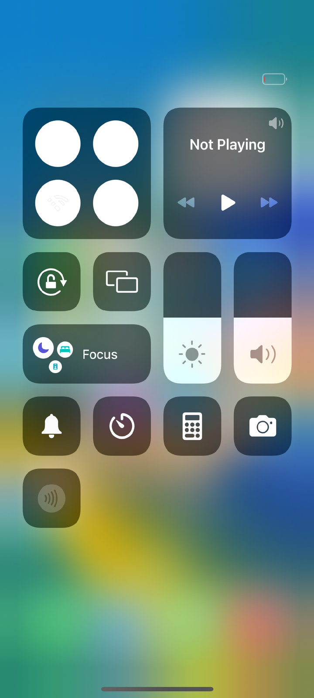
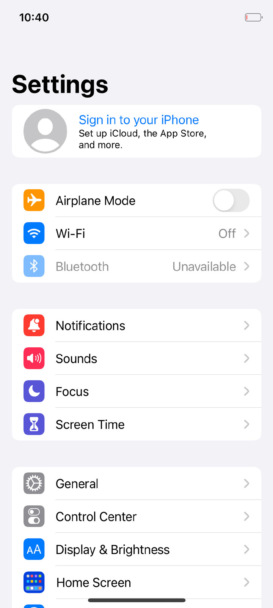
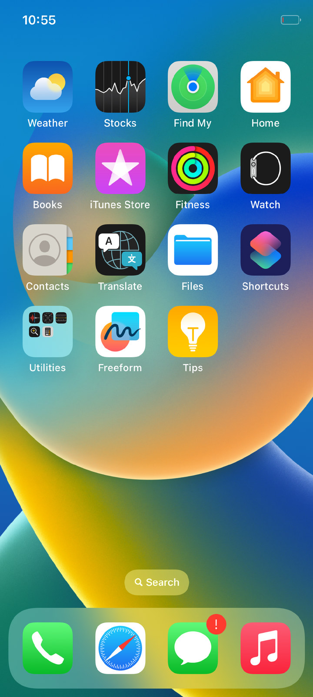
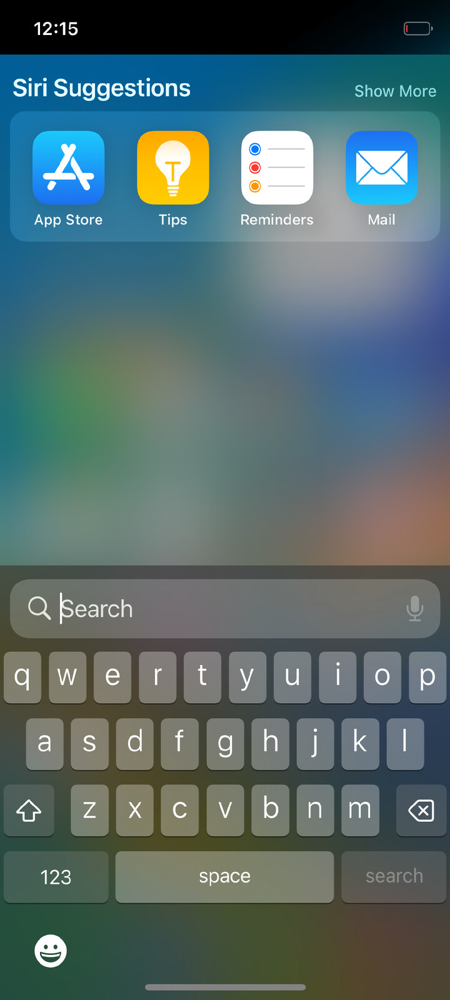
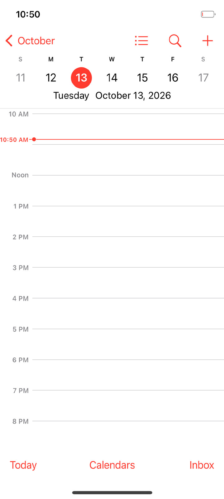
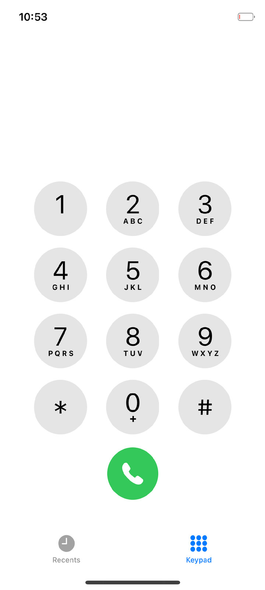
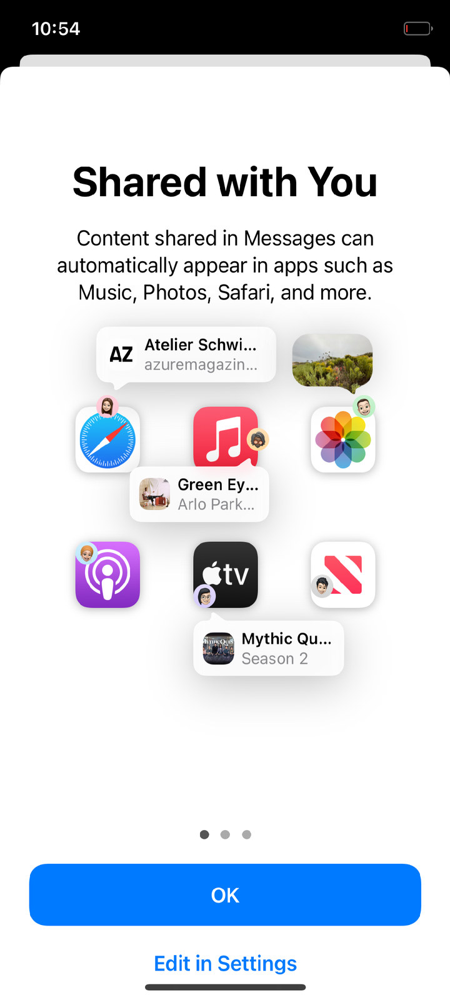
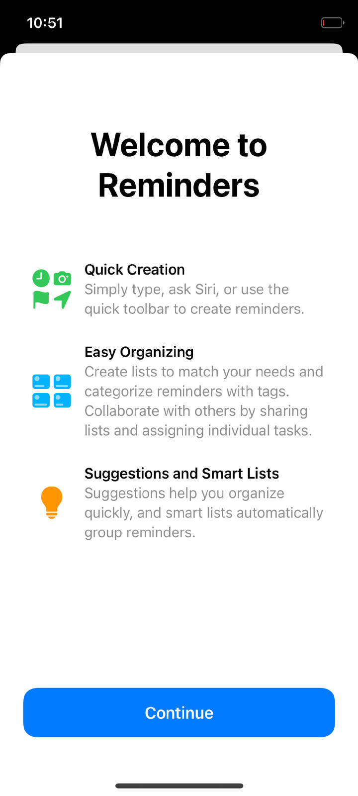

# HackiOS

**HackiOS** — iOS 16.5 на POCO X5 Pro 5G (redwood). Открытое ядро Apple XNU (xnu-8796.121.2 — ядро iOS 16.5), свой загрузчик и свои замены закрытых драйверов,
под которыми работает **немодифицированный userland iOS 16.5** от iPhone X: launchd → backboardd → SpringBoard →
приложения. Работает в двух местах:

- **POCO X5 Pro 5G (redwood, Snapdragon 778G)** — ничего не прошивается: UEFI грузится через `fastboot boot`,
  вся система живёт в ОЗУ, после перезагрузки телефон снова в Android;
- **QEMU** (`virt`, aarch64) — то же самое на любом Linux-компьютере, без телефона.

Графика по умолчанию — программный рендер CoreAnimation, поэтому всё небыстро: на телефоне 15–40 кадров/с на
четырёх ядрах. Отрисовка самим Adreno телефона уже работает в опытном виде — см. раздел «GPU».

<p>




</p>

Снимки сняты с телефона 13 октября 2026 г. (рисует Adreno, `gpu=1`); остальные — в разделе
[«Снимки экрана»](#снимки-экрана).

## Что работает и чего нет

| Работает | Не работает |
|---|---|
| Экран блокировки, разблокировка свайпом, домашний экран с полным набором значков (две страницы), стандартные обои iOS 16 | Звук, сотовая сеть, Bluetooth, камера |
| Системные жесты: свайп снизу — «домой» и переключатель приложений, свайп от левого края — «назад», Пункт управления | Без `gpu=1` (программный рендер; в QEMU всегда) часы экрана блокировки просто белые, без «вибрации» под цвет обоев, и верх обоев под ними не затемнён |
| Запуск приложений: Настройки (вглубь), Часы, Календарь, Фото, Заметки и др.; расширения приложений (виджеты «Погода» и «Календарь» на домашнем экране рисуют своё содержимое — на телефоне; в QEMU им не хватает скорости) | Metal (приложения, рисующие через него сами); отрисовка самим Adreno есть, но пока опытная — см. «GPU» |
| Сенсорный экран телефона (Goodix GT9916), мультитач, пробуждение касанием | Без `cpus=N` работает одно ядро процессора |
| Несколько ядер процессора (`cpus=8`: все семь, что не заняты загрузчиком; малые — после больших) | |
| Кнопки: на телефоне настоящие — питание (боковая кнопка iPhone) и громкость; в QEMU — клавишами | Зарядка под нашим ядром (телефон только разряжается) |
| Большое ядро на 2,4 ГГц, загрузка до экрана блокировки ~20 с (телефон) | |
| Safari: открывает страницы (на телефоне — через его Wi-Fi), его службы — из криптекса App, как на iPhone (см. «Только APFS, как на iPhone») | |
| Снимки экрана и запись экрана с телефона | Сохранение данных: /private/var в памяти, каждая загрузка — «новое устройство» |
| Звук iOS в QEMU (см. ниже; с громкостью; «Сейчас играет» — с оговоркой) | Динамики и микрофоны самого телефона: под нашим ядром они молчат |

Это стенд для исследования, а не прошивка: сеанс длится заданное число секунд, потом ядро возвращается в загрузчик
и отдаёт журнал.

## Быстрый старт: QEMU, без сборки ядра

В `prebuilt/` лежат собранные из этого же репозитория ядро, загрузчик и наши программы, так что нужен только
образ системы. **Файлов iOS в репозитории нет** — скрипт сам скачивает их с серверов Apple (из IPSW iOS 16.5
для iPhone X) и раскладывает.

Нужно: Linux x86-64, ~12 ГБ свободного места (готовое занимает ~8 ГБ), от 4 ГБ свободной памяти. Пакеты (Arch):

```sh
sudo pacman -S --needed git python 7zip lz4 gcc qemu-system-aarch64 qemu-ui-gtk edk2-aarch64
```

(7-Zip нужен версии 23 или новее — он читает APFS; `lz4` — библиотека `liblz4`.)

```sh
git clone git@github.com:vcvkk/darwin-redwood.git
cd darwin-redwood
ios165/fetch.sh               # скачивает 7,4 ГБ с CDN Apple и распаковывает нужное (минут 5–15)
REST=1 userland/build.sh      # собирает образы APFS: userland/root.apfs и userland/system.apfs (2,5 ГБ)
mkdir -p logs
qemu/run-ios.sh 1200 -display gtk > logs/qemu.log     # сеанс на 20 минут
```

Через 2–3 минуты в окне появится экран блокировки.

- **Мышь с зажатой левой кнопкой — палец.** Разблокировка и выход из приложения — свайп вверх от самого
  нижнего края (как на iPhone X), «назад» — свайп от левого края.
- Клавиши: `H` — «Домой», `L` — блокировка/питание, `↑`/`↓` — громкость, `F11` (держать) — пять пальцев.
- То же из скрипта (без окна, `-display gtk` можно не указывать):
  `qemu/touch.py swipe 0.5 0.985 0.5 0.3 250`, `qemu/touch.py tap 0.615 0.71`, `qemu/touch.py key home`
  (координаты — доли экрана), снимок экрана — `qemu/screendump.sh shot.png`.
- Первый аргумент `run-ios.sh` — длительность сеанса в секундах; по её истечении ядро возвращается в загрузчик
  и QEMU завершается. Журнал ядра и демонов идёт в stdout.
- Несколько ядер процессора: `QEMU_SMP=4 CMDLINE="cpus=4" qemu/run-ios.sh 1200 …` (`QEMU_SMP` — сколько ядер у
  машины, `cpus=` — сколько из них берёт ядро системы; без `cpus=` оно работает на одном). До экрана блокировки
  тогда полторы минуты вместо двух с половиной, и всё заметно отзывчивее. Программа `cpu_test` (из
  `userland/rc.jobs`) пишет в журнал число процессоров и, через четыре минуты, сколько из них на деле работало
  одновременно.
- Сразу после появления SpringBoard система ещё занята (регистрирует приложения): подождите секунд 30–40,
  иначе жесты «растягиваются» и не распознаются.

### Звук

Звуком в iOS заведует `mediaserverd`; в него встаёт наше устройство вывода (`RedwoodAudio.driver`), которое iOS
принимает за собственный динамик iPhone, и то, что она играет, приходит в ядро (`/dev/redwood-audio`):

```sh
REST=1 userland/build.sh
AUDIO=pipewire qemu/run-ios.sh 1200 -display gtk > logs/qemu.log    # или AUDIO=pa, alsa, sdl; AUDIO=файл.wav — в файл
```

Для вывода на звуковую карту компьютера QEMU нужен свой модуль (в Arch — пакет `qemu-audio-pipewire`, `qemu-audio-pa`
и т. п.); без `AUDIO` звук играется «в никуда», но внутри iOS всё происходит так же. Проверено в QEMU записью:
тон из своей программы через очередь звука и системные звуки (блокировка, сигнал) доходят до ядра; громкость
действует (кнопки и ползунок в Пункте управления меняют уровень, индикатор громкости появляется). Под эмуляцией
цепочка обработки звука iPhone не успевает за реальным временем, и запись идёт с пропусками. Модуль «Сейчас играет»
в Пункте управления в QEMU пуст, пока `mediaserverd` не перезапустится хотя бы раз (так же и без нашего
устройства); после перезапуска показывает «Не исполняется» с кнопками.
`RC_JOBS=rc.jobs.sound` добавляет в образ сценарий, который сам проигрывает тон и несколько системных звуков
(`userland/src/sound_test.c`); когда звук смолкает, ядро пишет в журнал строку
`redwood-audio: N s written at R frames a second, M s of it sound, peak P% of full scale`.

На телефоне с `adsp=1 sound=4` то, что играет iOS, звучит из обоих динамиков: через звуковой процессор (порт TDM,
поток, путь к порту) и два усилителя Awinic, которые включаются, только пока есть звук (параметр `sound=N` ниже;
`RC_JOBS=rc.jobs.speakers` проигрывает тон, звук блокировки, щелчки клавиатуры и фанфары). То, что iOS играет,
можно и забрать: параметр ядра `rec_sound=N` сохраняет первые N секунд звука в памяти, после
сеанса `./xl sound out.wav` достаёт их (в QEMU — `pmemsave` по адресу из строки `redwood-audio: recording … at 0x…`,
затем `tools/sound.py`); с `rec_sound_fed=1` — то, что ушло к усилителям. На телефоне звук проверен на слух.
Защиты динамиков, которая у Android работает в звуковом процессоре (алгоритм Awinic с калибровкой), здесь нет;
вместо неё отсчёты по пути к усилителям проходят «сторож» ядра (`bsd/dev/redwood_guard.c`): сначала усиление
`sound_gain` (по умолчанию и самое большее 12 дБ: обработка самой iOS для динамика iPhone X держит даже полный тон
на максимуме громкости на 12,6–14,3 дБ ниже полной шкалы), затем фильтр верхних частот 200 Гц, три средних мощности
на динамике — за 0,2, 3 и 60 с, пределы на 3, 6 и 9 дБ ниже мощности синуса полной шкалы на уровне Android (громкость
опускается так, чтобы ни одно не вышло за свой; средние падают и при выключенных усилителях, как динамик остывает) — и
ограничитель пиков на 3 дБ ниже полной шкалы на уровне Android. Раз в секунду читаются температура усилителей и
напряжение батареи, как их видят сами усилители, и по таблице «монитора» драйвера Android из той же конфигурации
громкость снижается на холоде и при разряженной батарее. Проверка на телефоне: `sound_below=160` (−20 дБ) — сторож работает, у усилителей ни одной ошибки; −10 дБ и
уровень Android — ещё впереди. По умолчанию, пока громче на слух не проверено, `sound_below=240` (−30 дБ).
`RC_JOBS=rc.jobs.loud` — самое тяжёлое: тон полной шкалы 60 с прямо в `/dev/redwood-audio` мимо обработки iOS, потом
тон через iOS на максимуме громкости; `sound_guard_as=0` вместе с `sound_below=720` показывает в журнале и записи,
что сторож делает на уровне Android, без единого звука. `tools/guard_test.c` — сторож на этой машине.

Основной микрофон телефона (`adsp=1 mic=3`, пока только в ядре): аналоговый микрофон на ADC1 кодека WCD938x,
его отсчёты идут по SoundWire (ведущий TX цифрового кодека LPASS) в дециматор 1 макроса TX, оттуда через порт
codec DMA TX_CDC_DMA_TX_3 и звуковой процессор в поток, который ядро читает (48 кГц, 16 бит, один канал). Всё —
как это делает Android при записи с микрофонов трубки: значения из живого дерева устройств, путей микшера Xiaomi и
ядра Xiaomi (`bsd/dev/redwood_mic.c`). Шина SoundWire — как у Android на пути «handset-mic»: там включены два АЦП
(ADC1 и ADC4), и шина идёт на 9,6 МГц; таблицы Android для одного ADC1 (шина 4,8 МГц) переносят только половину
того, что ADC1 выдаёт в режиме «low power», и вместо комнаты слышен громкий тон (`mic_main=1`). Уровень каждой
секунды идёт в журнал, а с `rec_sound=N rec_sound_mic=1` отсчёты попадают в запись для `./xl sound`. Проверено на
телефоне: тихая комната — около −73 дБ полной шкалы; с `mic_tap=1 haptic=5` моторчик вибрации работает со 2-й по
3-ю секунду, уровень поднимается на 6–9 дБ, а в записи появляется его резонанс 175,5 Гц (на 20 дБ выше фона) с
нечётными гармониками — микрофон слышит, и частота отсчётов верна.

Замечания:

- Память гостя — 7 ГБ (ядру достаётся то же окно 4,2 ГБ, что и на телефоне), отображённые из разрежённого файла
  `qemu/ram.img` (образ системы лежит в нём по нужному смещению). На btrfs/xfs это reflink и места не занимает,
  на ext4 образ копируется (ещё 2,5 ГБ). Один запущенный QEMU занимает 2,5–3 ГБ памяти компьютера.
- **Сеть (опытно, только в QEMU).** `QEMU_NET=1 qemu/run-ios.sh …` добавляет машине сетевую карту virtio, за
  которой стоит «пользовательская» сеть самого QEMU (DHCP, DNS и выход в сеть компьютера, без прав root); ядро
  делает из неё интерфейс `en0`. Сам по себе интерфейс iOS не настраивает: образ, собранный с
  `RC_JOBS=rc.jobs.net`, при загрузке просит об этом штатный configd (`userland/src/net_test.m`), после чего у
  системы есть адрес, работают DNS (через mDNSResponder) и HTTPS (CFNetwork). Штатные службы тут же начинают
  ходить на серверы Apple (в первые минуты около 30 МБ данных Карт), а приложения Apple — Погода, App Store,
  Подкасты — данных всё равно не получают: им нужна служба `fairplayd`, которой в образе нет. В Настройках
  Wi-Fi остаётся «Выкл.» (это не Wi-Fi). По умолчанию сети нет, и без `QEMU_NET=1` ничего не меняется.
- **Связка ключей (Keychain).** Работает так, как если бы у устройства не было код-пароля и оно всегда было
  разблокировано: программы записывают в неё пароли и читают их обратно (wifid — пароли сетей, подключённых из
  Настроек). Это не защищённая связка: Secure Enclave нет, ключи классов защиты заменяет обратимое
  преобразование в ядре (`iokit/Kernel/MiniAppleKeyStore.cpp`), и всё записанное лежит в `/private/var`, то есть в
  памяти, и пропадает при следующем старте. Проверка: `/redwood/bin/keychain_test` (подписывается `ldid`
  с группой доступа к связке; без `ldid` связка такой программе отказывает).
- **Wi-Fi телефона (опытно): `wifi=1`.** Радио телефона подключается к одной сети WPA2 с паролем, и iOS выходит
  через него в интернет: адрес по DHCP, DNS, HTTPS. Нужны прошивка радио в `fw-wifi/` (см. `wifi_step=N` в
  таблице параметров ядра), адрес радио одной строкой в `fw-wifi/mac` и файл `fw-wifi/network` — имя сети первой
  строкой, пароль второй (оба файла в git не попадают; `userland/build.sh` кладёт второй в малый образ, на
  командную строку ядра он не идёт, в журнал пишутся только длины). Затем `tools/mk-ath11k.sh`, `./xnu-build.sh`,
  `GL=1 REST=1 userland/build.sh`, и к обычной командной строке сеанса добавляется одно слово:
  `XL_CMDLINE="touchscreen=1 cpufreq=1 bootcpu=7 cpus=8 gpu=1 wifi=1" ./xl run`. Радио поднимается рядом с
  загрузкой системы и её не задерживает (сеть есть через 12 секунд после старта ядра), интерфейс — тот же `en0`;
  настроить его просит configd задание `com.redwood.wifi`, которое есть в каждом образе и без `wifi=1` ничего не
  делает. Без прошивки ядро говорит об этом одной строкой и идёт дальше; без файла сети радио поднимается, но ни к
  чему не подключается. В Safari при наборе в
  строке поиска появляются подсказки поисковика — они приходят уже по этой сети; страницы Safari открывает и рисует
  (yandex.ru с поиском, погодой и новостями дзена, example.com). Чёрными они были, пока экран считался экраном
  широкой гаммы: у iPhone X в дереве устройств «artwork-display-gamut» = P3, MobileGestalt по нему отвечает
  HasExtendedColorDisplay = да, и WebKit рисует плитки страницы в поверхности по десять бит на цвет ('w30r',
  'b3a8'). Таких наших поверхностей нет (ядро даёт вместо них BGRA, оконный сервер только её и показывает), и
  CoreGraphics в них не рисовал — плитки оставались нулями. Теперь загрузчик пишет в дерево sRGB, как и есть у
  нашего кадрового буфера, и WebKit рисует в BGRA (`xnuloader/loader.c`, `dt_identity()`; проверка —
  `RC_JOBS=rc.jobs.safari`). Цветные эмодзи и китайский шрифт PingFang (130 и 74 МБ) целиком в образ системы не
  помещаются, и их знаки выходили квадратиками с вопросом; теперь `ios165/fetch.sh` кладёт их в образ уменьшенными
  (`tools/font_trim.py`): эмодзи — без самых крупных картинок (остаются 40, 64 и 96 точек; 59 МБ), PingFang — с
  обычным и полужирным начертаниями упрощённого, традиционного и гонконгского письма (26 МБ). Проверка —
  `RC_JOBS=rc.jobs.fonts` (`font_test`: к какому шрифту система идёт за эмодзи, китайским, японским и корейским и
  сколько точек он рисует, сколько из них цветных; с `wifi=1` — китайская Википедия и страница эмодзи в Safari).
  Настройки: в образе работает и wifid, служба Wi-Fi самой iOS, а ядро отвечает на её запросы
  (`bsd/dev/redwood_apple80211.c`). Раньше его добавлял только `WIFID=1`; теперь он в образе по умолчанию, потому
  что там, где радио нет вовсе, он ничего не стоит: в QEMU wifid поднимается, сам с собой разговаривает о кодах
  стран и сидит — 114 запущенных процессов против 119 без него, ни одной аварии, ни одного перезапуска, — а на
  вопросы, которые система всё равно задаёт, отвечает: `com.apple.wifi.manager` (это имя wifid регистрирует сам,
  в задании его нет) упал с 30 ненайденных обращений за сеанс до 3, `com.apple.private.corewifi-xpc` — с одного
  до нуля, а всего ненайденных обращений в сеансе стало 305 вместо 331. Оставить его за бортом — `WIFID=0`.
  (Считать по журналу запуска QEMU надо, убрав повторы: `qemu/run-ios.sh` выводит журнал launchd дважды.)
  С радио (`wifi=1`) при работающем wifid в строке
  состояния есть значок Wi-Fi, в Настройках Wi-Fi включён, подключённая сеть названа, под ней список сетей,
  которые слышит радио. Ядро отвечает и на просьбу подключиться, которую wifid шлёт, когда в Настройках выбрали
  сеть и ввели пароль, и на отключение; неверный пароль ядро возвращает wifid как неверный пароль, и после него
  сеть из файла подключается снова.
  Выключатель Wi-Fi в Настройках выключает радио и включает его снова, и сеть из файла подключается опять.
  У подключённой сети стоит галочка — и когда сеть подключило само ядро (при старте, после выключателя, после
  неверного пароля). Подключение из Настроек пальцем проверено на телефоне: сеть выбрана, пароль набран на
  экранной клавиатуре — галочка; неверный пароль — штатное сообщение iOS о неверном пароле. Чтобы радио при старте
  ждало выбора в Настройках, а не подключало сеть из файла, ядру дают `wifi_file=0`. С `WIFID=0`
  Wi-Fi в Настройках по-прежнему «Выкл.». Скорость: 20 МБ по HTTPS за 2–3 секунды (55–90 Мбит/с; канал шириной
  80 МГц, если точка доступа его даёт, прерывания радио и блочные подтверждения — всё это `wifi=1` включает само,
  а `wifi_irq=0`, `wifi_wide=0`, `wifi_ba=0` выключают по одному). Чего нет ещё: WPA3, открытых сетей, экономии
  энергии.
- Несколько QEMU сразу: `QEMU_INSTANCE=1 qemu/run-ios.sh …` (у каждого номера свои порты; `touch.py`,
  `screendump.sh`, `stop.sh` понимают ту же переменную). `qemu/stop.sh` завершает QEMU досрочно.
- Прошивка UEFI для aarch64 ищется там, куда её кладёт Arch. В Debian/Ubuntu (пакет `qemu-efi-aarch64`):
  `QEMU_EFI=/usr/share/AAVMF/AAVMF_CODE.fd QEMU_VARS=/usr/share/AAVMF/AAVMF_VARS.fd qemu/run-ios.sh …`
  (проверялось только на Arch).
- QEMU без KVM эмулирует ARM программно: всё заметно медленнее, чем на телефоне.

## На телефоне

Нужен именно **POCO X5 Pro 5G (redwood)** с разблокированным загрузчиком, `adb` и `fastboot` на компьютере
(`sudo pacman -S android-tools`), и образы из предыдущего раздела (`ios165/fetch.sh`, `REST=1 userland/build.sh`).

```sh
./xl enter            # Android → fastboot → наш загрузчик в ОЗУ (fastboot boot), он поднимает свой USB-канал
./xl ramdisk          # залить образ системы в ОЗУ телефона (2,5 ГБ, ~80 с) — один раз на сеанс загрузчика
XL_SECS=900 XL_CMDLINE="touchscreen=1 cpufreq=1 bootcpu=7 cpus=8" ./xl run     # 15 минут iOS
./xl screenshot shot.png      # что осталось на экране после возврата
./xl reboot                   # обратно в Android
```

Образ системы — контейнер APFS, сжатый zlib так же, как Apple сжимает корень iOS (5,4 ГБ файлов в 2,5 ГБ); его
и прочие образы ядро читает тем же драйвером APFS, что и том iOS на флеше (см. «Только APFS, как на iPhone»).
Для графики телефона — образ с `GL=1` и `gpu=1` в командной строке, для звука и батареи — `adsp=1` (не
`battery=1`: с ним ядро не спрашивает батарею у звукового процессора, и iOS показывает не тот заряд).

`./xl run` ждёт конца сеанса и кладёт журнал в `logs/`; запускать можно сколько угодно раз, образ системы в ОЗУ
остаётся. `./xl` без аргументов печатает все команды. Пока идёт сеанс, из другого терминала работают
`./xl screenshot` (снимок экрана на ходу), `./xl log` (журнал ядра на данный момент), `./xl state` и
**`./xl stop`** — завершить сеанс сейчас. `XL_FOLLOW=5 ./xl run` каждые 5 секунд сохраняет журнал в
`logs/…-run.log.live`: если телефон сбросится без единого слова, останется всё, что ядро успело сказать.

Управление как на iPhone X: свайп вверх от нижнего края — разблокировка и «домой», погасший экран будится
касанием. **Закончить сеанс раньше времени — приложить к экрану пять пальцев на полторы секунды** (или
`./xl stop` с компьютера): ядро вернётся в загрузчик (кнопки телефона заняты своим делом: питание гасит и будит экран, как на iPhone).
На экране при этом остаётся последний кадр.

**Прочитайте до запуска:**

- В постоянную память ничего не прошивается, с одним исключением: загрузчик пишет свой текстовый журнал в начало
  сырого раздела **`logdump`** (отладочный раздел Xiaomi; Android им в обычной жизни не пользуется). Если есть root —
  сохраните его заранее: `adb shell su -c 'dd if=/dev/block/by-name/logdump of=/sdcard/logdump.img'`.
- UEFI собран из драйверов прошивки `OS1.0.3.0.UMSMIXM`. С другой версией xbl он может не завестись — тогда
  телефон просто не выйдет на связь; выход — зажать питание на 10–15 секунд.
- Ядро напрямую трогает железо (регуляторы через RPMh, GPIO, частоту процессора). Проверено ровно на одном
  экземпляре. **На свой риск.**
- Под нашим ядром телефон **не заряжается** и греется (одно ядро на 2,4 ГГц постоянно рисует). Между длинными
  сеансами возвращайте его в Android (`./xl reboot`).
- Сенсоры в redwood бывают двух видов: Goodix GT9916 и FocalTech FT3680. Драйвер есть только для Goodix.
- Если ядро зависло, сторожевой таймер гипервизора сам перезагрузит телефон в Android (до минуты). Если нет —
  питание на 10–15 секунд.

Параметры ядра (`XL_CMDLINE`, в QEMU — переменная `CMDLINE`):

| Параметр | Что делает |
|---|---|
| `touchscreen=1` | включить сенсорный экран телефона (`touch_flip=1\|2\|3` — отразить оси). На этом телефоне в нём Goodix GT9916. Для меньшей задержки (пальцем ещё не проверено, поэтому не по умолчанию): `touch_poll_us=1000` — смотреть на линию прерывания каждую миллисекунду вместо 8; `touch_spi_hz=5000000` — шина на 5 МГц, как в дереве устройств Android (отчёт читается за 0,14 мс; при 1 МГц — дольше); `touch_rate=480` — команда самой микросхемы (игровой режим Xiaomi, `0xC0`) отчитываться 480 раз в секунду вместо 240. Микросхема её подтверждает; итог видно в строке `goodix: so far …` раз в минуту |
| `touch_lat=1` | замер задержки касания и ровности кадров (`RC_JOBS=rc.jobs.fps`: листание домашнего экрана, Поиск, Пункт управления, открытие Настроек, бросок списка, закрытие — трижды; `tools/frames.py ЖУРНАЛ ЖУРНАЛ.live*` — кадров в секунду и доля кадров дольше 16,7 и 33 мс по каждому жесту, куда ушло время медленных; `XL_FOLLOW=8 XL_FOLLOW_KEEP=1` сохраняет все промежуточные журналы, в которых есть то, что конечный теряет). Вместе с `glslow=МКС` — строка о каждом вызове OpenGL ES дольше МКС (о текстурах — с размером), с `gpu_log=1` — о каждой посылке работы GPU (`tl: Q`: сколько буферов, сколько из них от 4 МБ) и о том, сколько GPU на неё потратил (`tl: q`); SpringBoard пишет `tl: a` о каждом обороте своего главного цикла. Замер задержки касания: строки `tl:` на каждом этапе (ядро выложило отсчёт, оконный сервер прочёл и отдал его системе событий, кадр нарисован, отдан драйверу экрана, GPU закончил, кадр в памяти панели), всё во времени `mach_absolute_time`. `RC_JOBS=rc.jobs.latency` (с `rec_secs=200 rec_ring=1 rec_step=4 rec_mb=256`) через 100 с после запуска водит «пальцем» вверх-вниз по списку Настроек (`rwtouch zigzag`), `tools/latency.py ЖУРНАЛ logs/recording.raw` по развороту пальца в кадрах записи считает задержку от отсчёта касания до кадра в памяти панели и раскладывает её по этапам. Первые 1–2 минуты после запуска все четыре ядра заняты виджетами, searchd и прочими: замер в это время мерит их, а не путь касания (`ustacks=top ustacks_at=S ustacks_ms=MS` показывает, кто занимал процессор) |
| `buttons=0` | не читать кнопки телефона. Вместе с `touchscreen=1` они включены: питание — боковая кнопка, громкость вверх и вниз (опрос микросхемы питания раз в 16 мс, только чтение). Не держать питание дольше 5 с: 10–15 с сбрасывают телефон |
| `autounlock=0` | экран блокировки остаётся, пока его не смахнут вверх, как на iPhone. По умолчанию SpringBoard сам убирает его через 10 с (на случай, если сенсор ещё не ожил) |
| `bootcpu=7` | запустить ядро на самом большом ядре процессора (загрузчик остаётся на нулевом и наблюдает) |
| `cpus=N` | использовать N ядер процессора: то, на котором ядро запущено, и ещё N−1 ближайших к нему по номеру (после 7 — 6, 5, 4, потом малые 3, 2, 1); их запускает само ядро через PSCI. `cpumask=M` — выбрать по позиции в этом порядке (бит 0 — загрузочное). Без параметра — одно ядро. На телефоне ядру достаётся не больше семи: нулевое занято загрузчиком, который наблюдает за сеансом. Малые ядра (Cortex-A55, в 2,5 раза медленнее больших) загрузчик помечает в дереве устройств (`small-core`), и планировщик берёт их, только когда все большие заняты: каждое малое — пара своему большому, как второй поток ядра с гиперпотоками у XNU, но без его ограничений, а поток с малого ядра переводится на большое, как только то освободилось. `small_cores=0` — все ядра одинаковы, как было раньше (тогда `cpus=8` заметно медленнее `cpus=4`); `small_cores=1` — пары ровно как у гиперпотоков XNU. Малые ядра запускаются через 28 с после остальных, когда экран блокировки уже готов (`small_cores_after=S`, 0 — сразу). Нужен загрузчик от 15 октября (`./xl reload`): со старым малые ядра не помечены. Лучший вариант — `cpus=8` |
| `cpuload=MS` | каждые MS миллисекунд строка `tl: u` о том, насколько было занято каждое ядро процессора (в процентах; `tools/frames.py` показывает это по жестам) |
| `cpufreq=1` | поднять частоту до максимума (иначе 300 МГц) всем группам ядер, в которых есть наши |
| `rec_secs=N` | записывать экран N секунд (`rec_start=S`, `rec_mb=M`, не больше 640); потом `./xl recording out.mp4`. `rec_ring=1` — по кругу: когда память кончилась, запись идёт поверх самых старых кадров, и к концу сеанса в ней последнее (для того, что случается раз за долгий сеанс: сеанс кончают сразу после — пятью пальцами); `rec_step=N` — каждый N-й пиксель вместо третьего (4 — в 1,8 раза больше кадров). Память на запись отнимается у системы на весь сеанс: с `rec_mb=640` в долгом сеансе iOS убивала процессы ради памяти, вплоть до SpringBoard (респринги), с 256 — нет. `XL_REC_KEEP=1 ./xl recording` оставляет саму запись в `logs/recording.raw`; `tools/recording.py logs/recording.raw out.mp4 --frames DIR` раскладывает её на кадры с именами по времени ядра в миллисекундах — тому же, что в строках `glframes=1` |
| `rec_sound=N` | сохранить первые N секунд звука, который играет iOS (тишина между звуками места не занимает); потом `./xl sound out.wav`. С `rec_sound_fed=1` — то, что пропустил к усилителям сторож динамиков, с `rec_sound_mic=1` — отсчёты микрофона (`mic=3`) |
| `speaker_probe=N` | только телефон, **ещё ни разу не запускалось**: посмотреть на звуковое железо, ничего не включая. `1` — только чтение (состояние выводов, имена питаний у RPMh, один регистр тактового генератора); `2` — ещё и спросить у усилителей динамиков, кто они, по I2C, для чего на время перенастраиваются два вывода (GPIO 12 и 13). Ответы — строки `speaker:` в журнале |
| `-v` | текст загрузки на экране (по умолчанию у `xl run`, если `XL_CMDLINE` не задана) |
| `applog=1` / `applog=2` | stderr приложений в журнал / плюс os_log всех процессов |
| `applog_name=ИМЯ[,ИМЯ]` | вместе с `applog=1`: os_log только тех программ, чьи имена файлов начинаются с одного из ИМЁН (так читают расширения приложений — виджеты, обои: их запускает launchd по просьбе других процессов, описания задания у нас для них нет) |
| `launchd_disable_all_timeouts=1` | параметр самого launchd: не убивать расширение приложения, которое не отметилось за 5 секунд после запуска («Extension is hanging on launch. Killing.»). Нужен только в QEMU, где при загрузке полсотни расширений стартуют одновременно на эмулируемом процессоре; на телефоне таких убийств нет |
| `ustacks=ИМЯ ustacks_at=С` | через С секунд после запуска напечатать, где стоит каждый поток процесса ИМЯ (`ustacks_ms=МС` — повторять каждые МС, `ustacks_count=N` — N раз, `ustacks_threads=N` — только первые N потоков, `ustacks_tname=ТЕКСТ` — только потоки, в имени которых есть ТЕКСТ: тогда строки идут и в журнал загрузчика, с именем потока и временем; `ustacks_tname=*` — все потоки, и тоже в журнал загрузчика); имена функций — `qemu/symstack.py ЖУРНАЛ ИМЯ`. `ustacks=top` — кто сколько занимал процессор |
| `surftrace=N surftrace_of=ИМЯ` | первые N поверхностей IOSurface (по умолчанию 24 при запуске) в журнал; с `surftrace_of` — только тех программ, чьи имена начинаются с ИМЕНИ (для WebKit — `com.apple.WebKit`), и строки идут в журнал загрузчика: что программа просила (ключи), какой порт сделала, кто нашёл поверхность по порту (оконный сервер — для слоя) и что в ней было в ту минуту и когда её не стало (сколько пикселей не нули) |
| `systrace=1` | печатать неудачные системные вызовы и аварии процессов (`systrace_name=ИМЯ` — только процессов с этим именем) |
| `fbscale=2` | рисовать в 2 пикселя на точку вместо 3 и растягивать на панель: в 2,25 раза меньше работы программному рендеру (на телефоне пик 28 кадров/с вместо 19), картинка мягче, сверху появляется красная служебная полоса SpringBoard |
| `fb_filter=0` | масштабировать картинку на панель «ближайшим соседом», как раньше. По умолчанию каждый пиксель панели смешивается из четырёх соседних пикселей картинки (билинейно): 1125×2436 на 1080×2400 «ближайший сосед» выбрасывает каждый 25-й столбец и каждую 67-ю строку, и буквы и наклонные линии там, где они попадают на выброшенные, выходят чуть кривыми. Цена — около 9 мс на кадр в потоке драйвера экрана вместо 4 (отдельный поток, частота кадров та же), если считает одно ядро |
| `fb_threads=N` | столько ядер вместе масштабируют кадр на панель (по умолчанию 3: кадр в памяти панели через 3 мс вместо 9–10; `fb_threads=1` — как было) |
| `fb_queue=1` | драйверу экрана может ждать один кадр, как раньше. По умолчанию два: CoreAnimation не задерживается в SwapEnd до следующего тика своих часов (задержанный тик сдвигает её часы, и кадр выходит через 19–20 мс вместо 16,7); `rc.jobs.fps`: 28 % кадров дольше 16,7 мс с двумя, 33 % с одним |
| `ddr=0` | не голосовать за пропускную способность памяти. По умолчанию (вместе с `cpufreq=1`) ядро через RPMh голосует, как драйвер межсоединений Linux под нагрузкой GPU: контроллер памяти (MC0) и общий узел с системным кэшем (SH0) — на максимум, память включена для процессора (ACV). Все ядра вместе получают от памяти 15 ГБ/с записи вместо 12,4 (`membench=2`), кадров дольше 16,7 мс 28 % вместо 34–36 %: Пункт управления 59 кадров/с вместо 46, открытие Настроек 37 вместо 29, Поиск 45 вместо 36. При возврате в загрузчик (любом, и после паники) голос опускается до `ddr_rest=N` (по умолчанию 1024): с любым голосом от 4 до 4096 ядра получают те же 12–12,4 ГБ/с, что до первого голоса, а без голоса вовсе — 0,2 ГБ/с (память на нижнем пределе, USB загрузчика 8 МБ/с вместо 30), так что у прошивки был свой голос от нашего имени. `ddr_vote=N` — голос N вместо 16383. `ddr=1` — только прочесть и напечатать BCM из базы команд и то, что лежит в слотах команд RPMh |
| `membench=1` / `membench=2` | скорость памяти для одного ядра / для всех наших ядер сразу (сумма — то, что даёт память на своей частоте) |
| `caenv=ИМЯ=ЗНАЧЕНИЕ` | (сколько угодно раз) в окружение оконного сервера: переключатели самой CoreAnimation (`CA_…`) |
| `fb_beat=0` | кадр уходит на панель сразу, как GPU его закончил, а не по собственному такту драйвера 60 Гц (такт держит ровный шаг, но кадр ждёт его в среднем 5–7 мс; панель всё равно обновляется 120 раз в секунду и к такту не привязана) |
| `ca_vbl=1` | (опыт) CoreAnimation ведёт кадры по уведомлениям драйвера экрана о такте (`CA_FORCE_TIMER=1` в backboardd), а не по своим часам; на ровность кадров не повлияло |
| `machine_name=0` | сообщать `hw.machine = arm64` вместо iPhone10,3 (как было раньше; тогда iOS не находит ни одного ресурса с суффиксом `~iphone`, и, например, Пункт управления теряет раскладку) |
| `privs=0` | привилегии ядра (`priv_check_cred`) процессам не от root — только `PRIV_WORK_INTERVAL`, как раньше. По умолчанию заглушка песочницы (`bsd/kern/kern_minimac.c`) даёт привилегию процессу, у которого в подписи есть право, что к ней относится, — так делает и песочница iOS; имена прав — те, что носят программы самой iOS: dasd — «vm-pressure-level», symptomsd и aggregated — `com.apple.private.network.statistics`, mediaserverd и mDNSResponder — `com.apple.private.network.socket-delegate` (без него NECP писал «does not hold the necessary entitlement to delegate network traffic»), и так далее, сорок привилегий. Права читаются у текущего процесса, поэтому только когда спрашивают о его собственных полномочиях: проверки, которые NECP делает за trustd и сетевой процесс WebKit в потоке ядра, по-прежнему получают отказ. Отказ, как и раньше, пишется в журнал один раз на привилегию |
| `xpcproxy_idversion=1` | процесс, которым становится xpcproxy (так launchd запускает службы XPC), при exec получает новую версию идентичности, как в XNU. По умолчанию он сохраняет версию xpcproxy, как если бы launchd запустил службу сам — это и значит «elide xpcproxy», о чём launchd пишет, но здесь всё равно запускает xpcproxy (`bsd/kern/kern_exec.c`). RunningBoard держит маркер аудита такого процесса из времени до exec и нового не берёт: каждая его проверка прав для такого процесса кончалась ошибкой (SecTaskLoadEntitlements error 3 — тысяча раз в минуту при открытом Safari), а веб-процессы Safari не получали утверждений («target is not running or doesn't have entitlement com.apple.runningboard.assertions.webkit»). С версией xpcproxy — ни одной такой ошибки |
| `wfi=0 wfe_mode=0` | простаивающее ядро процессора не засыпает, а крутится в цикле, как всегда было с одним ядром (с `cpus=N` простой — это WFI; на случай, если под гипервизором телефона он поведёт себя плохо) |
| `return_cpu=N`, `return_panic=1` | для проверки возврата в загрузчик с несколькими ядрами: вернуться по таймеру с процессора N (по номеру в ядре: 0 — загрузочный) и/или через панику |
| `gpu=1` | рисовать графическим процессором телефона (образ с `GL=1`, прошивки в `fw-gpu/`; см. раздел «GPU»). Без него, без прошивок и в QEMU всё рисует программный рендер CoreAnimation |
| `virtio_net=1` | (QEMU; `QEMU_NET=1` добавляет его сам) сетевой интерфейс `en0` на сетевой карте virtio. `net_names=1` — писать в журнал каждое имя, которое система спрашивает у DNS, и каждое начатое TCP-соединение; `net_trace=N` — строка о каждом из первых N кадров |
| `adreno=N` | опыт с GPU телефона: первые N шагов его пробуждения (питание, такты, первые регистры), каждый шаг пишет в журнал, что собирается тронуть и что прочёл; шаги и остальные параметры описаны в начале `bsd/dev/redwood_adreno.c` |
| `wifi=1` | Wi-Fi телефона, всё сразу (см. «Wi-Fi телефона» выше): процессор радио, драйвер, подключение к сети из `fw-wifi/network`, и так до конца сеанса; рядом с загрузкой системы, в журнале — только итог (`wifi_loud=1` — со всеми подробностями шагов) |
| `wifi_file=0` | с `wifi=1`: сеть из `fw-wifi/network` при старте не подключается, радио ждёт, пока сеть выберут в Настройках (wifid в образе есть по умолчанию) |
| `wifi_irq=0`, `wifi_ba=0`, `wifi_wide=0` | с `wifi=1`: без прерываний радио (его кольца опрашиваются раз в миллисекунду, как раньше), без блочных подтверждений (точка доступа шлёт кадры по одному — скорость впятеро ниже), без широкого канала (только 20 МГц) |
| `wifi_step=N` | то же по шагам, как это выяснялось: первые N шагов, и ядро ждёт, пока они пройдут. 1–5 только читают (общая память процессоров, почтовый ящик процессора питания, RPMh, шины питания, выводы), 6–11 кладут прошивку процессора Wi-Fi в его память, заводят в общей памяти нашу половину его сигнальных битов (SMP2P) и запускают его через TrustZone, 12–14 поднимают связь с ним (GLINK, канал IPCRTR) и QRTR поверх неё: процессор Wi-Fi объявляет свои службы, среди них службу прошивки Wi-Fi; 15 — разговор с этой службой, какой драйвер ведёт до того, как тронет радио (нужны описания сообщений из ath11k: `tools/mk-wlfw.sh`, затем пересобрать ядро): прошивка принимает сообщения ath11k, файл платы и базу регионов телефона, с `wifi_cal=1` калибруется и через 7 секунд говорит «готова»; с `wifi_mission=1` прошивка получает настройку и переходит в рабочий режим; 16 — чтение нескольких регистров радио (`wifi_radio_read=1`): в рабочем режиме они отвечают, вне его чтение кончается ошибкой шины, и шаг его не делает (`adb pull` файлов `wpss.mdt`, `wpss.b02`…`wpss.b07` из `/vendor/firmware_mnt/image` в каталог `fw-wifi/`; в git они не попадают, `userland/build.sh` кладёт их в малый образ). Каждый шаг пишет в журнал, что собирается тронуть и что прочёл. `wifi_keep=1` оставляет процессор Wi-Fi и связь с ним работать, пока идёт сеанс. С `wifi_lx=1` шаг 15 ведёт сам драйвер ath11k из Linux (см. «Драйвер Wi-Fi» ниже; ядро собирается после `tools/mk-ath11k.sh`): его `qmi.c` проходит весь разговор с прошивкой до рабочего режима, со своей настройкой и списком теневых регистров, а регистры радио не трогает. С `wifi_lx=2 wifi_smmu=2` потоку радио в SMMU даётся контекст с нашими таблицами страниц (`wifi_smmu=2` в одиночку — только это, с возвратом как было), `ce.c` и `hal.c` драйвера заводят в регистрах радио кольца его «копировальных машин», `htc.c` подключает по ним службу WMI, и прошивка по WMI рассказывает о радио (одно, две антенные цепи, 2,4 и 5 ГГц) и через четверть секунды после запуска шины сообщает, что готова к командам («unified ready»); собственного адреса у прошивки нет (нули). Прерываний при этом нет: кольца опрашиваются раз в миллисекунду. С `wifi_scan=1` драйвер после этого регистрирует радио, заводит интерфейс в режиме станции и просит прошивку просканировать эфир — только слушая, в эфир ничего не уходит: 26 каналов 2,4 и 5 ГГц за четыре секунды, и в журнале появляются точки доступа вокруг с каналами и уровнем сигнала (имена и адреса чужих сетей — только в журнале запуска на вашей машине). Адрес радио у прошивки свой не записан: он лежит одной строкой в `fw-wifi/mac` (в git не попадает), и `xl run` передаёт его ядру параметром `wifi_mac`. С `wifi_join=1` драйвер подключается к сети из `fw-wifi/network` (WPA2 с паролем): находит её точку доступа, проходит аутентификацию, ассоциацию и четырёхстороннее рукопожатие, отдаёт ключи прошивке и становится тем, что стоит за `en0`; с `wifi_keep=1` он остаётся работать, пока идёт сеанс, без него — сворачивается, когда шаги кончились (`wifi_hold=S` — на S секунд позже). Остановленный без спроса (ядро, которое до этого не дошло) второй раз без перезагрузки телефона не запускается — такой запуск сбрасывал телефон, и драйвер от него сам отказывается; шаги и остальные параметры описаны в начале `bsd/dev/redwood_wifi.c` |
| `adsp=1` | аудиопроцессор телефона (ADSP: звук, а у Xiaomi ещё и зарядка), шаг 1 звука: прошивка `adsp.mdt` и `adsp.b02`…`adsp.b36` с разделов телефона (`/vendor/firmware_mnt/image`, в каталог `fw-audio/`, в git не попадает; `userland/build.sh` кладёт её в образ системы в `/fw`, откуда ядро читает её, когда корень смонтирован, — после её появления образ системы пересобирается с `SYSTEM=1`; для `adsp_step=N`, который идёт до монтирования, — в малый образ с `ADSP=1`, и только без `GL=1`: вместе они не помещаются в 64 МБ, что берёт загрузчик) кладётся в его память, RPMh просят о его шинах питания LCX и LMX, пока он не попросит о них сам, TrustZone его запускает, через 41 мс он говорит «готов», поднимается GLINK (канал IPCRTR) и QRTR поверх него: процессор — узел 5 — объявляет 12 служб и открывает свои каналы, среди них `apr_audio_svc`; на нём — APR, протокол звуковых служб: служба ядра процессора отвечает, что звуковые службы готовы, и перечисляет их (9, среди них AFE, ASM, ADM — то, через что пойдёт звук). Рядом с загрузкой системы и рядом с `wifi=1`; в конце сеанса его просят остановиться и выключают. `adsp_step=N` — то же по шагам (первые N из 11, ядро ждёт), подробности в начале `bsd/dev/redwood_adsp.c` |
| `sound=N` | с `adsp=1`, шаг 3 звука, путь к динамикам, как его строит Android (числа — из живого дерева устройств телефона, его путей микшера и его ядра): `sound=1` — ножки TDM (GPIO 97–100) отданы интерфейсу, звуковой процессор включает его тактовую частоту (3,072 МГц), группу и порт 0x9000 (PRI_TDM_RX_0) и запускает его; по ножкам видно, что тактовый сигнал и синхронизация кадров идут. `sound=2` — ещё и поток: наша память видна процессору через SMMU (поток 0x1801), путь ADM к порту, поток ASM, и в него 3 с пишется тон 1 кГц −20 дБ полной шкалы; процессор забирает его с частотой 48 кГц. Усилители выключены. `sound=3` — ещё и усилители: настраиваются из профиля «Music» конфигурации Android (`/vendor/etc/aw882xx_acf.bin` телефона в `fw-audio/`, в git не попадает, `userland/build.sh` кладёт её в `/fw` образа системы), каждая запись читается обратно, при любом расхождении или сбое оба сразу выключаются; громкость плавно поднимается до `sound_below` восьмых долей дБ ниже уровня Android (по умолчанию 240, то есть на 30 дБ тише; выше уровня Android — никогда), тон звучит 3 с, потом всё затихает, выключается и возвращается как было. `sound=4` — то, что играет iOS (`/dev/redwood-audio`), до конца сеанса: порт и поток работают всё время (без звука в них идёт тишина), усилители настраиваются один раз и выключены, а когда в записи iOS появляется не тишина, включаются и быстро (как у драйвера Android) выводятся на `sound_below`; после трёх секунд тишины снова выключаются. Звук доходит до усилителей через 160 мс после записи, усилители готовы через 65 мс. У динамика в модуле HAL есть регулятор громкости, его значение уходит в ядро (`ioctl` `REDWOOD_AUDIO_SET_VOLUME`) и задаёт уровень усилителей ниже потолка (0 — усилители не включаются), но iOS ставит его только раз, на максимум, а громкость кнопок и Пункта управления применяет к самим отсчётам (программная громкость для динамика iPhone X в таблицах VirtualAudio); при громкости 0 iOS пишет тишину, и усилители тоже не включаются. Проверка — `RC_JOBS=rc.jobs.volume`. По пути к усилителям — сторож (см. выше): `sound_gain=N` (восьмые доли дБ, 0–96), `sound_guard_as=N` (для проверки: сторож считает усилители на N ниже уровня Android и сдерживает, как сдерживал бы там). `sound_secs=S` (не больше 3 с тоном), `sound_pause=MS`. Подробности в начале `bsd/dev/redwood_sound.c` и `bsd/dev/redwood_speaker.c` |
| `haptic=N` | моторчик вибрации: Awinic AW86927 на I2C (шина QUP SE9, GPIO 36/37, адрес 0x5a; сброс — GPIO 35), линейный мотор с резонансом 175,5 Гц; всё — из живого дерева устройств Android, его журнала и регистров (`bsd/dev/redwood_haptic.c`). `haptic=1` — только читать: из загрузчика Android сброс держит чип выключенным, он не отвечает. `haptic=2` — сброс отпущен, как это делает драйвер Android, регистры прочитаны и сравнены с Android. `haptic=3` — ещё и настройка Android (каждая запись читается обратно; аналоговые регистры — за разблокировкой 0x5b) и волновые формы Android (`/vendor/firmware/aw8697_haptic.bin` телефона в `fw-haptic/`, в git не попадает; `userland/build.sh` кладёт его в `fw/` малого образа) в ОЗУ чипа, с проверкой чтением. `haptic=4` — ещё и одна короткая форма (`haptic_effect=1…10`) один раз, с усилением Android. `haptic=5` — моторчик для iOS до конца сеанса: всё, что iOS играет на своём устройстве «Actuator» (системные отклики и вибрация звонка, CoreHaptics приложений, отклики UIKit — например, меню иконки по долгому нажатию), звуковой модуль HAL отдаёт в `/dev/redwood-haptic`, и ядро играет по нему формы Android: каждую волну iOS — коротким толчком (форма 1), а длинную — повтором формы 11, пока iOS играет, но не дольше 1 с, после чего мотор столько же отдыхает; усиление — по громкости волны iOS: от трети полной шкалы и выше — усиление Android (0x80), ниже — до пяти восьмых его у самых тихих, и никогда не выше Android (волны iOS для Taptic Engine почти всегда гораздо тише полной шкалы, и в прямой пропорции большинство откликов выходило на десятой доле усиления Android — их было не почувствовать). Проверка обычных касаний: `RC_JOBS=rc.jobs.haptic2` (долгое нажатие на иконку, переключатель в Настройках). Без `haptic=5` iOS играет на «Actuator» как обычно, но в мотор ничего не идёт. Проверка: `RC_JOBS=rc.jobs.haptic`. Любая неисправность, о которой говорит чип, несовпадение при чтении или неотвеченный байт — чип снова в сброс до конца сеанса; не дольше 1 с на эффект; в конце сеанса и при панике — сброс |
| `torch=N` | фонарик: светодиодный модуль вспышки PM8350C (SPMI, ведомый 2, регистры 0xee00; задний светодиод — канал 0), значения Android: его фонарик горит на 125 мА через канал 0 (прочитано у включённого фонарика Android), шаг тока 12,5 мА, порядок записей — драйвера Xiaomi `leds-qti-flash.c` (`bsd/dev/redwood_torch.c`). `torch=1` — только читать: канал арбитра, тип модуля, регистры, температурная тревога PMIC. `torch=2` — ещё и зажечь один раз на 125 мА на `torch_secs` (по умолчанию 2 с). `torch=3` — фонарик для iOS: `/dev/redwood-torch` принимает уровень 0…1000 (тысячные тока Android, не выше 125 мА); загрузчик с `torch=N` добавляет в дерево `/product/camera` со свойством `flash` айфона (кнопка фонарика в Пункте управления), а `libredwood-media.dylib` отдаёт FigFlashlight в mediaserverd своё «устройство» вместо отсутствующей камеры (`userland/src/inject_media.c`). Пределы: записи — только в шесть регистров этого модуля, каждая читается обратно, канал арбитра перепроверяется; не дольше `torch_max_s` подряд (по умолчанию 30 с, не больше 120), потом темно, пока iOS не попросит снова; 10 раз в секунду — флаги неисправности и перегрева модуля, температурная тревога PMIC и температура батареи (не выше 45 °C; из battmgr при `adsp=1` или из `battery=1`) — что-то не так, и фонарик гаснет до конца сеанса; в конце сеанса и при панике — погашен. Проверка: `RC_JOBS=rc.jobs.torch` (`torch_test` — как программа, через AVFlashlight; потом кнопка в Пункте управления) |
| `cam=N` | камеры: все четыре — макро, широкая, фронтальная и сверхширокая (`cam_sensor=macro|wide|front|ultra`, по умолчанию — макро, при `cam=5` — широкая); макрокамера — OmniVision OV02B10 (2 Мп, камера 2 Android, «redwood_aac_ov02b10_macro»); всё — из живого дерева устройств (cam-sensor2), файла модуля камеры Android (`/vendor/lib64/camera/com.qti.sensormodule.redwood_aac_ov02b10_macro.bin`: адрес, где и как читается ID чипа, порядок включения) и драйверов ядра Android (`bsd/dev/redwood_camera.c`). Датчик — на CCI 1, ведущий 0 (GPIO 73/74, здесь I2C вручную, как у других драйверов), адрес 0x3c; сброс — GPIO 77; MCLK — mclk2 camcc на 19,2 МГц на GPIO 66 (у Android эти 19,2 МГц — от PLL2 camcc, здесь — от самого кварца, без PLL); питание — LDO6 (1,8 В, DOVDD) и LDO7 (2,8 В, AVDD) PM8008i, который на I2C последовательного движка 1 (GPIO 4/5, адреса 0x08 и 0x09) и выходит из сброса по GPIO 3 PM8350C, как его выводит Android. `cam=1` — только смотреть: тактовые частоты и домен питания камеры, ножки, сброс PM8008i и, если он не в сбросе, сам PM8008i. `cam=2` — ещё и включить датчик в порядке файла модуля (у макрокамеры: сброс низкий, 1 мс; DOVDD; AVDD, 2 мс; верхний домен питания камеры и MCLK, 4 мс; сброс высокий, 9 мс), прочитать ID чипа так, как читает Android (16-битный регистр по 16-битному адресу 0x0203; ждёт 0x002b), и выключить в обратном порядке. Пределы: напряжения — только Android (1,8 и 2,8 В у макрокамеры, 1,0 и 1,8 В у широкой), записи — только в перечисленные регистры (у каждого устройства — список, проверяется при каждой записи), каждая читается обратно; неотвеченный байт, регулятор не готов вовремя или сообщает о перегрузке по току, запись не читается обратно — всё выключается и больше ничего не пишется; в конце сеанса и при панике включённое выключается, найденное включённым остаётся включённым. `cam_after=S` — через сколько секунд после старта (по умолчанию 20). `cam=3` — путь кадра без датчика: генератор тестовой картинки CSID-lite 0 (RAW10 1600×1200, цветные полосы) → его путь RDI 0 → IFE-lite 0, чей мастер записи 0 пишет кадр в память через SMMU (поток 0x800, маска 0x4e0, в свободный контекст с нашими таблицами); для этого — голоса RPMh за CX на SVS и MX на SVS_L1 (через вторую TCS DRV 2, в конце отдаются), PLL0 camcc (1,2 ГГц), RCG и ветви камеры на частотах уровня «svs» из дерева устройств (cphy_rx, CSID, IFE-lite — 400 МГц, таймер PHY — 300, camnoc — 150, slow_ahb — 80), всё — по драйверам Android (`camcc-yupik.c`, `cam_ife_csid_lite17x.h`, `cam_vfe_lite16x.h`, `cam_vfe_bus_ver2.c`). `cam=4` — кадры самого датчика: питание и ID, как при `cam=2`, его таблицы Android — инициализация (108 записей), режим (1600×1200 RAW10, одна линия, 665,6 Мбит/с, 30 кадров/с), «пуск», таблица экспозиции; CSIPHY 2 (v1.2.1, D-PHY, линия данных 0 и линия такта; число отсчётов установления — из файла модуля для этого режима, 20, `cam_settle=N` — своё), приёмник CSID-lite 0 от PHY 2 и тот же путь RDI 0 → IFE-lite 0 → SMMU → память; несколько кадров подряд в два места, последний остаётся; потом «стоп» и всё выключается. Таблицы читаются при запуске из `fw/camera-ov02b10.tab` малого образа: его делает `tools/camsensor.py` из файла модуля датчика Android (`fw-camera/com.qti.sensormodule.redwood_aac_ov02b10_macro.bin` с телефона; ни он, ни таблицы в git не попадают). `cam_pattern=1` — тестовые полосы самого датчика вместо изображения, `cam_frames=N` — сколько кадров (по умолчанию 8), `cam_shutter=СТРОК`, `cam_gain=N` — своя экспозиция и усиление. Память с кадрами загрузчик отдаёт после сеанса: `./xl camera [префикс]` забирает её и через `tools/camraw.py` делает картинки (`префикс-N.png` — по пикселю на ячейку 2×2 Байера, серый мир, гамма 2,2; `префикс-N-raw.png` — сырые значения; порядок Байера изображения датчика — RGGB: в снимке комнаты друг за другом следуют второй и третий отсчёты ячейки, то есть зелёные; его собственные полосы приходят со сдвигом на строку, как GBRG; `--bayer N` — другой порядок; `cam_vblank=СТРОК` — удлинить кадр для выдержки длиннее 1200 строк). `cam_sensor=wide` — то же для основной широкоугольной камеры, Samsung S5KHM2SD (108 Мп, камера 0 Android, «redwood_sunny_s5khm2sd_wide», cam-sensor0): CCI 0, ведущий 1 (GPIO 71/72), адрес 0x20, ID чипа 0xfad2 по адресу 0x0000; сброс — GPIO 21; MCLK — mclk1 camcc (19,2 МГц, GPIO 65); питание — LDO1 (1,0 В, VDIG) и LDO5 (1,8 В, VIO) PM8008i и VANA 2,8 В от постоянного регулятора, который включает GPIO 106 (всё — напряжения дерева устройств); порядок включения и выключения, ID, таблицы и режимы — из её файла модуля (`fw-camera/com.qti.sensormodule.redwood_sunny_s5khm2sd_wide.bin` → `fw/camera-s5khm2sd.tab`, формат RWCTAB02 — все режимы, порядок питания, назначение линий; инициализация — 1441 запись; шесть режимов, от 12000×9000 до 1920×1080 на 240 кадрах/с). Кадры — по трём трио C-PHY в CSIPHY 1 (трёхфазные таблицы v1.2.1 Android и строка таблицы скоростей, покрывающая скорость трио; число отсчётов установления — из файла модуля, 34), CSID-lite 0 — в режиме C-PHY. `cam_mode=N` — режим из таблицы датчика (по умолчанию — с наименьшим числом пикселей: у широкой — 1920×1080 RAW10 на 120 кадрах/с, 3,11 Гбит/с на трио). Порядок Байера широкой — GBRG (в снимке комнаты друг за другом следуют первый и четвёртый отсчёты; красный против синего — по сырым уровням обеих камер при одном тёплом свете), заголовок кадра говорит его сам. Экспозиция широкой — регистры SMIA внутри group hold 0x0104: `cam_vblank` — длина кадра 0x0340, `cam_shutter` — выдержка 0x0202, `cam_gain` — аналоговое усиление 0x0204 (32 — 1×). `cam_sensor=front` — фронтальная камера, OmniVision OV16A1Q (16 Мп, cam-sensor1, «redwood_aac_ov16a1q_front»): CCI 0, ведущий 0 (GPIO 69/70), адрес 0x10, ID чипа 0x1641 по адресу 0x300b; сброс — GPIO 20; MCLK — mclk0 (19,2 МГц, GPIO 64); питание — LDO3 (2,8 В, VANA), LDO2 (1,2 В, VDIG), LDO5 (1,8 В, VIO) PM8008i; четыре линии D-PHY в CSIPHY 0 (по умолчанию — режим 1920×1080 на 120 кадрах/с, 1,44 Гбит/с на линию). `cam_sensor=ultra` — сверхширокая, Samsung S5K4H7 (8 Мп, cam-sensor3, «redwood_sunny_s5k4h7_ultra»): CCI 1, ведущий 1 (GPIO 75/76), адрес 0x2d, ID чипа 0x487b по адресу 0; сброс — GPIO 78; MCLK — mclk3 на 24 МГц, как просит её файл модуля: от PLL2 camcc (Zonda, 1440 МГц, настройки `cam_cc_pll2_config` Android, запуск — как `clk_zonda_pll_enable()`), делитель 10 и M/N 1/6 (`ftbl_cam_cc_mclk0_clk_src`); питание — LDO4 (2,8 В, VANA), LDO5 (1,8 В, VIO) и VDIG 1,2 В от постоянного регулятора (`camera_ultra_dvdd_ldo`, от PM7325 S8), который включает GPIO 108; четыре линии D-PHY в CSIPHY 3. Собственных цветных полос (таблицы «tpgon» в файле модуля) нет ни у широкой, ни у фронтальной, ни у сверхширокой — только у макрокамеры; `cam_pattern=1` для остальных даёт их изображение (при `cam=4`) или полосы CSID (при `cam=5`). Выдержка по `cam_shutter`/`cam_gain`/`cam_vblank` при `cam=4` — только у макро и широкой; фронтальная и сверхширокая при `cam=4` снимают с выдержкой своих таблиц. Порядок Байера: макро и фронтальная — RGGB, широкая и сверхширокая — GBRG (зелёные — два равных по уровню отсчёта ячейки; красный против синего — по отношениям R/G и B/G, одинаковым у всех четырёх при одном свете). Память под два кадра `cam=3`/`cam=4` (до 12 МБ каждый) берётся одним куском при загрузке (`cam_keep_mb`). `cam=5` — широкая камера для iOS: устройство `/dev/redwood-camera` (`bsd/sys/redwood_camera.h`); первое чтение после открытия включает датчик и запускает кадры (режим — `cam_mode`, по умолчанию 1: 4000×3000 RAW10, 30 кадров/с), последнее закрытие, секунда без чтения или любая неисправность всё выключают (после неисправности — до конца сеанса). Кадры идут по кругу в три места памяти ядра (отображённые через SMMU постранично): одно пишет IFE, одно может копировать чтение, одно готово; в каждом начале кадра адрес места для следующего кадра уходит мастеру записи, который берёт его в следующем начале кадра (на это есть целый кадр, а не промежуток между кадрами); кадр, для которого адреса не оказалось, считается переписанным. Строка RAW10 у мастера записи выровнена на 16 байт (4000 пикселей — 5008 байт, а не 5000). `read()` отдаёт заголовок (номер, время, выдержка, усиление, длина кадра и строки) и сам кадр; `write()` принимает другой датчик (`REDWOOD_CAMERA_SENSOR`: кадры останавливаются, всё выключается, следующее чтение включает другой; номер датчика — в заголовке кадра; режим по умолчанию — самый крупный 4:3 не быстрее 30 кадров/с и не больше 13 Мп: широкая 4000×3000, фронтальная 2304×1728, сверхширокая 3264×2448, макро 1600×1200; выдержка из `write()` пишется каждому его способом в его group hold: SMIA у широкой и сверхширокой — 0x0340/0x0202/0x0204, у фронтальной OV16A1Q — 0x380e/0x380f, 0x3500…0x3502, 0x3508/0x3509 (0x100 — 1×), у макро OV02B10 — страница 1: 0x14/0x15, 0x0e/0x0f, 0x22 (16 — 1×); предел усиления — свой у каждого: 64× у широкой, 16× у сверхширокой, 15,5× у фронтальной и макро), выдержку и усиление (пишутся между кадрами в group hold, с пределами: усиление от 1× до предела датчика, кадр не длиннее 0xfff0 строк) или картинку для хоста (память под неё — `cam_keep_mb`, по умолчанию 24, берётся при загрузке одним куском; `./xl camera` её забирает, `tools/camraw.py` понимает NV12 и BGRA). Проверка всех четырёх по очереди — `RC_JOBS=rc.jobs.cameras` (`camera_test cycle`); `camera_test noise` — уровень чёрного и шум каждого датчика в темноте (временной, фиксированный, строк) при усилении 1×…максимум. `camera_test raw` — кадры через `src/camera_isp.c` (замер, автоэкспозиция, баланс белого, цветовая матрица, гамма, NV12 BT.601 с округлением до ближайшего: полосы CSID `cam_pattern=2` с `noae noawb` выходят основными цветами с точностью до шага — точнее 8-битный YCbCr красный и синий не передаёт); `full` — каждый пиксель (билинейная демозаика в размер датчика, 8 потоков; на резких цветовых границах — кайма в 1–2 пикселя от демозаики и общей цветности 2×2), `ccm M` — своя цветовая матрица (девять чисел через запятую; по умолчанию единичная: настоящей нужна цветовая мишень). Устройство появляется сразу при старте ядра (раньше mediaserverd, который ищет камеры один раз, при старте); чтения ждут, пока датчик не включится. `cam_pattern=1` — цветные полосы: собственные полосы датчика, если в файле модуля есть их таблица, иначе — генератора CSID (у широкой камеры таблица пустая, поэтому — CSID, как при `cam=3`, датчик тогда не включается вовсе); `cam_pattern=2` — всегда CSID. Для iOS: `libredwood-media.dylib` в mediaserverd даёт его `BWFigCaptureDeviceVendor` наше устройство захвата (`src/camera_device.c`: FigCaptureDevice и FigCaptureStream, производные объекты CoreMedia, как у H10ISP.mediacapture; форматы названы, как «Photo» и «Video-60» задней камеры в `D22/AVCaptureSession.plist`); AVFoundation перечисляет «Back Camera» с 16 форматами (`camera_avtest`), Camera.app открывается. НЕ ГОТОВО: до приложений кадры пока не доходят — сессия Camera.app берёт поток и тут же отдаёт его (граф захвата не строится), раз за разом; предпросмотр чёрный (`RC_JOBS=rc.jobs.camera`) |
| `mic=N` | с `adsp=1`, основной микрофон (`bsd/dev/redwood_mic.c`, значения Android). `mic=1` — только посмотреть: звуковой процессор голосует за блоки LPASS и даёт тактовые частоты макроса TX (19,2 МГц), регистры макросов TX и VA, ведущего SoundWire, ножек LPASS и сброса кодека читаются; без всех четырёх ни один регистр не трогается. `mic=2` — ещё и кодек поднят настолько, чтобы ответить по SoundWire: сброс (GPIO83) отпущен, как это делает Android, ножки ведущего (LPASS GPIO 0, 1, 2, 14) — в активное состояние Android, тактовые частоты макроса TX, ведущий запущен, устройство TX кодека перечислено и его номер прочитан. `mic=3` — ещё и запись с микрофона `mic_secs` секунд (по умолчанию 10, не больше 600): настройка кодека, как в `wcd938x_init_reg()`, смещение микрофона 2750 мВ, ADC1 в режиме «low power», «ADC1 Volume» 6, дециматор 1 и порт codec DMA, шина SoundWire как на пути Android «handset-mic» (выше). Каждая запись читается обратно, любое расхождение или отказ звукового процессора — всё останавливается. Для проверки: `mic_input=0` (дециматор слушает ноль — точная тишина), `mic_adc=0`, `mic_test=1` (без смещения), `mic_test=2` (вход ADC1 удержан), `mic_main=1`, `mic_tap=1` с `haptic=5`. `mic=4` — микрофон для iOS: путь до кодека поднимается, только пока iOS записывает (пока открыт `/dev/redwood-mic`, кольцо на 341 мс, чтение никогда не ждёт и держится в 40 мс за звуковым процессором), а в плагине звука `RedwoodAudio.driver` есть устройство «Codec» с одним входом и источником данных `imic` («Bottom»), из которого VirtualAudio, как на iPhone, делает «iPhone Microphone» (Built-In Microphone). Приложения записывают с него: «Диктофон» пишет и рисует волну (`RC_JOBS=rc.jobs.voicememos`), `record_test` (AVAudioRecorder) — 6,00 с из 6,00, на частоте мотора 175,5 Гц с `haptic=5` уровень растёт с −68 до −29 дБFS (`RC_JOBS=rc.jobs.mic`, с `sound=4 sound_below=720` — сначала беззвучная проверка динамиков). Программа без интерфейса, записывающая в фоне, получает оранжевую точку, но не плашку записи в строке состояния, и MediaSafetyNet в mediaserverd, как на iPhone, через девять секунд такой записи останавливает mediaserverd; записи `record_test` поэтому короче и с паузой между ними. В конце и при выключении звукового процессора всё возвращается как было: кодек снова в сбросе, ножки и регистры как были |
| `battmgr=0` | с `adsp=1` батарея не спрашивается. Без него (по умолчанию) ядро раз в 10 с спрашивает у звукового процессора, который у этого телефона и ведёт батарею с зарядкой (как Android — `qti_battery_charger`, Linux — `qcom_battmgr` поверх `pmic_glink`), по каналу `PMIC_RTR_ADSP_APPS` процент заряда, зарядку, напряжение, ток, температуру, заряд в мА·ч, ёмкость, циклы и что даёт порт USB — только читает, ни пределов, ни токов не задаёт — и показывает это iOS так же, как батарея iPhone: службой `RedwoodBattery` класса `IOPMPowerSource` (`iokit/Kernel/RedwoodBattery.cpp`). Её читает powerd, и дальше всё делает сама iOS: батарея с процентом и молнией в строке состояния, «58% Charged» на экране блокировки, виджет «Батареи», Настройки → Аккумулятор (переключатель «Заряд в процентах» работает; в образе он включён); перехваты батареи в SpringBoard при этой службе уступают iOS. Сверено с Android (`dumpsys battery` и `/sys/class/power_supply/battery` сразу после): 56 % и 58 %, «заряжается», напряжение, температура, заряд, ёмкость 3677 из 5000 мА·ч, 890 циклов совпадают. Номера свойств — этой прошивки: до 9-го как у Linux, дальше на один больше; `battmgr=2` пишет в журнал все. Те же числа — в `kern.redwood.battery_*`. С `battery=1` (путь загрузчика через UEFI) не включается. Историю заряда и расход по приложениям iOS 16 берёт из журнала энергии, который ведёт aggregated (`com.apple.powerlog.plxpclogger.xpc` и другие службы; база `CurrentPowerlog.PLSQL`); раньше он был в списке не запускаемых (`userland/mkjobs.py`), и страница «Аккумулятор» вечно крутила колёсико. Теперь она открывается сразу: в первые минуты — «As you use your iPhone, battery usage will be reported here» (так iOS говорит, пока данных о расходе нет), через час — график уровня заряда за 24 часа и список приложений («Connected to Charger», пока телефон на зарядке); экран всё это время iOS считала выключенным («Screen On 0m»), отчего — ещё не разобрано. Расход в процентах по приложениям iOS считает из энергии частей системы на кристалле, которую на iPhone сообщают счётчики IOReport («Energy Model»); их здесь нет. Не показывается износ в «Состоянии аккумулятора» (powerd ждёт серийный номер батареи, а его прошивка не даёт; вместо цифры колёсико). Проверка — `RC_JOBS=rc.jobs.battery` (`battery_test`), `RC_JOBS=rc.jobs.battery2` (страницы Настроек, в конце `battery_test powerlog`: что журнал энергии собрал — таблицы, строки, время), `RC_JOBS=rc.jobs.battery3` (то же после часа работы приложений) |

Несколько ядер на телефоне проверены (2, 4 и 7 ядер запускаются и чисто возвращаются в загрузчик). На одном и
том же сценарии `cpus=4` (четыре больших ядра: 7, 6, 5, 4) дал 929 кадров вместо 671 на одном ядре, пики 35
кадров/с вместо 19, SpringBoard готов на 7 секунд раньше. Все семь (`cpus=8`) раньше были хуже четырёх:
планировщик не знал, что ядра 1–3 малые, и сажал на них интерфейс (84 % кадров дольше 16,7 мс против 46 %,
копирование кадра на панель 15 мс вместо 4). Теперь малые ядра помечены (см. `cpus=N` в таблице), и **`cpus=8`
не медленнее `cpus=4` ни в чём**: по кадрам вровень (`rc.jobs.fps`, трижды, с голосом за память и двумя кадрами в
очереди: 28–29 % кадров дольше 16,7 мс и 6 % дольше 33 мс у обоих), экран блокировки готов через 25,2–25,3 с после
старта ядра (у `cpus=4` — 25,3–25,5), а вся работа запуска кончается раньше (36 с против 38). Для этого малые ядра
запускаются через 28 с после остальных (`small_cores_after=S`, 0 — сразу): когда они работали с самого начала,
экран блокировки был готов на 1,5 с позже (они делят с большими память и кэш, пока все семь заняты запуском). Паника «Ticket spinlock … timeout» значила бы, что ядрам тесно
во времени (в QEMU загрузчик сам увеличивает эти сроки в 20 раз): помогает `ml-timeout-global-scale=4`.

## GPU

**iOS на телефоне может рисовать графический процессор** — Adreno 642L, через открытый драйвер Mesa freedreno
и наш драйвер в ядре (`docs/adreno-springboard.png`: треугольник, экран блокировки, домашний экран).

Как это устроено:

- ядро (`bsd/dev/redwood_adreno.c`, `iokit/Kernel/RedwoodGPU.cpp`) поднимает Adreno — прошивка управляющего
  процессора (GMU), питание 3D-ядра, zap-шейдер через TrustZone, микрокод — и отдаёт его userland'у через
  клиент IOKit с подмножеством интерфейса msm DRM (буферы, отправка команд, ожидание);
- `tools/mk-mesa.sh` собирает Mesa 25.0.7 под userland iOS (freedreno и программный softpipe, минута сборки);
- `userland/src/eagl.c` встаёт за системный `EAGLContext`: в QuartzCore 16.5 есть рендер через OpenGL ES, на
  который сервер окон переходит сам, если нет Metal.

Запуск (прошивки GPU один раз снять со своего телефона:
`adb pull /vendor/firmware/a660_{gmu.bin,sqe.fw,zap.mdt,zap.b00,zap.b01,zap.b02}` в каталог `fw-gpu/`; в git они
не попадают):

```sh
tools/mk-mesa.sh
GL=1 REST=1 userland/build.sh
XL_CMDLINE="touchscreen=1 cpufreq=1 bootcpu=7 cpus=8 gpu=1" ./xl run
```

`gpu=1` — всё, что нужно сказать: ядро само запускает GPU и само выгружает и загружает zap-шейдер в TrustZone
(`adreno_zap=0` больше не нужен; прежняя длинная строка `adreno=21 … adreno_keep=1` работает как раньше).
Без `gpu=1`, без прошивок и в QEMU библиотека OpenGL ES не загружается вовсе, рисует программный рендер
CoreAnimation; если GPU не запустился, в журнале одна строка `adreno: THE GPU IS NOT STARTED: …` с причиной.

Состояние — опытный режим, не по умолчанию. GPU рисует прямо в память поверхностей (IOSurface экрана и
полноэкранных слоёв — общая с GPU, без копий); готовый кадр ждёт GPU и уходит на панель в потоке драйвера экрана,
по его собственному такту 60 Гц. Прокрутка Настроек на телефоне: 56–58 кадров/с, 95–97 % кадров с шагом 16,7 мс
(программный рендер на четырёх ядрах — около 28–35). Короткий сценарий (разблокировка, прокрутка, Часы) — 1383 кадра
против 929. Известные дефекты: нет размытой подложки под листом FaceTime; кадр может рваться (копирование в панель
не привязано к развёртке; панель обновляется 120 раз в секунду). Чтение кадра из шейдера
(`EXT_shader_framebuffer_fetch`, им CoreAnimation рисует тени подписей) в freedreno исправлено заплаткой в
`tools/mesa/freedreno-darwin.patch`; `glfetch=0` прячет расширение для сравнения.
У рендера OpenGL ES в QuartzCore 16.5 нет шейдеров для половины из девяноста «функций» CoreAnimation (у Metal
есть все); то, чему они нужны, он рисует вовсе без программы. Три такие функции `userland/src/eagl.c` рисует
своими программами по арифметике программного рендера: полоску «домой», цветовую матрицу над уже нарисованным
(`vibrantColorMatrix` — ею сделаны часы экрана блокировки и затемнение обоев под ними) и цветовую матрицу над
предумноженными пикселями (ею же — кнопки связи в Пункте управления, которые без неё были белыми кругами).
Четвёртую — уменьшение картинки в восемь раз, первый шаг размытия подложки — тоже: шестнадцатью выборками вместо
одной. Размытие с переменным радиусом (полоса под строкой состояния в Поиске, в Картах, в библиотеке приложений и
на экране виджетов: чем выше, тем сильнее размыто то, что под ней) рендер OpenGL ES делает, четыре раза очищая
текстуру и рисуя в неё из неё же самой: уменьшенные вдвое уровни он кладёт туда, где в OpenGL ES их нет, и что из
этого выйдет, решает драйвер (полоса бывала чёрной). Здесь у каждой такой картинки своя цепочка текстур, каждая
вдвое меньше предыдущей: четыре шага уменьшения рисуются в них, а последний шаг читает их по маске CoreAnimation
(радиус r — с уровня log2 r, между двумя соседними смешиванием). Частота кадров от этого не изменилась. `vblur=0`
возвращает прежнюю замену — полоса остаётся неразмытой копией того, что под ней; `vblur=2` для проверки
закрашивает полосу по маске (красное — полный радиус, синее — нулевой). Сценарий `RC_JOBS=rc.jobs.vblur`
проходит по всем этим местам.
Шейдеры CoreAnimation считаются с полной точностью (`lowp` и `mediump` в них определены как `highp`): 16-битного
`mediump` у Adreno не хватало на таблицу цветов градиента — фон виджета «Погода» шёл полосами; `glprecision=0`
возвращает как написано.
Кадры с недостающими частями — обои без иконок, Пункт управления без половины модулей, прямоугольники из другого
кадра, чёрные прямоугольники на экране блокировки — на кадр-другой, а то и через кадр, при каждом открытии Пункта
управления, Центра уведомлений, Поиска и приложений (заметно с тех пор, как экран стал sRGB). Кадр рисовался прямо в
память поверхности, которую потом показывает драйвер экрана, а CoreAnimation читает рисуемую картинку, чтобы
рисовать поверх (`EXT_shader_framebuffer_fetch`: цветовая матрица над тем, что позади, — наша программа `vibrant`); с
P3 поверхности кадров копировались, и этого не было. Теперь `userland/src/eagl.c` даёт CoreAnimation рисовать в
собственную текстуру Mesa, а в конце кадра GPU одним blit переносит её в память поверхности (драйвер экрана ждёт эту
отправку, как раньше ждал последнюю отрисовку). По записи экрана жестов `RC_JOBS=rc.jobs.gfx` — ни одного такого
кадра (без этого — десятки), и кадров больше: по `rc.jobs.fps` 3113 шагов против 2733, дольше 16,7 мс — 25 % против
30 %. `glblit=0` — рисовать прямо в поверхность, как раньше. Конец кадра к тому же просит у Mesa забор с флагом
сброса, не дожидаясь его, чтобы придержанные отправки сразу ушли в ядро (`glsync=0` — без этого). Для проверок есть
и `gpu_keep=0` (ядро не держит буферы программ для повторной выдачи; `gpu_keep=2` — держит, но выдаёт очищенными) и
параметр загрузчика `gamut=p3` (в дереве устройств остаётся «artwork-display-gamut» P3 самого iPhone — Safari тогда
рисует чёрные страницы).
Пункт управления при появлении: модули и их части проявляются (анимации прозрачности, в основном пружины, до
секунды), и пока прозрачность слоя меньше 1, CoreAnimation рисует его со всем содержимым в отдельную картинку —
группу — и кладёт её на экран с этой прозрачностью, а при 1 рисует прямо на экран. Круглые кнопки модуля связи и
заголовок «Не исполняется» — «живые» (функция 45, `vcm`: цветовая матрица над тем, что позади, — наша программа,
читающая рисуемую картинку), а в группе позади них — сама группа, очищенная в ничто: матрица от ничего — ничто, и
диски кнопок с заголовком появлялись разом примерно через полсекунды после остального, когда проявление кончалось.
Теперь `userland/src/eagl.c` (`group_draw_begin()`) в такую пустую группу записывает, что «живой» слой покрывает (его
прозрачность на маску), и запоминает матрицу; когда группу кладут на экран (или на картинку, где уже что-то есть),
наша программа накладывает матрицу на то, что там, по этому покрытию, умноженному на прозрачность группы, — то же,
что дала бы группа, начатая с того, что позади неё, и то же, что даёт отрисовка при полной непрозрачности. Группа, в
которую после этого рисуют или которую читают иначе, сначала делается тем, чем была бы (матрица от ничего по
покрытию). По записи экрана (`RC_JOBS=rc.jobs.cc`) диски и заголовок видны с первых кадров и проявляются вместе с
модулем, анимации iOS не тронуты. `glgroup=0` — как раньше.
Штрихи значков, которые по счёту отрисовок будто бы приходили через 0,4 с, на деле на месте с первого кадра: при
прозрачности 1 CoreAnimation лишь отделяет полностью покрытые отрезки заливки в свои отрисовки без смешивания (концов
отрезков в кадре до и после столько же). `cc_fade=МС` (`userland/src/inject_sb.c`: анимации прозрачности в окне
Пункта управления заменяются плавными за МС) остаётся для проверки, по умолчанию выключен; `RC_JOBS=rc.jobs.cc`
трижды открывает и закрывает Пункт управления — для записи экрана и `glframes=1`.
`glframes=1` — строка на каждый кадр оконного сервера: когда он кончен (время ядра), сколько отрисовок, в какую поверхность экрана, прямоугольник отсечения первой отрисовки в неё и отрисовки размытия с переменным радиусом, в конце — отрисовки отрезками (так CoreAnimation заливает значки) в экран без смешивания и со смешиванием, концы их отрезков и такие же отрисовки в другие картинки; следующая строка, если она не та же, что у кадра до него, — в каких функциях CoreAnimation отказано, отрисовки без программы по функциям и что сделано с группами с «живым» слоем; вместе с `rec_ring=1` кадры записи сопоставляются со строками.
`glcensus=1` ведёт перепись: каждая отрисовка без программы (номер и имя функции, где на экране, с какими
текстурами и числами, чем нарисована здесь) — при первой встрече, и каждые десять секунд счёт по функциям; туда же
попадают функции, о которых CoreAnimation спросил и получил отказ.
Прерываний нет (ожидание опросом). GPU выключается при любом штатном конце сеанса (таймер, `./xl stop`, пять
пальцев); после паники следующий запуск сам останавливает его и запускает заново. Приложения, использующие Metal
сами, от этого ничего не получают.

## Накопитель телефона (UFS)

**Ядро читает флеш телефона** — все 112 разделов GPT шести логических единиц UFS, только чтение, до 920 МБ/с
запросами по 1 МБ (по 4 КБ — 31 мкс на запрос; см. ниже «Скорость: почтовый ящик»).
Своего драйвера UFS в ядре нет, и он не нужен: загрузчик никогда не выходит из UEFI, драйвер Qualcomm
(`UFSDxe`) уже поднял контроллер, его PHY, такты и питание и остаётся жить на ядре 0, где загрузчик и так
обслуживает ядро порта (батарея). С `ufs=2` загрузчик выкладывает общую страницу (`ufs_shared_pa=`) с таблицей
разделов, запросом и ответом и буфер на 4 МБ; ядро пишет запрос — какой раздел, какие блоки, — а ядро 0
читает их через `ReadBlocks` этого драйвера (`xnuloader/loader.c`, `block_poll`; ядро —
`bsd/dev/redwood_ufs.c`). Каждый раздел — `/dev/ufs_ИМЯ` (блочное) и `/dev/rufs_ИМЯ` (символьное), имя — как в
таблице разделов. Нужен `bootcpu=7`: служба живёт в цикле, которым ядро 0 следит за ядром порта, а он есть,
только когда ядро порта работает на другом ядре.

Только чтение — по построению: открытие на запись отказывается, запись, дошедшая до драйвера, отказывается,
а в странице просто нет поля, которым можно было бы попросить записать, — загрузчик зовёт `ReadBlocks` и
больше ничего. Поля, которые пишет ядро, и поля, которые пишет загрузчик, лежат в разных строках кэша, а в
буфер данных ядро 0 само не пишет никогда — поэтому очистка кэша одной стороны не затирает записи другой.

Проверка — `ufs=1` (только загрузчик) или `ufs=2 ufs_check=1` (и ядро), затем `tools/ufs-survey.py`:
- заголовок GPT каждой логической единицы сам себя проверяет (CRC-32 заголовка и таблицы разделов) — у всех
  шести обе суммы верны: прочитанные байты — те, что на флеше, независимо от версии прошивки;
- шестнадцать разделов (`xbl`, `tz`, `hyp`, `abl`, `aop`, `bluetooth`, `dsp`, `modem`, оба слота) ядро
  прочитало через почтовый ящик — 568 запросов, 586 735 616 байт, 0 ошибок — и их хеши совпали с тем, что
  загрузчик прочитал сам до старта ядра. С образами из `fw/fw.zip` они **не** совпадают: на телефоне стоит
  другая версия прошивки (начала разделов при этом верные — ELF у загрузчиков, FAT у `modem` и `bluetooth`).

Что лежит внутри `super` (8,5 ГБ, где у Android `system`, `vendor`, `product` и прочие логические разделы):
с `ufs=1` загрузчик выводит метаданные liblp как есть, `tools/ufs-super.py` проверяет их суммы SHA-256 (все
верны) и раскладывает. Телефон живёт на слоте `_b` (Virtual A/B: разделов `_a` в `super` нет вовсе), семь
логических разделов занимают 8,42 ГБ, и не покрыто ни одним экстентом **85 МБ** — 12 + 2,6 МБ дырами после
прошлого обновления и 70 МБ в хвосте. Своему тому порта места в `super` нет. Вне `super` на флеше свободного
места не было тоже: `userdata` доходил до конца единицы 0.

**Раздел порта — `darwin`, 20 ГиБ, отрезан от конца `userdata`** (тип — контейнер APFS, LUN 0, LBA
25374720..30617594, под Android — `sda34`). `userdata` на этом телефоне — f2fs без шифрования (суперблок лежит на
флеше открытым текстом, `ro.crypto.state=unsupported`, в fstab нет `fileencryption`), а его последние ~51 ГиБ не
занимал ни один блок, так что ничего переносить не пришлось. Как это сделано, из root-шелла adb под Android, за
**один** сеанс — между шагами перезагружаться нельзя: при каждой загрузке `fs_mgr` запускает `resize.f2fs`, и тот
растягивает f2fs до размера раздела (сжатую f2fs в старом разделе он так и вернул обратно):
1. `tools/android/f2fs-resize /data БЛОКОВ` — ядро Android само сжимает смонтированную f2fs (`F2FS_IOC_RESIZE_FS`);
2. `tools/userdata-carve.py` по сохранённым копиям таблицы и суперблоку уже сжатой f2fs делает новую таблицу:
   `userdata` ровно по f2fs, `darwin` — с ближайших 2 МБ до конца; меняются две записи и больше ничего, обе копии
   таблицы проверяются здесь так же, как их проверит прошивка; записываются `dd` (у каждой копии сначала таблица,
   потом заголовок) и читаются с флеша обратно.

После перезагрузки Android поднялся, `/data` — 89,6 ГБ, `resize.f2fs` ничего не тронул, загрузчик через UEFI видит
`darwin`, суммы GPT верны. В `darwin` записан корневой контейнер APFS iOS 16.5 (`rootfs.apfs`, 5 628 755 968 байт)
— из Android, `adb exec-in 'dd of=/dev/block/sda34 bs=4194304 conv=fsync'`, ~13 МБ/с; SHA-256 прочитанного с флеша
обратно (после сброса кешей) совпал с файлом. Резервные копии (обе копии старой таблицы, первые 458 МБ `userdata` — все метаданные
f2fs, файлы `/sdcard`) и то, как вернуть таблицу, — в `fw-backup/userdata-shrink/` основной копии репозитория,
вне git.

Загрузчик пишет на флеш с первого коммита проекта ровно одно — свой журнал, в служебный раздел `logdump`
(`write_logs`); к этому драйверу это не относится.

### Скорость: почтовый ящик

`ufs=2 ufs_bench=1` (с `bootcpu=7`) читает раздел `darwin` с начала запросами разного размера, каждый размер —
по своему участку, и раскладывает запрос на три части: `ReadBlocks` на ядре 0 (по часам самого загрузчика в
странице), остальное ожидание ответа и копирование из буфера загрузчика. Микросекунд на запрос:

| размер | было: МБ/с | ReadBlocks | ожидание сверх | копирование | стало: МБ/с | на запрос | ReadBlocks | копирование |
|---|---|---|---|---|---|---|---|---|
| 4 КБ | 37 | 27 | 74 | 4 | **129** | 31 | 27 | 1 |
| 64 КБ | 275 | 85 | 76 | 74 | **677** | 96 | 88 | 5 |
| 1 МБ | 422 | 1213 | 68 | 1198 | **923** | 1134 | 1031 | 100 |
| 4 МБ | 365 | 6240 | 423 | 4810 | **831** | 5044 | 4197 | 607 |

Ни то ни другое не было флешем: ядро 0 смотрело в почтовый ящик раз за проход своего цикла (а в проходе ещё
опрос USB и пауза на 20 000 оборотов) — запрос ждал 60–75 мкс, пока его заметят; теперь пауза — это 64 взгляда
в ящик. И ядро порта копировало данные из некэшируемого отображения буфера со скоростью 870 МБ/с; теперь буфер
отображён кэшируемым, а то, что покрывает ответ, перед копированием выбрасывается из кэша (эта сторона в буфер не
пишет, ядро 0 после каждого чтения его чистит). Только чтение — по-прежнему по построению.
`kern.redwood.ufs_*` (и строки `ufs: … waiting … of it in ReadBlocks … copying` до и после обхода `apfs_check=6`)
говорят, куда ушло время. Остаётся сам `ReadBlocks`: около 25 мкс на запрос плюс около 1 мс на МБ, произвольное
чтение 4 КБ — около 110 мкс, и в полёте всегда один запрос (драйвер Qualcomm через `BlockIo`).

### Корневой том iOS с флеша

Весь том за один проход, с `/dev/ufs_darwin` (`bootcpu=7 cpus=7 cpufreq=1 ufs=2 apfs_check=6 apfs_dev=ufs_darwin
apfs_mnt=/lib`; теперь — `apfs_mnt=/System/Volumes/iOS`, каталог образа системы): 318 098 записей, 8 285 771 220 байт, сумма `ceb8a53c349a011f` —
та же, что на компьютере, ошибок 0. Время по шагам:

| | обход | МБ/с содержимого |
|---|---|---|
| сразу после слияния | 83 982 мс | 98,7 |
| почтовый ящик: ответ сразу, кэшируемый буфер | 60 167 мс | 137,7 |
| 2048 блоков метаданных в кеше вместо 64 | 52 887 мс | 156,7 |
| соседние куски сжатых файлов — одним запросом | 46 275 мс | 179,1 |
| метаданные по 4 блока за запрос | **44 814 мс** | **184,9** |
| то же без хеша проверки (`apfs_hash=0`) | 34 367 мс | 241,1 |

Из 34,4 с без хеша 24,3 с — `ReadBlocks`: дальше упирается в флеш с одним запросом в полёте. Где запрос дорог
(флеш, virtio в QEMU), драйвер читает соседние куски и блоки метаданных вместе; с диска в памяти — нет
(`cheap_requests`; иначе один читатель ramdisk терял 8 %).

**В обычном сеансе том виден пользовательскому пространству:** с `apfs_volume=ufs_darwin` ядро монтирует его
только для чтения (и `nosuid,nodev`) на `/System/Volumes/iOS` — сразу после корня и devfs, до launchd
(`apfs_volume_at=` — другое место; каталог есть в образе системы). Корнем он не становится.

```sh
SYSTEM=1 REST=1 RC_JOBS=rc.jobs.ios userland/build.sh
./xl ramdisk userland/system.apfs
XL_CMDLINE="touchscreen=1 cpufreq=1 bootcpu=7 cpus=8 ufs=2 apfs_volume=ufs_darwin" XL_SECS=180 ./xl run
```

iOS доходит до домашнего экрана как обычно, а `rc.jobs.ios` показывает из пространства пользователя:
`/dev/ufs_darwin on /System/Volumes/iOS (apfs, local, nodev, nosuid, read-only)` (`/sbin/mount`, `df` — 278 712
файлов), листинги `vol_ls ls` (своего `ls` в iOS нет: в `/bin` только `df` и `ps`) корня тома и
`/System/Library/CoreServices`, `SystemVersion.plist` целиком (iPhone OS 16.5, 20F66), хеши трёх файлов через
`read(2)` и через отображение — совпадают между собой и с компьютером, и все 32 файла `/usr/sbin` (50 096 208
байт) обоими способами — каждый размер и хеш как на компьютере, ошибок 0, 208 и 244 МБ/с. Путь отображения —
`vnop_pagein`: 227 подкачек, 50 МБ, 146 мс — на телефоне он впервые и отработал.

### iOS с корнем на флеше

С `root_apfs=ufs_darwin` корень системы — сам том iOS на флеше, только для чтения, а в памяти телефона только то,
чего на нём нет: образ `flashboot.apfs` — загрузочный том (`stage0`, прошивки звукового процессора, точки
монтирования), 21 МБ. Оба криптекса — образы Apple как есть — лежат на флеше, в разделе `darwin` сразу за томом iOS
(см. «Криптексы на флеше»). Без `CRYPTEXES=flash` образ несёт их сам, тремя контейнерами подряд (994 МБ), — для
телефона, на флеше которого их нет; `init` берёт криптексы из памяти, если они там есть, иначе с флеша.

```sh
CRYPTEXES=flash FLASHBOOT=1 GL=1 REST=1 RC_JOBS=rc.jobs.flashcheck userland/build.sh
./xl ramdisk userland/flashboot.apfs
XL_CMDLINE="root_apfs=ufs_darwin ufs=2 ufs_native=1 bootcpu=7 cpus=8 cpufreq=1 touchscreen=1 gpu=1 adsp=1 sound=4 wifi=1" XL_SECS=180 ./xl run
```

iOS доходит до того же домашнего экрана, что и с образа в памяти (SpringBoard готов через 6,1–6,3 с против
4,5–4,6 с с образа в памяти; см. «Только APFS, как на iPhone»), и из пространства пользователя видно (`/sbin/mount`):

```
/dev/ufs_darwin on / (apfs, local, read-only)
devfs on /dev (devfs, local, nobrowse)
root_device on /private/preboot (apfs, local, read-only)
/dev/md1 on /private/preboot/redwood (apfs, local, read-only)
/redwood/LaunchDaemons on /System/Library/LaunchDaemons (bindfs, local, nosuid, read-only, nobrowse)
/redwood/empty on /System/Library/NanoLaunchDaemons (bindfs, local, nosuid, read-only, nobrowse)
/redwood/empty on /System/Library/LaunchAngels (bindfs, local, nosuid, read-only, nobrowse)
/redwood/xpc on /System/Library/xpc (bindfs, local, nosuid, read-only, nobrowse)
/redwood/hal on /System/Library/Audio/Plug-Ins/HAL (bindfs, local, nosuid, read-only, nobrowse)
/fw on /fw (bindfs, local, nosuid, read-only, nobrowse)
/dev/ufs_darwin,c=1 on /private/preboot/Cryptexes/OS (apfs, local, read-only)
/dev/ufs_darwin,c=2 on /private/preboot/Cryptexes/App (apfs, local, read-only)
/private/preboot/redwood on /redwood (bindfs, local, nosuid, read-only, nobrowse)
ramfs on /private/var (ramfs, local)
```

Как это устроено. На том ничего не пишется, поэтому то, что большой образ системы меняет в iOS, ставится вокруг
него при загрузке:

- ядро стартует как всегда, с образа в памяти (`rd=md0` — ровно по этой строке launchd понимает, что задачи
  загрузки настоящего устройства не нужны: с `rd=md1` он выполнял их все и вставал на `keybag`); `stage0`
  монтирует маленький образ на `/redwood` и запускает его `init`;
- `init` (`flash_root`) монтирует том на `/flash`, кладёт поверх его каталогов (bindfs) наш список заданий
  launchd, пустые `NanoLaunchDaemons` и `LaunchAngels`, `xpc` без `launchd.plist` и только наш аудиоплагин,
  даёт `/Applications` 32 приложения, которые iOS ставит при первом запуске, и просит ядро сделать том корнем
  (`sysctl kern.redwood_switch_root`, внутри — `vfs_switch_root`);
- загрузочный том из памяти уезжает в `/private/preboot` тома, а `init` монтирует на его пустые `Cryptexes/OS` и
  `Cryptexes/App` криптексы — контейнеры 1 и 2 раздела `darwin` (`/dev/ufs_darwin,c=1`, `c=2`) или, если образ в
  памяти их несёт, его (`/dev/md0,c=1`, `c=2`); туда ведут `/System/Cryptexes/OS` и `App` самого тома, как на
  iPhone, где их прививает `graftdmg`; кроме корня, ядро принимает общий кеш только
  оттуда; маленький образ на загрузочном томе привязывается обратно на `/redwood`.

Для этого в драйвере APFS появились синтетические каталоги (`sysctl kern.apfs_synthetic=ПУТЬ`), как
`synthetic.conf` у macOS для запечатанного тома: пустые каталоги для точек монтирования (`/redwood`) или
`ПУТЬ=ЦЕЛЬ` — другое имя для каталога того же тома; так приложения из `staged_system_apps` и стоят в
`/Applications` (точками монтирования их тот, кто регистрирует системные приложения, пропускал). Ещё:
`lookup` APFS находит существующее при любой операции и отказывает (EROFS) только в создании нового имени, —
иначе `mkdir` существующего каталога давал EROFS вместо EEXIST, и xpcproxy отказывал всем службам;
ioctl отвечает ENOTTY; bindfs доступен процессу 1 без entitlement.

Проверено: SystemVersion.plist, `usr/lib/dyld`, `usr/sbin/mediaserverd` и все 32 файла `/usr/sbin` прямо с корня —
через `read(2)` и через отображение, каждый как на компьютере. Загрузка с образа в памяти работает как раньше.

**Звук при корне на флеше.** Прошивка звукового процессора и настройки усилителей лежат в `/fw` загрузочного тома
`flashboot.apfs`, как в образе системы (ядро читает прошивку, как только есть корень), а `flash_root` привязывает
этот `/fw` к синтетическому `/fw` тома до смены корня — для того, что читается после. На телефоне (`root_apfs=ufs_darwin
ufs_native=1 adsp=1 sound=4`, `RC_JOBS=rc.jobs.flashsound`): «[ ok ] the firmware on /fw», в записи (`rec_sound`)
тон `sound_test` — 3,00 с, 1000 Гц слева и 440 Гц справа, за ним системные звуки, усилители включаются и
выключаются вокруг каждого. В том же сеансе — чтение через отображение (подкачка страниц): `/usr/libexec`, 338
файлов, 209 950 173 байта, через `read(2)` по 64 КБ — 948 мс (211 МБ/с), через отображение — 1518 мс (132 МБ/с),
сумма у обоих `978ed0d4dda1a256`, как на компьютере; за всю загрузку iOS с флеша — 144 499 поисков имён, все по
хешу (`vol_ls sysctl kern.apfs_stats`).

**Несколько запросов к флешу сразу — через UEFI нельзя.** Block I/O 2 у драйвера Qualcomm есть (`ufs_probe=1`
загрузчику), и вызовы возвращаются сразу (восемь случайных чтений по 4 КБ — за 160 мкс), но завершаются все
восемь только через 61,5 мс против 1,0 мс подряд через Block I/O: асинхронные чтения драйвер доводит по таймеру
UEFI, а тот на ядре 0, пока работает ядро порта, и не тикает. Значит, один синхронный запрос за раз; больше —
только со своим драйвером контроллера UFS в ядре. Упреждающее чтение в этих рамках проверено и проигрывает: из
154 275 запросов обхода тома 62 310 продолжают предыдущий, но между ними ядру нечего делать, а ненужное упреждение
задерживает следующий запрос (обход без хеша 35 132 → 36 172 мс); оно убрано.

### Свой драйвер контроллера UFS: свой список запросов на время сеанса

`ufs_native=1` (`bsd/dev/redwood_ufshc.c`, со стороны загрузчика — `hc_*` в `xnuloader/loader.c`) читает флеш
самим ядром, многими запросами сразу, а не по одному через ядро 0. Контроллер остаётся у UEFI: ни сброса, ни
старта линка, ни UIC-команд, ни прерываний, агрегации, тактов, питания; список задач управления не трогается,
`IS` и `UTRLCNR` только читаются.

**Почему свой список.** Проба (`ufs_native=2`, ни одной команды): контроллер на `0x1d84000`, UFSHCI 3.0,
32 слота, 64-битные адреса, `IE=0`, без агрегации и автоматического hibern8 — но список UEFI на `0xccf96000`
рассчитан на один запрос: дескриптор команды слота 0 лежит на `0xccf96100`, внутри килобайта, что заняли бы
остальные 31 («слоты» 8–14 — UPIU команды UEFI, его ответ и таблица PRD прямо в буфер загрузчика, 1–7 и 15–17 —
прочие данные драйвера). Поэтому на время сеанса ядро ставит в контроллер свой список:

- список (32 слота) и дескрипторы команд — в памяти **загрузчика** (`hc_area`, предлагается в его странице,
  версия 3, вместе с адресом списка UEFI), так что возврат списка UEFI не зависит от памяти ядра; буферы данных —
  страницы ядра;
- переключение — только когда `UTRLDBR == 0`, под замком почтового ящика: `UTRLRSR=0`, `UTRLBA/UTRLBAU` — свой
  список, `UTRLRSR=1`, всё прочитано обратно и записано в журнал со старым и новым адресом; пока свой список
  стоит, ядро не просит загрузчик ни о чём;
- обратно — в `loader_return` (и при `xl stop`, и при панике): дождаться своих запросов, остановить список,
  записать адрес UEFI, запустить, прочитать обратно. Загрузчик запоминает адрес UEFI до первого сеанса и
  проверяет его на каждом пути возврата (ядро вернулось, зависло, не стартовало, перед сбросом), а если там не
  список UEFI, забирает контроллер сам: говорит ядру ничего больше не слать, ждёт 50 мс, ждёт пустого
  `UTRLDBR` (1 с), при необходимости `UTRLCLR` на слотах ядра, останавливает список, пишет адрес, запускает,
  читает обратно. Читать для ядра, писать журнал в `logdump` и опрашивать зарядку он соглашается только при
  списке UEFI в контроллере.

**Только чтение по построению.** Команда собирается в своём буфере и попадает в слот, только если её пропускает
белый список; затем содержимое слота читается обратно, должно совпасть и снова пройти список — и только тогда
звонок, с выключенными прерываниями, после проверки, что в контроллере свой список, он запущен и загрузчик его
не забирает. Список проверяет у каждой команды: операцию SCSI (READ(10)/(16), TEST UNIT READY, REQUEST SENSE,
INQUIRY, READ CAPACITY — никаких QUERY, задач управления, NOP), направление данных в дескрипторе (от устройства
или нет данных — никогда к устройству), флаги UPIU (никогда W), логический блок (никаких W-LUN: REPORT LUNS,
BOOT, RPMB, устройство; и только разрешённые сейчас — обычные LUN 0–5, сопоставленные с блоками загрузчика)
и совпадение длины чтения. На старте он проверяется на 35 придуманных командах (WRITE(10)/(16),
UNMAP, READ с направлением «к устройству», READ с флагом W, все W-LUN, LUN 3, FORMAT, START STOP, SYNCHRONIZE
CACHE, WRITE BUFFER, SECURITY PROTOCOL, MODE SELECT, QUERY, задачи управления, NOP — отказ; чтения — проходят).
В каждом слоте всегда разрешённая команда (TEST UNIT READY, пока слот не занят чтением). После каждого
переключения, до первого чтения, — доказательство: TEST UNIT READY в слоте 0 своего списка должен вернуться в
свой список (если бы контроллер не заметил смены, он выполнил бы слот 0 UEFI — а там, как проверяется заранее,
тоже чтение: последнее, что загрузчик делает с флешем перед сеансом, — читает обратно записанный журнал).

**Как проверено (на телефоне, по шагам; после каждого шага — отпечаток флеша `tools/flash-fingerprint.sh`:
обзор загрузчика с CRC всех шести GPT, хешами разделов с образами, метаданными `super` и суперблоком userdata,
и из Android — концы GPT всех шести LUN, `sgdisk --android-dump`, первый МБ userdata, хеш образа `darwin`, число
файлов `/sdcard`; всё одинаково с исходным, кроме трёх новых журналов приложений Android в `/sdcard`):**

- холостые прогоны (`ufs_native=3`, ни одной команды) дважды: список туда-обратно и снова туда, назад — ядром в
  конце сеанса и (`ufs_native_leave=1`) самим загрузчиком; пока стоял свой список, загрузчик дважды отказался
  писать журнал; после — список UEFI, журнал записан и прочитан обратно тем же;
- `ufs_native_check=1`: чтения своим драйвером против почтового ящика байт в байт — основные и резервные GPT всех
  шести LUN (unit k = LUN k по совпадению заголовка GPT), xbl, aop, tz, hyp, modem (469 МБ), bluetooth, abl, dsp
  в обоих слотах целиком (FNV по длине образа — те же, что считает загрузчик), первые 8 МБ `super`, 32 МБ, 256
  блоков и 32 невыровненных куска `darwin`: 377 кусков, 1 176 564 110 байт, различий 0, ошибок 0, до 31 запроса
  в полёте, 61 переключение и 61 доказательство;
- плохие концовки посреди чтения тома: `xl stop` (в момент входа в `loader_return` в полёте был один запрос — он
  дождан) и паника нарочно (`return_panic=1`): список UEFI на месте, журнал в `logdump`; после паники обычный
  прогон через почтовый ящик (`ufs_bench=1`) — как всегда;
- весь том с `/dev/ufs_darwin` (`apfs_check=6`; `apfs_walkers=N` — N потоков обхода с общим стеком каталогов,
  суммы построчных хешей складываются, так что итог тот же): 318 098 записей, 8 285 771 220 байт, сумма
  `ceb8a53c349a011f`, ошибок 0 в каждом прогоне;

| путь | потоков обхода | время | в полёте не больше |
|---|---|---|---|
| почтовый ящик | 1 | 46 171 мс (раньше 44 814) | 1 |
| почтовый ящик | 4 | 40 313 мс | 1 |
| свой драйвер | 1 | 42 644 мс | 1 |
| свой драйвер | 4 | 22 265 мс | 4 |
| свой драйвер | 8 | 23 351 мс | 8 |

  Так было после первого шага: сам по себе драйвер с одним читателем даёт около 8 %, выигрыш — когда запросов
  много сразу, но 8 потоков не быстрее 4. Почему — ниже;
- обычная загрузка с корнем на флеше (`root_apfs=ufs_darwin ufs=2 ufs_native=1 …`, образ — тогда ещё `flashboot.packfs`):
  домашний экран, `/dev/ufs_darwin on / (apfs, local, read-only)`, 32 файла `/usr/sbin` через `read(2)` и
  через отображение — сумма `3095b9e298a4df17`, как раньше; своим драйвером 42 690 чтений, 965 МБ, ошибок 0,
  до 7 в полёте, отказов 0, к загрузчику ни одного запроса;
- после всего Android загружается как обычно (`sys.boot_completed=1`, `/data` смонтирован), журнал последнего
  прогона в `logdump` читается из Android целиком.

**Восемь быстрее четырёх.** Куда уходило время (по потокам обхода — на процессоре, поиск, чтение, хеш, ожидание
каталога; у замка тома — ожидания и удержания по длине; у драйвера — опросы `UTRLDBR`, ожидание слота, сколько в
полёте): не драйвер (ожиданий слота 0, замок слотов — 0,1 с) и не раздача каталогов (потоки ждали работу 0,1 с), а
единственный замок тома APFS. Его держали 12 с из 22,7 с обхода, и 9,2 с из них — чтение метаданных с устройства
под замком; с восемью потоками данные в полёте замедляли и эти чтения (147 → 223 мкс), а все остальные стояли в
очереди: ожидание замка 77–105 с на всех, 14–28 тыс. ожиданий дольше 1 мс (до 58 мс). Ещё каждый ждущий флеш крутился
на `UTRLDBR` до 5 мс, и восемь потоков занимали все 7 процессоров. Два изменения, по одному, каждое — с суммой
`ceb8a53c349a011f` и 0 ошибок:

1. ждущий смотрит на свой бит 40 мкс, потом спит; один поток-опросчик будит тех, чьи слоты готовы. Ожиданий замка
   дольше 1 мс стало вдвое меньше, самое долгое — 10 мс вместо 58, но время то же;
2. блок метаданных, которого нет в кеше, читается **без замка тома** — в свою память, и вставляется, когда замок
   снова взят (если его не вставил кто-то раньше). Безопасно по построению, а не по разбору всех мест: слот кеша,
   в который приходит новый блок, получает новую память, а старая уходит в список «отставленных» с номером эпохи
   и освобождается, только когда не осталось операции, начатой раньше (`apfs_lock`/`apfs_unlock` отмечают начало
   и конец операций, `apfs_lib` отпускает замок посередине через `apfs_unlock_inner`). Места, которые что-то
   вычисляли через чтение дерева и рассчитывали, что замок не отпускается, теперь так не делают: состояние
   сжатого файла собирается в копии и ставится, только если его никто не поставил раньше, опережающее чтение
   занимает свой буфер до планирования, синтетический каталог проверяется ещё раз, том при монтировании
   открывается под замком. Сначала проверено на компьютере (`tools/apfs/apfs-tool` из той же библиотеки, замок —
   pthread mutex, который падает, если его отпускают не взявши): обход образа тома 8 потоками —
   `ceb8a53c349a011f`; под ThreadSanitizer ни одного сообщения (весь том, только метаданные, и новый `cfrace` —
   сжатые файлы тома, каждый 8 потоками сразу через одно общее состояние, кеш пустеет каждый круг, 0 расхождений);
   под AddressSanitizer утечек нет, а прежняя сборка состояния в `cfrace` теряет 120 выделений.

| потоков обхода | после шага 1, с хешем | после шага 2, с хешем | после шага 2, без хеша |
|---|---|---|---|
| 1 | 43 484 мс | 43 726 мс | 32 950 мс |
| 2 | 29 416 мс | 27 779 мс | 23 155 мс |
| 4 | 22 740 мс | 19 452 мс | 18 585 мс |
| 8 | 22 673 мс | **18 094 мс** | 17 929 мс |
| 16 | — | 18 537 мс | — |

Ожидание замка тома при 8 потоках — 5 с вместо 77, удержание 3,4 с вместо 12. Дальше упирается в сам флеш: потоки
на процессоре 42 с из 145, чтение данных ждёт в среднем 534 мкс (179 при одном потоке), 16 потоков не быстрее 8.
Что флеш даёт при N запросах в полёте (`ufs_native_bench=1`, случайные чтения из `darwin`), МБ/с:

| размер | 1 | 2 | 4 | 8 | 16 | 31 |
|---|---|---|---|---|---|---|
| 4 КБ | 83 | 140 | 201 | 247 | 261 | 267 |
| 32 КБ | 288 | 495 | 739 | 858 | 883 | 862 |
| 128 КБ | 511 | 862 | 1021 | 1047 | 1018 | 1027 |
| 512 КБ | 786 | 1094 | 1097 | 1094 | 1086 | 1089 |

Мелкие и средние чтения перестают прибавлять между 8 и 16 в полёте (около 65 тыс. чтений в секунду по 4 КБ),
крупные упираются в 1,1 ГБ/с — предел UFS 2.2 по двум линиям — уже при 2–4.

**Остальное.**

- `UTRLCNR` (уведомления о завершении) теперь возвращается: при возврате списка — ядром, а после зависания —
  загрузчиком (ядро пишет в странице, каким он был) — пишутся единицы ровно в те биты, что выставили запросы ядра;
  читается обратно `1`, как было. `IS` не меняется вовсе.
- LUN 1–5 тоже: `ufs_native=1` сопоставляет все блоки (unit k — LUN k, только если заголовок GPT читается обоими
  путями одинаково), чтения идут в LUN 0–5, только обычные, особые по-прежнему отказываются. Проверено:
  `ufs_native_check=1` — GPT всех шести, разделы с образами целиком, `super`, `darwin` — 377 кусков,
  1 176 564 110 байт, различий 0; `ufs_check=2` (проверка сразу и назад) обычным путём — хеши 16 разделов с
  образами, в том числе xbl на LUN 1/2, как у загрузчика.
- Настоящее зависание: `ufs_native_hang=N` (проверка) — после N чтений поток, только что позвонивший в слот,
  останавливает все процессоры с выключенными прерываниями. На телефоне при 8 потоках обхода: «slot 2 just rung,
  doorbell de, 6 reads in flight»; через 50 с загрузчик сказал «THE KERNEL HUNG», нашёл в контроллере список ядра,
  очистил биты завершения, вернул список UEFI (run 1, doorbell 0) и записал журнал в `logdump`, прочитан обратно
  тем же; потом `xl` перезапустил телефон.
- Отпечаток флеша (`tools/flash-fingerprint.sh`) после каждого шага — тот же, кроме новых файлов самого Android
  в `/sdcard` (журналы приложений, видео магазина Xiaomi; список файлов теперь тоже сохраняется).

Загрузчик после каждой записи журнала в `logdump` читает его обратно и пишет в копию для компьютера
`log: N bytes written to logdump (0), read back the same (0)`.

### Замок тома при обычной загрузке с флеша

Как мерилось. `kern.apfs_stats` теперь разбирает единственный замок тома APFS: по тому, кто его берёт (функция:
взятий, повторных взятий из `apfs_lib`, ожидание и удержание — всего, самое долгое, сколько дольше 1 мс), сколько
других ждало в момент взятия, удержания по длине, ожидания по базовому приоритету ждущего, у ожиданий дольше
1 мс — куда ушло время (заблокирован, замок не дают / в очереди, готов к работе без процессора / на процессоре;
по таймеру готовности потока и `recount`) и на каком процессоре кончилось, и по процессам — ожидания, вызовы
`read(2)` и `pagein`, байты и время в них. Список заданий `userland/rc.jobs.flashlock` делит прогон на три
отрезка: загрузка (до 25 с после начала списка — нашего ничего, чтобы не делить старт SpringBoard), следующие
30 с (iOS сама по себе; `vol_ls cpuload 30` смотрит загрузку процессоров) и наши проходы. Счётчики после первого
отрезка обнуляются (`vol_ls zero kern.apfs_stats`), результаты копятся в `/private/var/results` (`>>` у `init`) и
показываются в конце (`vol_ls cat`): середину журнала ядра вытесняют строки `launchd`.

```sh
FLASHBOOT=1 GL=1 REST=1 RC_JOBS=rc.jobs.flashlock userland/build.sh
./xl ramdisk userland/flashboot.apfs
XL_CMDLINE="root_apfs=ufs_darwin ufs=2 ufs_native=1 bootcpu=7 cpus=8 cpufreq=1 touchscreen=1 gpu=1 adsp=1" XL_SECS=120 ./xl run
```

Числа этого раздела и следующего сняты ещё с образами packfs, с `battery=1` и без `gpu=1` (программный рендер):
сравнивать их между собой можно, с нынешними — нет. Те же замеры с `gpu=1 adsp=1` — в «Только APFS, как на iPhone».

Прежние «~20 с ожидания за загрузку» — не загрузка: `apfs_mmap_test` обнуляет счётчики перед каждым проходом,
и то число было за время после загрузки. Сама загрузка ждёт замок 0,14–0,43 с — в сумме по всем потокам. После
загрузки (стартуют виджеты и постеры экрана блокировки: `WeatherWidget` читает 136 МБ через `read(2)`,
`CollectionsPoster`, `PosterBoard`…) за 30 с — от 3,7 до 44,6 с в сумме (до изменений — 69 с), и при одном и том
же ядре разброс в разы (3,7–20,1 с). Удержания короткие (93–99 % — до 100 мкс, самые долгие — 3,5–24 мс, когда
держащего вытесняют), а у ожиданий дольше 1 мс 75–99 % времени — очередь за процессором, не замок: поток,
уступивший процессор на замке, потом ждёт его в общей очереди, а окно после загрузки упирается в процессоры (у
фоновых потоков такие ожидания доходят до секунд). Поэтому меры — меньше взятий. Пять изменений, по одному,
каждое с загрузкой до домашнего экрана и суммами проходов:

| | взятий за загрузку | из них `read` / `pagein` / `lookup` / `readlink` / `inactive` | взятий за 30 с после | SpringBoard |
|---|---|---|---|---|
| до | 315 415 | 55 220 / 4 594 / 93 845 / 15 655 / 34 969 | 263 698 | 6,32–6,59 с |
| 1. цель ссылки хранится у узла | 301 310 | 55 819 / 4 592 / 93 857 / 19 / 35 469 | 195 333 | 6,06 с |
| 2. «имени нет» — в кеш имён, `vnop_lookup` сначала спрашивает его | 268 085 | 55 414 / 4 592 / 62 230 / 19 / 35 283 | 149 912 | 6,32 с |
| 3. `inactive` без сжатого состояния — без замка | 251 894 | 56 343 / 4 602 / 62 899 / 19 / 15 283 | 141 645 | 6,13 с |
| 4. учёт `read(2)` и `pagein` — без замка | 214 085–216 629 | 26 302 / 2 297 / 62 239 / 19 / 14 926 | 111 575–115 900 | 5,97–6,29 с |
| 5. найденный поиском vnode — в кеш имён | 213 935–216 624 | 26 277 / 2 297 / 62 178 / 19 / 15 030 | 113 726–118 674 | 6,18–6,61 с |

- 1: `readlink` читает цель один раз под замком и дальше без него; 2: пространство имён `namei` отдаёт
  отрицательные записи файловой системе, так что без `cache_lookup` в `vnop_lookup` их никто не спрашивал (после
  загрузки 36 тыс. ответов «нет» за 30 с); 3: у большинства файлов отдавать нечего; 4: буферы `read(2)` — со своим
  спин-замком, счётчики атомарные, замок берётся снова, только если за `uiomove` следует ещё круг, `pagein` не
  берёт его ради счётчиков; 5: около 700 на загрузку, заметного действия нет — до драйвера доходят поиски,
  которые делают vnode впервые (25,8 тыс. новых на 6,8 тыс. найденных).
- Ожидание замка за 30 с после загрузки по прогонам: до изменений 69 с; с 1–3 — 7,5–44,6 с; с 4 — 3,7 / 20,1 / 5,6 с;
  с 5 — 5,9 / 15,5 / 13,6 / 9,5 / 14,2 с. Из этого «заблокирован» — 0,04–2,2 с (один раз 5,1), остальное — очередь.
- SpringBoard с флеша — 5,97–6,61 с во всех 20 прогонах этой серии, ни одно изменение его заметно не сдвинуло. С
  образа в памяти тем же ядром и теми же параметрами — 4,45 / 4,47 / 4,49 с. Разница — не замок, а чтения с
  флеша; кто ждёт их за загрузку: `lsd` — 1 333 мс в 17 734 мелких `read(2)` (50,8 МБ, ~75 мкс на вызов) при 17 мс
  ожидания замка, `UserEventAgent` — 466 мс в `read(2)` и 254 мс в `pagein`, `launchd` — 458 мс, `nanoregistryd` —
  450 мс в `pagein`. Это и есть следующая цель для времени до SpringBoard.

Проходы после 30 с покоя, во всех 17 прогонах с этим списком одинаково (`/usr/libexec`: 338 файлов, 209 950 173 байта,
сумма `978ed0d4dda1a256`; `/usr/sbin`: 32 файла, сумма `3095b9e298a4df17`):

| | `read(2)`, куски по 64 КБ | через отображение |
|---|---|---|
| `/usr/sbin` | 188–190 мс (253 МБ/с) | 208–212 мс (228 МБ/с) |
| `/usr/libexec`, первый проход | 847–854 мс (235 МБ/с) | 850–877 мс (229–235 МБ/с) |
| `/usr/libexec`, второй (тёплый) | 795–802 мс (250 МБ/с) | **302–306 мс (655–663 МБ/с)** |

Второй проход через отображение берёт страницы из кеша страниц; `read(2)` тогда кешем страниц не пользовался и
каждый раз читал с флеша и распаковывал заново — поэтому почти не быстрее. Теперь пользуется — следующий раздел.

Проверено с последним ядром: домашний экран (снимок с телефона), суммы проходов в каждом прогоне, обход всего тома
8 потоками — 318 098 записей, `ceb8a53c349a011f`, 0 ошибок, 18,1 с (213 547 чтений своим драйвером, ошибок 0);
отпечаток флеша после серии тот же, что после прошлой (обзор загрузчика, список файлов `/sdcard`, данные Android).

Побочное: у медленных ядер (4–6) счётчик простоя (`PROCESSOR_CPU_LOAD_INFO`) идёт примерно в 56 раз быстрее
времени, так что их «99 % простоя» ничего не значит — IPI к ним идут (22–30 тыс. за 30 с на каждое), и половина
долгих ожиданий кончается на них.

### read(2) через кеш страниц

Раньше `read(2)` шёл мимо кеша страниц: каждое чтение, тёплое или нет, читало файл с флеша и распаковывало заново в
буфер драйвера; `lsd` за загрузку делает 17,7 тыс. мелких `read(2)`, и все шли на флеш. Теперь — как decmpfs читает
сжатый файл HFS (`decmpfs_read_compressed`): что есть в кеше, копируется оттуда (`cluster_copy_ubc_data`); для
остального страницы файла берутся в UPL, ещё не действительные заполняются `apfs_read_file` — тем же, что у
`pagein`, — запрошенное копируется (`cluster_copy_upl_data`), и UPL фиксируется: страницы остаются и для
следующего `read(2)`, и для отображения того же файла — это те же страницы. Для простых и сжатых файлов одинаково,
не меньше 64 КБ с выравниванием (сжатый файл хранится кусками по 64 КБ), а читающему по порядку — вдвое больше
вперёд с каждым разом, до 1 МБ. `apfs_ubc_read=0` оставляет старый путь, чтобы сравнивать одним ядром.

Список `userland/rc.jobs.flashcache`: загрузка, 30 с покоя, потом для `/usr/sbin` и `/usr/libexec` — выбросить
страницы из кеша (`apfs_mmap_test drop`: `msync(MS_INVALIDATE)` на общем отображении каждого файла), `read(2)`
холодный и тёплый, отображение поверх того, что оставил `read(2)`, снова выбросить, отображение холодное и
тёплое, `read(2)` поверх страниц отображения. Каждый проход — со своей суммой (`3095b9e298a4df17`,
`978ed0d4dda1a256`), и все они сошлись: страницы, заполненные `read(2)`, верны для отображения, и наоборот.
`kern.redwood_memory` — строка ядра о памяти.

| | старый путь (`apfs_ubc_read=0`) | через кеш страниц |
|---|---|---|
| SpringBoard готов | 6,29 с (раньше 5,97–6,61 в 20 прогонах) | 5,43 / 5,44 / 5,72 / 5,56 с |
| `read(2)` за загрузку, всего | 2 831 мс | 1 036–1 117 мс |
| из них `lsd` | 1 343 мс | 716–736 мс |
| `read(2)` за 30 с после | 22 261 мс, замок взят 111 тыс. раз | 1 171–1 897 мс, 47–49 тыс. раз |
| `/usr/sbin`, `read(2)` холодный / тёплый | 222 / 194 мс | 205–208 / 71 мс |
| `/usr/sbin`, отображение холодное / тёплое | 213 / 73 мс | 214–215 / 73 мс |
| `/usr/libexec`, `read(2)` холодный / тёплый | 836 / 796 мс | 888–919 / 307–309 мс |
| `/usr/libexec`, отображение поверх `read(2)` | 926 мс | 437–761 мс |
| `/usr/libexec`, `read(2)` поверх отображения | 1 129 мс | 397–421 мс |
| память через 25 с: свободно / файлы / доступно | 1 869 / 986 / 2 856 МБ | 1 607–1 642 / 1 161–1 190 / 2 797–2 808 МБ |
| память в конце: свободно / доступно | 278 / 2 029 МБ | 162–187 / 2 024–2 043 МБ |

Холодный `read(2)` на 6 % медленнее: страницы кеша надо завести (под ядром это 600 мс против 543 у буфера, который
не меняется). Холодное отображение `/usr/libexec` в этом порядке проходов — 1,1–1,6 с при обоих путях: свободной
памяти к этому месту 0,2–0,5 ГБ, и страницы приходится отбирать. Доступной памяти (свободной и файловой) столько же,
кеш её не съедает — файловые страницы отдаются по первому требованию; в QEMU после обхода всех 8,29 ГБ тома через
`read(2)` строка памяти вернулась к 1,9 ГБ свободных.

Проверено: обход всего тома на телефоне — через тот же `read(2)` — 318 098 записей, `ceb8a53c349a011f`, 0 ошибок,
18,0 с; в QEMU тоже; домашний экран; отпечаток флеша после сеанса тот же.

### Только APFS, как на iPhone

Раньше образы порта были в своём формате packfs (`mkpackfs.py`: только чтение, сжатые куски по 64 КБ, целиком в
ОЗУ). Теперь packfs нет ни в ядре (`bsd/miscfs/packfs`, его строки в `vfs_conf.c` и `bsd/conf/files`, параметр
конфигурации, декодер Zstandard), ни в сборке (`mkpackfs.py`, `tools/mk-zstddec.sh`): каждый образ — контейнер
APFS, и все их читает тот же драйвер APFS ядра, что и том iOS на флеше. Раскладка — как у iPhone:

| | iPhone, iOS 16.5 | порт |
|---|---|---|
| системный том | System: запечатанный том на флеше | он же из раздела `darwin` (`root_apfs=ufs_darwin`, только чтение) или `system.apfs` в памяти — отобранная часть iOS 16.5 |
| криптекс OS (общий кеш dyld) | образ `Cryptex1,SystemOS` на томе Preboot, привит (`graftdmg`) на `/private/preboot/Cryptexes/OS`, куда ведёт `/System/Cryptexes/OS` | образ Apple как есть (2,5 ГБ) — контейнер 1 раздела `darwin` на флеше, на том же месте (или второй контейнер `flashboot.apfs`: пересобранный, 1 ГБ); в `system.apfs` — каталог `/System/Cryptexes/OS` |
| криптекс App (службы Safari) | `Cryptex1,AppOS` на `/private/preboot/Cryptexes/App`, куда ведёт `/System/Cryptexes/App` | образ Apple байт в байт (10 МБ) — контейнер 2 раздела `darwin`, на том же месте (или третий контейнер `flashboot.apfs`); в `system.apfs` — каталог `/System/Cryptexes/App` |
| Preboot | том Preboot | загрузочный том `flashboot.apfs` (`stage0`, прошивки звукового процессора, точки монтирования), после смены корня — на `/private/preboot` |
| Data (`/private/var`) | том Data | ramfs: каждая загрузка — «новое устройство» |
| — | — | `root.apfs` на `/redwood`: наш init, программы, библиотеки-вставки, задания launchd, прошивки GPU и Wi-Fi |

| образ | контейнеров | размер | был packfs |
|---|---|---|---|
| `root.apfs` | 1 | 13,4 МБ | 31,5 МБ |
| `system.apfs` | 1 | 2372 МБ, 62 299 записей, заливается за 77 с | 2170 МБ (Zstandard) или 2689 МБ (LZ4) |
| `flashboot.apfs` | 1 (`CRYPTEXES=flash`) или 3 | 21 МБ, заливается за 1 с; с криптексами — 994 МБ, 33 с | 881 МБ, с криптексом OS, без App |

**Сборка.** `tools/apfs/mkapfs.py -o ОБРАЗ [-z [--plain КАТАЛОГ]] ТОМ=КАТАЛОГ[,manifest=ФАЙЛ] …` пишет контейнер
одной транзакцией; раскладка объектов (контрольная точка, менеджер пространства, карта объектов, деревья тома) — как
у `mkapfs` из apfsprogs. `-z` — zlib, как Apple сжимает корень: маленький файл целиком в атрибуте
`com.apple.decmpfs` (тип 3), остальные кусками по 64 КБ в ресурсной вилке (тип 4) — там, где это экономит блоки;
`--plain fw` оставляет прошивки как есть, и драйверы ядра берут их прямо из памяти диска (`bsd/dev/redwood_image.c`;
то, что лежит не одним куском, копируется). Манифест (`ios165/system.manifest`) даёт владельцев и права. Хеш имён
каталога — CRC-32C по NFD, как у Apple. Жёстких ссылок нет: имя — отдельный файл.

**Проверка.** Каждый контейнер, который делает сборка (`CHECK=1`), проверяют два читателя, которые не он:
`apfsck -cw` из [apfsprogs](https://github.com/linux-apfs/apfsprogs) должен найти его чистым (контрольные суммы,
деревья, битовые карты пространства против каждого занятого блока, счётчики ссылок, экстенты), а библиотека APFS
ядра, собранная программой для компьютера (`apfs-tool census`), — прочитать каждый том ровно таким, каким был
каталог: путь, вид, права, владелец, размер и хеш содержимого каждой записи (`tools/apfs/check-image.sh`). Сейчас:
`root.apfs` — 476 записей, `system.apfs` — 62 299, загрузочный том — 45, криптекс OS — 2086, всё чисто и всё на
месте. Образы Apple (криптексы OS — в QEMU, App — и на телефоне) читаются ядром как есть: это запечатанные тома — узлы деревьев без
заголовка, SHA-256 каждого узла в родителе (ядро сверяет), экстенты в отдельном дереве `fext`, сжатие LZBITMAP
(`apfs_zbitmap.c`, libzbitmap); криптекс App библиотека ядра (`apfs-tool`) и 7-Zip с `unzbm` читают одинаково,
все 1047 записей.

**Ядро.**

- несколько контейнеров подряд на одном устройстве: ядро проходит их по `nx_block_count` × `nx_block_size`
  суперблока; монтирование — `УСТРОЙСТВО[,c=N][,v=M]` (контейнер и том), корень — `apfs_root_c=`/`apfs_root_v=`;
  второе монтирование уже открытого устройства (корень с `md0` и криптексы с `md0,c=1`, `c=2`) делит с первым его
  vnode;
- общий кеш dyld ядро принимает (кроме корня) с тома, смонтированного в `/private/preboot/Cryptexes` — там, куда
  iOS прививает криптекс OS (`bsd/vm/vm_unix.c`);
- `bsd/dev/redwood_image.c`: драйверы GPU, звукового процессора и Wi-Fi находят свои прошивки в образах APFS дисков
  в памяти.

**Что проверено на телефоне** (`gpu=1 adsp=1`, образ `GL=1`; с корнем на флеше `root_apfs=ufs_darwin ufs=2
ufs_native=1`, `rc.jobs.flashcheck`):

- корень на флеше (прогоны 165449 и 172245 — криптексы в памяти, 175638 и 175933 — на флеше, см. «Криптексы на
  флеше»): все проверки `init`, том iOS — корень, загрузочный том на `/private/preboot`, оба криптекса на своих
  местах (`mount` выше); Wi-Fi (`wifi=1`) — адрес по DHCP через 12,4–12,9 с,
  имя, две страницы по HTTPS (200); звук (`sound=4`) — тон, системные звуки, фанфары; батарея — 100 % от звукового
  процессора; домашний экран рисует GPU; **Safari открывает example.com**, а его службы `SafariBookmarksSyncAgent`
  и `com.apple.Safari.History` запускаются из `/System/Cryptexes/App` (раньше этих заданий не было вовсе: их
  программ не было в системе);
- корень в памяти (165856; 172713 — ещё и с `wifi=1 sound=4`): домашний экран, батарея, Wi-Fi, звук, Safari со
  службами из `/System/Cryptexes/App` — каталога образа системы;
- обход всего тома iOS с флеша (170142): 318 098 записей, 8 285 771 220 байт, `ceb8a53c349a011f`, ошибок 0, 17,2 с;
- отпечаток флеша после каждого сеанса — тот же, что до (на флеш ничего не пишется).

Цена — память. Одни и те же сеансы одним ядром (оно ещё знало packfs), образы packfs и APFS (`gpu=1 adsp=1`, без
Wi-Fi и звука):

| | packfs | APFS |
|---|---|---|
| корень в памяти: SpringBoard готов | 4,61 с | 4,53 с (и 4,50 / 4,59 в других прогонах) |
| корень в памяти: доступно памяти | 758–906 МБ | 618–765 МБ |
| корень в памяти: wired | 2769–2836 МБ | 3041–3108 МБ |
| корень на флеше: SpringBoard готов | 5,85 с | 6,28 с (и 6,52 / 5,89) |
| корень на флеше: доступно памяти | 1760–1930 МБ | 1611–1744 МБ |
| корень на флеше: wired | 1615–1651 МБ | 1759–1785 МБ |

Около 200 МБ — сам образ: zlib жмёт хуже Zstandard (2372 МБ против 2170), остальное — кеш метаданных каждого
смонтированного контейнера (2048 блоков, 8 МБ). Время до SpringBoard — по одному прогону на образ, а разброс
между прогонами доходит до 0,6 с (5,89–6,52 с у APFS с флеша).

Числа SpringBoard в разделах «Замок тома при обычной загрузке с флеша» и «read(2) через кеш страниц» сняты ещё с
`battery=1` и без `gpu=1`: `battery=1` — батарея через UEFI-драйверы загрузчика, и при нём ядро не спрашивает
батарею у звукового процессора (`adsp: battmgr: not with battery=1`), так что iOS показывала не тот заряд; без
`gpu=1` рисует программный рендер. Все прогоны этого раздела — `gpu=1 adsp=1`.

Дальше:

- кеш метаданных поменьше для дисков в памяти — вернуть часть памяти, когда корень в памяти;
- префикс Sileo (`/var/jb`) живёт в ветке `camera`; в этой ветке его нет, и с APFS он не проверялся.

### Криптексы на флеше

На iPhone криптексы — файлы-образы на томе Preboot, которые iOS прививает (`graftdmg`) на
`/private/preboot/Cryptexes/OS` и `App`. У порта те же образы — байт в байт, их SHA-384 те же, что в BuildManifest
IPSW, — лежат в разделе `darwin` сразу за томом iOS, контейнерами подряд, и ядро монтирует их прямо с раздела тем
же способом, каким находит второй и третий контейнер образа в памяти (`/dev/ufs_darwin,c=1`, `c=2`). В памяти
остаётся только загрузочный том.

| блоки `darwin` (по 4 КБ) | с байта | что | sha256 |
|---|---|---|---|
| 0–1 374 207 | 0 | том iOS (`rootfs.apfs`), не тронут | `9f430a58…` |
| 1 374 208–2 039 807 | 5 628 755 968 | криптекс OS: `096-04666-078.dmg` (`Cryptex1,SystemOS`), том `SydneyF20F66.D22D221SystemCryptex` | `2279bf44…` |
| 2 039 808–2 042 367 | 8 355 053 568 | криптекс App: `096-03536-083.dmg` (`Cryptex1,AppOS`), том `AppCryptex` | `6b9d1f09…` |
| 2 042 368–5 242 874 | 8 365 539 328 | нули: контейнера 3 нет, ядро отвечает `EINVAL` | |

**Как записано.** Только из Android и только `tools/darwin-write.py`. Перед каждой записью он читает с телефона
заново и сверяет с константами: GPT логического устройства 0 (CRC заголовка и таблицы, запись 34 «darwin», её GUID
типа и уникальный, LBA 25374720..30617594, ничья другая запись не заходит на неё); что `sda` — логическое
устройство 0 контроллера UFS; что `/dev/block/by-name/darwin` — `sda34` с теми же номером, именем, началом и
размером в sysfs и у `blockdev`. Пишет только `dd` в `/dev/block/by-name/darwin` (имя проверяется ещё раз в той же
оболочке прямо перед `dd`), только в блоки внутри `darwin` и после тома iOS, с копии образа на телефоне, чья sha256
проверена, и читает записанное обратно. Без `DARWIN_WRITE=yes` не пишет ничего, `plan` показывает, что было бы
сделано, `selftest` проверяет отказы (диапазоны, номера, GPT с изменённым полем), каждая попытка — в
`logs/darwin-write.log`. Порядок был такой: отпечаток флеша; `check` и `selftest`; четыре запроса за пределы (в том
iOS, на блок за концом раздела, нули в суперблок тома, криптекс OS, не помещающийся до конца) — все отказаны до
обращения к телефону; пробная запись 1 МБ в середину свободного места, чтение обратно (и после сброса кешей),
возврат нулей; оба криптекса (2,5 ГБ за 11,3 с) с чтением обратно; отпечаток флеша. Всё за пределами `darwin` —
как было, том iOS — `9f430a58…`. Ядро на флеш по-прежнему не пишет ничего.

**Что это дало.** Корень на флеше, `gpu=1 adsp=1 sound=4 wifi=1`, `rc.jobs.flashcheck`, тот же `root.apfs`:

| | криптексы в памяти (`flashboot.apfs`, 994 МБ) | криптексы на флеше (21 МБ) |
|---|---|---|
| прогоны | 172245, 174603 | 175638, 175933 |
| SpringBoard готов | 5,89 / 6,50 с | 6,08 / 6,28 с |
| доступно памяти | 1312–1378 МБ | 2239–2310 МБ |
| wired | 1855–1899 МБ | 892–959 МБ |
| Wi-Fi: адрес по DHCP | 12,2–12,4 с | 11,9–12,2 с |

Около 930 МБ памяти вернулось системе; время до SpringBoard — в пределах разброса. В обоих случаях одинаково: все
проверки `init`, звук (тон, системные звуки), батарея 100 % от звукового процессора, две страницы по HTTPS, Safari
открывает example.com, а `SafariBookmarksSyncAgent` и `com.apple.Safari.History` работают из `/System/Cryptexes/App`.

Обход ядром прямо с флеша (`apfs_check=6 apfs_dev=ufs_darwin[,c=N] apfs_mnt=/flash apfs_walkers=8`), против того же
на компьютере (`verify.py sum` для тома iOS, `apfs-tool census` для образов Apple), ошибок 0:

| | записей | сумма с флеша | на компьютере | время |
|---|---|---|---|---|
| том iOS (контейнер 0) | 318 098 | `ceb8a53c349a011f` | `ceb8a53c349a011f` | 17,6 с |
| криптекс OS (контейнер 1) | 2093 | `25a8c994a06a8b7b` | `25a8c994a06a8b7b` | 10,8 с |
| криптекс App (контейнер 2) | 1047 | `df01e45a334513ee` | `df01e45a334513ee` | 0,05 с |

Отпечаток флеша после всех этих загрузок (обзор загрузчика и сторона Android) — тот же, что до записи.

## Снимки экрана

Всё снято с экрана телефона за один сеанс: образ `GL=1 REST=1`, запуск с `gpu=1`, касания подаёт сценарий
(`rwtouch`). Приложения открываются впервые, поэтому у многих на снимке приветственный лист.

<p>





</p>
<p>





</p>
<p>





</p>
<p>


</p>

Что на них не так: виджет «Погода» и магазины пусты, потому что нет сети. `docs/settings-about-qemu.png` — более старый снимок
«Об этом устройстве» из QEMU.

## Сборка из исходников

Готовые бинарники в `prebuilt/` собраны из этого репозитория; пересобрать всё можно самому.

### Ядро

Нужны [theos](https://theos.dev/docs/installation-linux) в `~/theos` (cctools и `iPhoneOS16.5.sdk`) и пакеты
`base-devel git curl clang lld python perl xz`. Дальше три команды, вместе около двух минут:

```sh
xnu/apply.sh             # исходники XNU (тег xnu-8796.121.2) с GitHub Apple + наши правки → xnu-src/
xnu-deps/setup.sh        # зависимости, инструменты и SDK для сборки на Linux стоковым clang
./xnu-build.sh -j8 -k    # → xnu-src/xnu-8796.121.2/BUILD/obj/DEVELOPMENT_ARM64_BCM2837/mach.development.bcm2837
```

Подробности, подводные камни и обзор того, что добавлено в ядро, — в `xnu/README.md`.

### Загрузчик

```sh
xnuloader/build.sh        # clang + lld-link → xnuloader/loader.efi (EFI-приложение без EDK2)
```

`xnuloader/identity.h` сгенерирован `mkidentity.py` из дерева устройств iPhone X (так система узнаёт, «какой она
iPhone»); перегенерировать: `python3 ios165/fetch-from-ipsw.py Firmware/all_flash/DeviceTree.d22ap.im4p dt.im4p`,
`ipsw img4 im4p extract dt.im4p -o dt.bin`, `xnuloader/mkidentity.py dt.bin > xnuloader/identity.h`. Кроме свойств
корня и `/product` оттуда же берётся узел `/product/haptics` (`closed-loop`, `supports-3rd-party-haptics`): по нему
MobileGestalt отвечает `DeviceSupportsClosedLoopHaptics`, и iOS играет вибрацию и отклики волнами на устройстве
«Actuator»; без него она ищет в IOKit старый вибромотор («vibrator»), которого у iPhone X нет, и не вибрирует вовсе.
Из узла `/product/camera` загрузчик берёт (только с `torch=N`) одно свойство `flash` — MobileGestalt `camera-flash`,
кнопка фонарика в Пункте управления; с `cam=5` сам узел есть и без него (MobileGestalt `video-camera`). С `cam=5` есть
ещё и `/arm-io/isp` — узел ISP айфона, из его свойств только `camera-rear` = 1, без `compatible` и `device_type` (ни
один драйвер его не берёт): по нему MobileGestalt отвечает `still-camera` и `rear-facing-camera`, а SpringBoard
показывает Camera.app (на первой странице, справа вверху). Остального о камере айфона здесь нет, и дерево этого не говорит.

### Userland и образы

```sh
REST=1 userland/build.sh
```

Без кросс-компилятора (см. раздел про ядро — он тот же) скрипт берёт наши программы из `prebuilt/userland`,
с ним — компилирует `userland/src`. Получаются образы APFS — контейнеры, как тома iPhone (`tools/apfs/mkapfs.py`,
сжатие zlib, как у Apple):

- `userland/root.apfs` — маленький (наш init, библиотеки-вставки, задания launchd, прошивки); едет вместе с
  ядром (`/dev/md1`, на `/redwood`), пересобирается за секунды;
- `userland/system.apfs` — корень: отобранная часть iOS 16.5 (`ios165/select-system.py`), криптексы OS (с кэшем
  dyld) и App на `/System/Cryptexes`. Пересобирается только при изменении входных данных или с `SYSTEM=1`;
- `userland/flashboot.apfs` (`FLASHBOOT=1`) — то, что нужно в памяти, когда корень — том iOS на флеше: загрузочный
  том и оба криптекса, три контейнера подряд (см. «iOS с корнем на флеше»).

`CHECK=1` проверяет каждый контейнер, как только он собран (`tools/apfs/check-image.sh`): `apfsck -cw` из
[apfsprogs](https://github.com/linux-apfs/apfsprogs) (скачивается и собирается при первом вызове) должен найти
его чистым, а библиотека APFS ядра (`apfs-tool census`) — прочитать каждый том ровно таким, каким был каталог.

`REST=1` добавляет ~375 штатных служб iOS «по требованию» (без них часть приложений зависает на старте;
с корнем на флеше — на семь больше, см. `FLASHBOOT=1` ниже);
список исключений — `DENY` в `userland/mkjobs.py`, пропустить службу из него для опыта: `ALLOW="слово"`.
Остальные переменные (`JOBS`, `OSLOG`, `INJECT`, `RC_JOBS`) описаны в начале `userland/build.sh`.

**Служба push-уведомлений (`apsd`).** Из всех служб, которых в образе не было, её спрашивали чаще всех:
29 % всех строк `failed lookup` в журналах запусков — это `com.apple.apsd`, в одном сеансе 250–300 строк
от 22 разных демонов (securityd, akd, amsaccountsd, imagent, remindd, healthd, fmfd — весь учётный слой
спрашивает её прежде, чем что-нибудь сделать). В `DENY` она стояла с первого дня, и её ни разу не пробовали.
Теперь она в образе «по требованию»: демон поднимается за 60 мс, когда его первый раз спрашивают, объявляет
`com.apple.apsd` и `com.apple.apsd.nsxpc` и остаётся работать; строк `failed lookup` про него в сеансе
больше нет ни одной, а клиенты получают свои порты (`com.apple.securityd.aps`,
`com.apple.coreservices.appleid.aps`, `com.apple.icloud.fmfd.aps`, `com.apple.coreduet.knowledge.sync.push`).
Самих уведомлений от Apple при этом нет и быть не может: курьеру нужен клиентский сертификат устройства,
который `apsd` берёт из связки ключей, а если его там нет — у `mobileactivationd` («No identity found in
keychain. Copying activation identity» → «Device is probably unactivated»). И этого сертификата здесь не
будет: цепочка активации растёт из Secure Enclave — `mobileactivationd` проверяет UCRT против UIK
устройства по `SEPRootCA.pem`, — а Secure Enclave у этого телефона нет, ключи классов защиты заменяет
обратимое преобразование в ядре (`MiniAppleKeyStore.cpp`, см. «Связка ключей»). Польза ровно в том, что
учётный слой получает ответ вместо ошибки и перестаёт переспрашивать.

Следующая по тому же признаку — `com.apple.CommCenter-noncellular` (телефонию SpringBoard спрашивает
10 тысяч раз за все сеансы). Это тот вариант задания, который iOS держит как раз для устройства без модема
(`_LimitLoadFromDeviceTree = baseband`, а узла `baseband` в дереве у нас нет), программа у него та же,
что у сотового, и в образе она есть; `DENY` отсекает оба по слову `CommCenter`.

`GL=1 REST=1 userland/build.sh` — образ, в котором оконный сервер рисует через OpenGL ES, а не программным
растеризатором CoreAnimation: за `EAGLContext` встаёт Mesa (прослойка — `userland/src/eagl.c`). На телефоне с
параметром ядра `gpu=1` рисует сам Adreno: драйвер freedreno из Mesa говорит с ядром
(`iokit/Kernel/RedwoodGPU.cpp`) на языке линуксового msm DRM. Без него и в QEMU библиотека не загружается, и
образ ведёт себя как собранный без `GL=1` (`gl=1` — всё же загрузить, с программным softpipe: для отладки прослойки).
Mesa в репозитории нет: `tools/mk-mesa.sh` один раз скачивает и собирает её (нужны meson, ninja, bison, flex).
`GL=test RC_JOBS=rc.jobs.gltest` — только библиотека и `gl_test`: один треугольник на экран.

После пересборки ядра/загрузчика/программ `tools/update-prebuilt.sh` обновляет `prebuilt/`.

### UEFI для телефона

См. `uefi/README.md` (порт Project Silicium на redwood). Для запуска пересобирать не нужно: `mkxnuimg.py` берёт
готовое из `prebuilt/uefi`.

## Как это устроено

```
fastboot boot ──► UEFI (Mu-Silicium, redwood) ──► xnuloader (EFI-приложение)
                                                    │  остаётся резидентным: USB-канал (протокол fastboot),
                                                    │  сторожевой таймер, приём журнала от ядра
                                                    ▼
                         XNU (конфигурация BCM2837 как основа + своя платформа)
                           ├─ GICv3, таймер, видеоконсоль, возврат в загрузчик
                           ├─ APFS (образы в ОЗУ, том iOS на флеше), ramfs (/private/var, /tmp)
                           ├─ minicrypto вместо corecrypto, заглушки AMFI и Sandbox (MAC-политики)
                           ├─ замены драйверов: IOSurface, IOMobileFramebuffer, AppleKeyStore, IONetworkStack
                           ├─ ввод: /dev/redwood-touch ◄─ Goodix GT9916 (телефон) / virtio-input (QEMU)
                           └─ звук: /dev/redwood-audio ─► virtio-sound (QEMU) / запись в память (rec_sound)
                                                    ▼
              launchd iOS 16.5 → logd, notifyd, cfprefsd, runningboardd, backboardd, SpringBoard, приложения
                           ├─ в backboardd, SpringBoard и mediaserverd внедряются наши библиотеки
                           │  (libredwood*.dylib): виртуальные HID-службы (сенсор, кнопки) и подмена
                           │  нескольких ObjC-методов
                           └─ mediaserverd получает наше устройство вывода (RedwoodAudio.driver — подключаемый
                              модуль CoreAudio), которое пишет смикшированный звук в /dev/redwood-audio
```

Программы и библиотеки iOS (исполняемые файлы, фреймворки, общий кэш dyld) не изменены ни в одном байте: всё, чего
им не хватает, либо делает ядро (замены драйверов), либо библиотека, которую ядро подсовывает через
`DYLD_INSERT_LIBRARIES` (sysctl `kern.exec_inject`) в backboardd, SpringBoard, mediaserverd и containermanagerd и
которая меняет там кое-что только в памяти. Из файлов iOS изменены два шрифта: `AppleColorEmoji-160px.ttc` и
`PingFang.ttc` урезаны по размеру (`tools/font_trim.py`, лишние размеры и начертания выброшены), чтобы поместиться в
образ. Задания launchd собирает `userland/mkjobs.py` из заданий iOS, а настройки в `userland/var` — наши файлы.

## Что где лежит

| Путь | Что |
|---|---|
| `xl` | управление телефоном по USB: загрузчик, запуск ядра, журнал, снимки экрана, запись экрана и звука |
| `xnuloader/` | загрузчик: `loader.c` (UEFI-приложение), `mkpayload.py` (контейнер «ядро + образ + аргументы») |
| `xnu/` | наши правки XNU: патч, новые файлы, `apply.sh`/`export.sh` |
| `xnu-deps/` | всё для сборки XNU на Linux: `setup.sh`, обёртки инструментов, заглушки |
| `xnu-build.sh`, `xnu-env.sh` | сборка ядра |
| `userland/` | наш init, вставки (`src/inject.c` — backboardd, `src/inject_sb.c` — SpringBoard, `src/inject_media.c` — mediaserverd), звуковое устройство (`src/audio_plugin.c`), тесты, сборка образов |
| `ios165/` | добыча файлов iOS из IPSW и выбор того, что идёт в образ |
| `qemu/` | запуск в QEMU, касания, снимки экрана, разбор стеков |
| `uefi/`, `mkxnuimg.py` | порт UEFI на redwood и упаковка загрузочного образа для `fastboot boot` |
| `tools/` | `recording.py` (запись экрана → mp4), `sound.py` (запись звука → wav), `update-prebuilt.sh`, `new-workspace.sh` (вторая рабочая копия со своим ядром и QEMU), `mk-mesa.sh` (Mesa для `GL=1`), `mk-ath11k.sh` (драйвер Wi-Fi для ядра), `apfs/` (APFS на компьютере: чтение — «Чтение APFS», сборка образов `mkapfs.py` и их проверка `check-image.sh` — «Только APFS, как на iPhone»), `darwin-write.py` (запись в раздел `darwin` и только в него — «Криптексы на флеше»), `qmi-test/` и `wpa-test/` (проверки на компьютере) |
| `wifi/lx/` | прослойка, на которой драйвер Wi-Fi из Linux собирается для нашего ядра (см. «Драйвер Wi-Fi») |
| `prebuilt/` | собранные ядро, загрузчик, наши программы и куски UEFI |

Скрипты не зависят от того, куда склонирован репозиторий.

## Отладка

- Журнал сеанса: stdout QEMU или `logs/ЧЧММСС-run.log` с телефона. Драйвер экрана раз в 5 с пишет частоту кадров,
  драйвер сенсора раз в минуту — сводку касаний, ядро раз в минуту — строку `memory:` (куда ушла память и при
  каком остатке оно начнёт убивать процессы).
- `RC_JOBS=rc.jobs.tour REST=1 userland/build.sh` — образ со сценарием: сам разблокирует экран и по очереди
  открывает все приложения первой страницы (проверка стабильности и памяти, сеанс ~9 минут).
- `userabort:` в журнале — стек процесса, вызвавшего `abort()`; `usertrap:` (с `systrace=1`) — аварии.
- Стеки зависшего процесса на лету (QEMU): `qemu/touch.py stacks ИМЯ`, затем `qemu/symstack.py ЖУРНАЛ ИМЯ`
  (нужен [`ipsw`](https://github.com/blacktop/ipsw)). `qemu/touch.py stacks top` — кто занимал процессор с прошлого
  такого запроса (строки `top:` в журнале): «тормозит» система или чего-то ждёт, на экране не отличить.
- `userland/jobinfo.py [-s СЛУЖБА | МЕТКА…]` — штатные задания launchd и кто даёт Mach-службу.
- `OSLOG=all userland/build.sh` — os_log всех заданий на консоль (очень многословно).

## Драйвер Wi-Fi

Радио телефона (WCN6750) в Linux обслуживает драйвер ath11k. Мы его не переписываем, а собираем как есть:
`tools/mk-ath11k.sh` скачивает ath11k из Linux 7.0.14 (kernel.org) и исходники FreeBSD 15.1 (заголовки LinuxKPI,
с которыми FreeBSD собирает драйверы Linux), сверяет контрольные суммы, накладывает `wifi/lx/patches/*.patch` на
заголовки FreeBSD и компилирует файлы драйвера без единой правки, как код ядра FreeBSD. Чего заголовкам не
хватает и всё, что под ними (блокировки, сон, очереди работ, таймеры, память для радио, буферы, файлы прошивки,
шина радио), — наше, в `wifi/lx/`, и стоит на двух с небольшим десятках вызовов, которые даёт ядро
(`bsd/sys/redwood_lx.h`, `bsd/dev/redwood_lx.c`). Получается один объектный файл
`xnu-deps/build/ath11k/out/ath11k.o` с единственным видимым именем; `xnu-build.sh` линкует его в ядро, если он
есть, а без него ядро собирается как раньше и на `wifi_lx` отвечает, что драйвера в нём нет.

Собрано восемнадцать файлов драйвера из трёх с лишним десятков — всё, что нужно станции (`core`, `hal`, `qmi`,
`ce`, `hw`, `fw`, `htc`, `wmi`, `mac`, `reg`, `peer`, `dp`, `dp_rx`, `dp_tx`, `hal_rx`, `hal_tx`, `dbring`,
`p2p`); заглушек не осталось (если появятся, их список — `out/stubs.txt` после сборки). Над драйвером вместо
mac80211 из Linux стоит наша станция (`wifi/lx/src/lx_80211.c`): регистрация радио, регуляторный домен, один
интерфейс, сканирование и подключение к сети WPA2 с паролем; арифметика рукопожатия — отдельно, в
`wifi/lx/src/lx_wpa.c`, и проверяется на компьютере (`tools/wpa-test/run.sh`: примеры из стандартов и целые
рукопожатия против точки доступа, написанной на Python). Кому нужна сеть, тот просит станцию не напрямую, а
через ядро (`bsd/sys/redwood_sta.h`, `bsd/dev/redwood_sta.c`: один поток, по одному вызову за раз, и список
того, что услышало последнее сканирование): так при старте подключается сеть из файла, и так же ядро отвечает
службе Wi-Fi iOS на запросы Apple80211 (`bsd/dev/redwood_apple80211.c`). Прерываний радио драйвер не получает: кольца
опрашивает поток, раз в миллисекунду и сразу снова, пока есть работа. Что это делает на телефоне, сказано в
строке `wifi=N` таблицы параметров ядра.

## Чтение APFS

Сначала корневая файловая система у нас была не APFS: `ios165/select-system.py` выбирал нужные файлы iOS из уже
распакованного `ios165/rootfs/`, а `mkpackfs.py` складывал их в наш образ `packfs` (только чтение, целиком в ОЗУ).
Чтобы ядро читало настоящий образ iOS как есть, нужен был свой APFS; теперь он — единственная файловая система
образов (см. «Только APFS, как на iPhone»). Пишется он снизу вверх, и каждый слой сначала проверяется на
компьютере — в ядро идёт только то, что уже сошлось с настоящим образом.

Описание формата — `bsd/miscfs/apfs/apfs_format.h` ядра (в репозитории — `xnu/files/bsd/miscfs/apfs/apfs_format.h`),
написано по «Apple File System Reference» Apple. Копия одна: по этому же заголовку проверяются и инструменты на
компьютере, и будущий драйвер. Имена структур с приставкой `apfs_`, чтобы ничего не задеть внутри ядра.

Инструменты в `tools/apfs/` (Python, как и остальные сборщики образов в репозитории):

| | |
|---|---|
| `dmg.py` | `ios165/rootfs.dmg` — не файловая система, а образ диска UDIF: сначала сжатые куски, потом список блочных таблиц в XML, а в последних 512 байтах — хвост `koly`, который говорит, где этот список. Читает любое место распакованного образа и вынимает из него раздел. Виды кусков: как есть, нули, zlib, bzip2, LZMA, ADC, LZFSE (в нашем образе — LZFSE и «как есть») |
| `apfs.py` | контейнер → контрольная точка → карта объектов → том → B-деревья → inode, каталоги, экстенты, расширенные атрибуты, дырки, сжатие `decmpfs`. Fletcher-64 проверяется у каждого прочитанного блока метаданных. Команды: `info`, `ls`, `tree`, `cat`, `stat`, `census` |
| `verify.py` | сверка с чужим читателем: тот же образ при распаковке читал 7-Zip, и от него остались `ios165/rootfs.slt` (список всего тома) и `ios165/rootfs/` (распакованные файлы) |
| `run-tests.sh` | всё, что проверяется на компьютере, одной командой |

Распаковать раздел и проверить (образ нужен целиком, около 5,3 ГБ, в git он не кладётся):

```sh
tools/apfs/dmg.py extract ios165/rootfs.dmg /куда/rootfs.apfs --apfs
tools/apfs/run-tests.sh /куда/rootfs.apfs
```

Что в образе iOS 16.5 (`20F66`, iPhone 10,3): один том `SydneyF20F66.D22D221OS` на 5 628 755 968 байт, блок 4096 байт,
без шифрования и без пломбы (не sealed), 142 299 файлов под 318 098 именами (остальное — жёсткие ссылки), 136 413
каталогов, 2324 символьные ссылки. Сжатие только zlib и в двух видах: тип 9 — байты лежат в самом атрибуте
`com.apple.decmpfs` без сжатия, тип 4 — zlib кусками по 64 КБ в `com.apple.ResourceFork`. Ни LZVN, ни LZFSE, ни
LZBITMAP внутри файлов не встречается.

Что проверено на компьютере:

- 119 смещений полей и 19 размеров структур: `apfs_format.h` против того, по каким смещениям читает `apfs.py`
  (заголовок компилируется, программа печатает `offsetof`, Python сверяет);
- хвост UDIF и таблица разделов — против того, что о том же файле говорит 7-Zip;
- все 318 098 записей тома против списка 7-Zip: путь, права, владелец, группа, размер, цель символьной ссылки и
  номер inode совпали все до одной, и ни один путь не увидел только один из двух читателей;
- все 43 228 файлов, которые 7-Zip тогда же распаковал, — побайтово: 2,81 ГБ, совпало всё; из них 16 138 сжаты zlib
  в ресурсной вилке и 18 403 лежат в атрибуте;
- 36 287 блоков метаданных — Fletcher-64 верен у каждого.

Чего проверить не на чем: разреженных файлов в этом томе нет вовсе (обход всех 318 098 записей не нашёл ни одного
inode с `INODE_IS_SPARSE`), поэтому чтение дырок проверено на придуманных списках экстентов — `test_sparse.py`,
девять случаев. Шифрование, снимки и Fusion не читаются совсем.

Чтение формата есть и в ядре — отдельно от всего, что знает про vnode, чтобы его можно было собрать программой для
компьютера и прогнать по настоящему образу прежде, чем оно попадёт в ядро:

| | |
|---|---|
| `bsd/miscfs/apfs/apfs_lib.{h,c}` | контейнер, контрольная точка, карты объектов, B-деревья, записи, inode, каталоги, символьные ссылки, расширенные атрибуты, экстенты и дырки, `decmpfs`. Про vnode не знает ничего. Проверяет всё по дороге: Fletcher-64 у каждого блока метаданных, каждое смещение и длину внутри узла, длину каждой записи против полей, вынутых из неё, — на порче чтение кончается `EIO`, а не диким указателем |
| `bsd/miscfs/apfs/apfs.h`, `apfs_vfsops.c`, `apfs_vnops.c` | прослойка до VFS: монтирование, vnode на объект (ищется по хешу номеров), `lookup`, `getattr`, `read`, `readdir`, `readlink`, `getxattr`, `listxattr`, `pagein`. Только чтение. `apfs_lib` выдаёт указатели в свой кеш блоков, а его курсоры сами не блокируются, поэтому каждый вызов в него — под замком тома |
| `tools/apfs/apfs-tool.c`, `build-tool.sh` | тот же `apfs_lib.c`, без правок, собранный программой для компьютера. Её `census` печатает по строке на запись каталога — путь, вид, права, владелец, группа, размер и хеш содержимого — в том же виде, что `verify.py clines`, так что два читателя сравниваются построчно |

В таблице файловых систем ядра он стоит под именем `apfs` (раньше — перед `packfs`): устройство с настоящим
контейнером узнаётся как APFS, а на любом другом `apfs_mountroot` отвечает `EINVAL`, и `vfs_mountroot()` спокойно
пробует следующую.

Две вещи, которых в спецификации Apple нет, а образ их показал:

- таблица кусков в ресурсной вилке лежит не по постоянному смещению, а на четыре байта дальше того смещения
  данных, что записано в её заголовке HFS+ (с обратным порядком байтов): здесь это 260, а не 256;
- спецификация даёт две формы ключа записи каталога и не говорит, какая используется. Хеш, который она описывает,
  нужен только для поиска имени без учёта регистра и нормализации, и этот том (normalization-insensitive) его
  несёт — значит, хешированный ключ там, где включено одно из этих двух свойств. Неверная догадка не пройдёт
  молча: длина имени не сойдётся с длиной ключа и запись будет отвергнута.

### Как это проверяется в QEMU

Том на 5,6 ГБ не влезает в память гостя так, как влезал образ `packfs`, да и смысл чтения APFS в том, чтобы
читать настоящий образ, а не урезанный. Поэтому гостю даётся блочное устройство:

| | |
|---|---|
| `bsd/dev/redwood_virtio_blk.c` | virtio-blk по шине virtio-mmio машины `virt` QEMU, в том же виде, что соседние драйверы ввода, сети и звука. `/dev/rvblk0`, только чтение, параметр ядра `virtio_blk=1`. По одному запросу за раз, опросом, без прерываний: запросы — это промахи кеша блоков самого APFS, а хост отвечает на них из своего страничного кеша |
| `bsd/dev/redwood_apfs_check.c` | монтирует `/dev/rvblk0` и обходит том через VFS (`vnode_lookup`, `vnode_getattr`, `VNOP_READDIR`, `VNOP_READLINK`, `vn_rdwr`), печатая на запись ту же строку, что `apfs-tool census` и `verify.py clines`. Параметры ядра: `apfs_check=1` — только итоги, `=2` — каждая строка, `apfs_subtree=/путь` — часть тома. 318 098 строк — это 47 МБ через последовательный порт, поэтому по умолчанию каждая строка хешируется отдельно, а хеши складываются: сложению всё равно, в каком порядке обход видел записи. `verify.py sum` считает то же самое на хосте |

```sh
tools/apfs/dmg.py extract ios165/rootfs.dmg /куда/rootfs.apfs --apfs
CMDLINE="virtio_blk=1 apfs_check=1" qemu/run-ios.sh 1200 \
  -drive file=/куда/rootfs.apfs,format=raw,if=none,id=apfsd,readonly=on \
  -device virtio-blk-device,drive=apfsd
python3 tools/apfs/verify.py sum /куда/rootfs.apfs      # с чем сравнивать
```

Один прогон тома целиком в QEMU против хоста (всё слева пришло из ядра через VFS):

| | в QEMU | на хосте |
|---|---|---|
| записей | 318 098 | 318 098 |
| каталогов | 136 413 | 136 413 |
| файлов | 179 361 | 179 361 (имён, то есть жёсткие ссылки посчитаны по разу на имя) |
| символьных ссылок | 2324 | 2324 |
| байт содержимого | 8 285 771 220 | 8 285 771 220 |
| сумма хешей строк | `ceb8a53c349a011f` | `ceb8a53c349a011f` |
| ошибок | 0 | — |

Сумма берётся по строке на запись, в которой путь, вид, права, владелец, группа, логический размер и хеш
содержимого, — значит, сошлось всё это для всех 318 098 записей, и все 8,29 ГБ содержимого прочитались побайтово
верно (142 299 файлов, почти все сжатые zlib, и 2324 цели ссылок). Обход занял 416 с. Ничего больше в сеансе не
случилось: ни паники, ни жалоб virtio-blk, и строка `memory:` ядра не сдвинулась от начала к концу (1451 МБ
свободно, 2803 МБ wired) — то есть чтение 8,29 ГБ не течёт ни блоками, ни vnode. iOS рядом с этим монтированием
продолжала загружаться до backboardd как обычно.

### Отображение в память и скорость

`vnop_pagein` обходом внутри ядра не задействуется: тот читает через `vnop_read`, а система тогда грузилась с
`packfs`, так что с тома APFS ничего не исполнялось. Чтобы страничная дорога заработала, файлы нужно отобразить в память из
пространства пользователя: это делает `userland/src/apfs_mmap_test.c` — проходит каталог на монтировании и считает
хеш каждого обычного файла либо через отображение (тогда байты приносит `vnop_pagein`), либо через `read(2)`
кусками заданного размера. Печатает строку на файл, так что строки сверяются с хостовой читалкой.
`userland/rc.jobs.apfs` запускает его тремя способами по одному набору файлов; в ядре для этого есть
`apfs_check=3` — смонтировать и не обходить, оставив том пространству пользователя.

Проверено этим: через отображение прочитаны 1189 файлов и 567 629 521 байт каталога `/usr`, и путь, размер и хеш
содержимого у каждого совпали с тем, что даёт `verify.py clines`; то же для 23 файлов, прочитанных кусками по
4096 байт. Ошибок 0 в обоих случаях. То есть `vnop_pagein` не только вызывается, но и приносит верные байты.

Скорость мерилась по одному набору (`/usr/sbin`: 32 файла, 50 096 208 байт в распакованном виде) на трёх ядрах,
отличающихся только кешированием, на одной машине и с одним образом:

| дорога | без кешей | кеш куска и таблицы | плюс кеш inode |
|---|---|---|---|
| отображение (`vnop_pagein`) | 23 761 мс | 30 885 мс | 24 530 / 23 151 мс |
| `read(2)` по 4096 байт | 54 469 мс | 48 815 мс | 35 254 / 38 206 мс |
| `read(2)` по 65 536 байт | 17 330 мс | 29 456 мс | 17 140 / 15 947 мс |

Во всех прогонах прочитаны одни и те же байты: сумма хешей строк всюду `3095b9e298a4df17`, ошибок 0. Два числа в
последнем столбце — два прогона одного и того же ядра: разброс от прогона к прогону около ±8 %, потому что машина
общая. На этом фоне:

- мелкие чтения стали быстрее на треть (54 469 → 35 254…38 206 мс) — это единственная дорога, которая и правда
  делала одну работу много раз; больше половины выигрыша даёт кеш inode, а не куска;
- крупные чтения не изменились (17 330 → 15 947…17 140 мс), и так и должно быть: чтение на 64 КБ всегда накрывало
  кусок целиком, повторять было нечего;
- отображение тоже не изменилось (23 761 → 23 151…24 530 мс). Значит, опасение, с которого всё началось — будто
  подкачка распаковывает кусок заново на каждую страницу, — было неверным: ядро просит у `vnop_pagein` по 32 768
  байт за раз при странице 16 384 (драйвер печатает это один раз за сеанс), то есть 64-КБ кусок закрывается двумя
  запросами, и кеш может убрать самое большее одну распаковку из двух. Время уходит не туда;
- средний столбец веры не заслуживает: его 17 330 → 29 456 → 17 140 по крупным чтениям не может быть следствием
  добавления кеша, тот прогон делил машину с чужой работой.

#### Чтение целым экстентом: пробовали, стало медленнее

Казалось, что время уходит на запросы к устройству: `apfs_read_stream` берёт данные файла блоками через кеш
блоков, то есть по 4096 байт на запрос virtio, а у virtio-blk в полёте один запрос. Это проверено —
`struct apfs_dev` получила `read_bulk`, драйвер делал на запрос один `VNOP_STRATEGY` со своим буфером, мимо
кеша и прямо в память вызывающего, а `read_stream` звала её для целых блоков в середине запроса, оставляя кешу
только невыровненные концы.

Число запросов и правда упало: по всему тому на хосте блоков метаданных прочитано 1 441 810 → 238 864, а
4 776 120 320 байт данных файлов пришли 128 588 запросами — по 37 КБ вместо 4 КБ, примерно в девять раз меньше.
Но быстрее не стало:

| дорога | блоками через кеш | целым экстентом |
|---|---|---|
| отображение (`vnop_pagein`) | 24 530 / 23 151 мс | 30 614 / 32 080 мс |
| `read(2)` по 4096 байт | 35 254 / 38 206 мс | 36 007 / 32 551 мс |
| `read(2)` по 65 536 байт | 17 140 / 15 947 мс | 23 288 / 17 922 мс |
| обход всего тома в ядре | 415 903 мс | 449 860 мс |

При разбросе одного и того же ядра около ±8 % дорога отображения медленнее на 30 % в обоих прогонах — это вне
разброса; дороги `read(2)` перекрываются и не говорят ничего; обход всего тома медленнее на 8 %, то есть на
границе. Читалось при этом всё верно: суммы хешей совпадают во всех прогонах, обход тома по-прежнему даёт
318 098 записей, 8 285 771 220 байт содержимого и сумму `ceb8a53c349a011f` при 0 ошибок.

Почему проиграло: почти всё на этом томе лежит сжатым, то есть с устройства читаются куски ресурсной вилки — по
десятку-другому килобайт, по смещениям, не выровненным на блок, и подряд друг за другом. Кеш блоков эти блоки
держал, поэтому соседний кусок и общий последний блок с предыдущим куском доставались без обращения к
устройству. Чтение середины запроса мимо кеша эту локальность выбрасывает, и сэкономленные запросы стоят меньше,
чем потерянная локальность. На томе из больших несжатых файлов, читаемых подряд, вышло бы, скорее всего,
наоборот — но этот том не такой, и корневая файловая система телефона тоже не такая.

Поэтому изменение откачено (в истории оставлено: коммит «read a file's data a whole extent at a time», чтобы к
нему можно было вернуться для устройства, где запрос стоит заметно дороже).

#### Куда уходит время: ожидание устройства

В драйвере есть счётчики, которые разводят время по трём местам; читаются и обнуляются через `kern.apfs_stats`
(чтение печатает, запись чего угодно обнуляет), а `apfs_mmap_test` обнуляет их перед каждой дорогой и печатает
после. По `/usr/sbin` (32 файла, 50 096 208 байт в распакованном виде), один прогон:

| | отображение | `read` по 4096 | `read` по 65 536 |
|---|---|---|---|
| всего (из пространства пользователя) | 33 294 мс | 43 200 мс | 25 551 мс |
| внутри vnop | 31 206 мс | 41 453 мс | 25 229 мс |
| **ожидание устройства** | **29 303 мс** | **39 263 мс** | **24 261 мс** |
| распаковка | 829 мс | 630 мс | 647 мс |
| запросов к устройству | 8662 | 8310 | 8313 |
| байт с устройства | 35 479 552 | 34 037 760 | 34 050 048 |
| попаданий в кеш блоков | 12 694 | 100 948 | 13 652 |

На всех трёх дорогах ответ один: **94–96 % времени — ожидание устройства**, распаковка — 2–3 %. На работу самого
драйвера и на механизм подкачки остаются считанные проценты. Каждая дорога забирает одни и те же ~8300 блоков по
4096 байт и получает с устройства 1,2–1,4 МБ/с — вот куда уходит всё.

Это же числами объясняет, почему проиграло чтение целым экстентом: против ~8300 забранных блоков стоят
12 694–13 652 попадания в кеш блоков, то есть около 60 % всех обращений за блоком до устройства вообще не
доходили. Чтение середины запроса мимо кеша превращало эти попадания в запросы к устройству — а устройство как
раз и есть то единственное, чего стоит избегать.

### На живом железе

Целиком том на 5,6 ГБ на телефоне не удержать (по частям его прочитать можно — см. ниже), и не из-за APFS: **в ядре нет драйвера собственного накопителя
телефона** — блочных устройств в нём всего два, диск в памяти и virtio (а он только в QEMU), — а самая большая
пригодная область памяти телефона, по его же прошивке (`xl memmap`), 4288 МБ против 5368 МБ у тома. Передним
куском тоже не обойтись: `apfs-tool` печатает, до какого блока дотягивается чтение, и даже один небольшой каталог
`/usr/sbin` дотягивается до блока 1 339 121, то есть на 5,49 ГБ вглубь — нужные блоки размазаны по всему образу.
Положить образ в раздел флеша не поможет по той же причине: читать его нечем, пока нет драйвера накопителя (это
отдельная и большая работа, зато она же дала бы порту постоянное хранение).

Зато влезает другой настоящий том APFS: **восстановительный ramdisk iOS 16.5**. Это IM4P, контейнер начинается с
27-го байта — 58 880 блоков по 4096, ровно 241 172 480 байт; том называется `ramdisk`, в нём 1497 файлов, 582
каталога и 307 символьных ссылок, а содержимого в них 1,24 ГБ в распакованном виде. Если отдать его ядру как
корневое устройство, его монтирует `vfs_mountroot` через `apfs_mountroot` — вторая точка входа драйвера, которой
до этого не пользовались ни разу.

Для этого есть `apfs_check=4`: обойти корневую файловую систему — ничего не монтируя и не делая точки
монтирования, потому что на телефоне пространства пользователя тогда не было (`bsd_init` запускал launchd только
с нашего образа packfs). Обход идёт прямо в этом потоке, до этой попытки, и затем зовёт `loader_return()`,
так что прогон кончается ответом, а не паникой. Обход не выходит за пределы тома (`NOCROSSMOUNT`, поэтому `/dev`
считается тем пустым каталогом, какой он на этом томе, а не смонтированной на него devfs).

```sh
./xl ramdisk /куда/ramdisk.apfs
XL_CMDLINE="apfs_check=4" XL_SECS=120 ./xl run
python3 tools/apfs/verify.py sum /куда/ramdisk.apfs      # с чем сравнивать
```

Два прогона на телефоне (на одном ядре и с `cpus=8`) против того же тома, прочитанного на компьютере — обе
хостовые читалки, кстати, сошлись на нём друг с другом построчно (2386 записей):

| | телефон | хост |
|---|---|---|
| записей | 2386 | 2386 |
| каталогов | 582 | 582 |
| файлов | 1497 | 1497 |
| символьных ссылок | 307 | 307 |
| байт содержимого | 1 239 229 501 | 1 239 229 501 |
| сумма хешей строк | `56dfa19788c9fd6d` | `56dfa19788c9fd6d` |
| ошибок | 0 | — |

То есть на живом железе сошлись все пути, вид, права, владелец, группа и размер, и все 1,24 ГБ содержимого.
Паник не было ни в одном прогоне; `cpus=8` ничего не изменил — правда, сам обход однопоточный, так что
одновременные читатели по-прежнему не проверены.

А вот куда уходит время — наоборот, чем в QEMU. Тот же обход, 14 658 мс:

| | телефон (диск в памяти) | QEMU (virtio-blk) |
|---|---|---|
| внутри `vnop_read` | 9336 мс | 41 453 мс |
| ожидание устройства | **318 мс (3,4 %)** | **39 263 мс (95 %)** |
| распаковка | **7821 мс (84 %)** | **630 мс (1,5 %)** |

Устройство здесь даёт 620 МБ/с против 1,3 МБ/с там, и узким местом становится распаковка: 179 484 725 байт на
входе, 1 228 638 464 на выходе, 19 137 вызовов — по одному на 64-КБ кусок, то есть уже минимум возможного. zlib на
одном ядре, около 157 МБ/с, — это и есть скорость драйвера сейчас. Этим же закрыт и откаченный `5258aa2` для
этого устройства: чтение целыми экстентами не может помочь, когда на устройство уходит 3,4 % времени.

### Несколько читателей сразу

`apfs_check=5 apfs_threads=N` — N потоков обходят том одновременно, каждый целиком. На телефоне, тот же том,
`cpus=8`:

| читателей | всё вместе | вместе | замок: ожидание | замок: удержание | удержание / время |
|---|---|---|---|---|---|
| 1 | 5917 мс | 204 МБ/с | 15 мс | 4092 мс | 69 % |
| 2 | 9998 мс | 242 МБ/с | 8060 мс | 8016 мс | 80 % |
| 4 | 16 733 мс | 289 МБ/с | 42 795 мс | 15 677 мс | 94 % |

Правильность: каждый читатель в каждом прогоне вернул 2386 записей, 1 239 229 501 байт и сумму
`56dfa19788c9fd6d` при 0 ошибок — замок своё дело делает. Но выигрыша почти нет: четыре читателя делают на 42 %
больше одного, потому что весь `apfs_lib` идёт под одним замком, а при четырёх читателях он занят 94 % времени,
и из 15 677 мс удержания 14 580 мс — это zlib. Распаковка шла под замком. Теперь не идёт, и не только она — см.
«Скорость чтения» ниже: те же четыре читателя дают 1692 МБ/с вместо 289.

### Настоящий том на телефоне — по частям

Целиком том на телефон не помещается, но обход читает не все его блоки, а те, что читает, можно сложить отдельно.
`tools/apfs/mksparse.py` проходит нужную часть тома читалкой на компьютере, записывает каждый тронутый блок и
выкладывает их вместе с таблицей «какой блок контейнера где»; `bsd/dev/redwood_sparse.c` (`/dev/rsp0`, параметр
`apfs_sparse=<смещение>`) отдаёт их по их настоящим адресам, а драйвер APFS разницы не видит. Образ ехал в хвосте
резидентного диска в памяти, за образом packfs, который был корнем (packfs читал ровно столько, сколько сказано в
его суперблоке); `apfs_check=6` монтирует `/dev/rsp0` на каталог корня (`apfs_mnt=/lib`) и обходит его. Блок, которого
в образе нет, читается нулями и считается — таких не было ни одного.

Всего обход тома трогает 1 282 462 блока, 5,25 ГБ, а у телефона 4,49 ГБ. Поэтому части: `apfs_subtree` — откуда
начинать, `apfs_skip` — в какие каталоги не входить (их собственная строка считается), `apfs_depth` — до какой
глубины; у `mksparse.py` и `verify.py` то же самое. Проверка — сумма хешей строк, так что части просто складываются:

| часть | записей | байт содержимого | сумма хешей строк | образ |
|---|---|---|---|---|
| A: `/`, без `/System` | 26 400 | 1 378 199 574 | `5bd06e9e45a89ce0` | 0,88 ГБ |
| B: `/System`, без `PrivateFrameworks` | 192 769 | 3 990 734 011 | `1145708680be3303` | 2,40 ГБ |
| C: `/System/Library/PrivateFrameworks` | 98 929 | 2 916 837 635 | `61a2c6176e33313c` | 2,02 ГБ |
| **телефон, вместе** | **318 098** | **8 285 771 220** | **`ceb8a53c349a011f`** | |
| хост, весь том | 318 098 | 8 285 771 220 | `ceb8a53c349a011f` | |

Все три части сняты на телефоне одним и тем же ядром, ошибок 0, недостающих блоков 0; 24,5 с, 98,5 с и 61,6 с —
на одном ядре (`./xl run` без `cpus=` даёт `cpus=1`) и на частоте, какую оставил прошлый прогон. С `cpus=8
cpufreq=1` и нынешним драйвером те же части проходят за 3,0, 10,4 и 7,0 с с теми же суммами (см. ниже).
То есть настоящий корневой том iOS 16.5 — тот, что нужен порту, — прочитан на живом железе целиком и совпал с хостом
до байта.

Чтобы до этого дойти, пришлось выяснить, почему любой обход дольше полминуты сбрасывал телефон без следа в журнале.
Не память (при обходе на 30 000 записей свободно 2229–2238 МБ, wired 2048–2058 МБ, ровно) и не драйвер: обход шёл
прямо в загрузочном потоке, а тот стоит выше потоков, обслуживающих thread call, и обход с диска в памяти ни разу
не засыпает — так что, пока он шёл, не выполнялся ни один thread call, включая тот, что раз в 10 с кормит сторожевой
таймер телефона. В QEMU сторожа нет, поэтому там те же обходы проходили; проверено прямо там: таймер, который
должен срабатывать раз в 6 с, за 72 с обхода не сработал ни разу. Теперь обход идёт в своём потоке обычного
приоритета, а загрузочный спит, пока он не кончится: тот же таймер срабатывает 12 раз в QEMU и 10 и 16 раз в
частях C и B на телефоне. Заодно остались `apfs_max=N` (остановиться после N записей), строка хода каждые 10 000
записей (время, память, vnode) и детектор зависания: если обход 6 с не двигается, он говорит, на какой записи и в
какой операции, и возвращается в загрузчик с журналом раньше сторожа.

Отображение в память (`vnop_pagein`) этими обходами не проверяется — они читают через `vnop_read`; на телефоне
оно проверено на томе с флеша (см. «Корневой том iOS с флеша»).

### Скорость чтения

Всё ниже — на телефоне (QEMU по просьбе не трогал: на машине мало памяти; из QEMU есть только старая точка, 50,8 /
56,4 / 55,8 МБ/с для 1/2/4 читателей с zlib под замком). Мерит `tools/apfs/bench-phone.sh "1 2 4 8" [аргументы]`:
`apfs_check=5`, N читателей обходят восстановительный ramdisk каждый целиком (2386 записей, 1 239 229 501 байт),
одна строка на прогон — время, МБ/с всех вместе, ожидание и удержание замка, распаковка, суммы.

Две вещи, без которых числа врут:

- **`cpufreq=1`** (скрипт ставит сам). Без него ядра работают на той частоте, какую оставил прошлый прогон —
  загрузчик её не сбрасывает, — и одно и то же ядро вечером намерило 60,6 МБ/с против 204,5 днём (распаковка
  13 167 мс против 3820, устройство 220 против 97 — всё медленнее в одно и то же число раз).
- **Проверка сама стоит времени.** Каждый байт она прогоняет через FNV-1a по байту, и это 1550 мс из 3570 у одного
  читателя. `apfs_hash=0` читает всё так же, но не хеширует (суммы тогда не те, с чем сравнивать:
  `778f98f13b268e4a`), — так видна скорость самой файловой системы. `apfs_chunk=N` — сколько просит одно
  чтение (по умолчанию 64 КБ, один кусок), `apfs_contents=0` — только обход и stat, без чтения содержимого.

Что сделано, по шагу, и что каждый дал (один читатель, `apfs_hash=0`, кроме первой строки; мс / МБ/с):

| шаг | 1 читатель | 4 читателя | 8 читателей |
|---|---|---|---|
| zlib под замком (было), с хешем | 5916 / 204 | 16 731 / 289 | 36 933 / 262 |
| zlib без замка (`ecc4b2b`), с хешем | 6120 / 198 | 6588 / 735 | 13 373 / 724 |
| libdeflate вместо zlib | 1989 / 608 | 3164 / 1530 | 9339 / 1037 |
| + его Adler-32 на NEON | 1632 / 741 | 3113 / 1555 | 9848 / 983 |
| + целый кусок — сразу в буфер читателя | 1479 / 818 | 1939 / 2496 | 4858 / 1993 |
| + без выделения памяти на каждое чтение | 1122 / 1078 | 1275 / 3795 | 2761 / 3507 |
| + данные файлов с устройства без замка | 1020 / 1186 | 1122 / 4312 | 1976 / 4898 |
| + опережающее чтение (64 КБ за раз) | 663 / 1825 | 1123 / 4310 | 1988 / 4869 |
| + поиск имени по хешу, деление пополам в узлах, ответы карты объектов | 612 / 1977 | 1122 / 4312 | 1937 / 4996 |

- **libdeflate** (MIT, `tools/mk-libdeflate.sh`) вместо zlib из libkern: один читатель распаковывает за 1248 мс
  вместо 3834, а с Adler-32 на NEON — за 856. Поток, который libdeflate не примет, уходит в zlib и считается
  («by zlib» в строке `apfs: inflate`) — таких 0 из 19 149 на ramdisk и 0 из 108 367 на всём корневом томе.
- **Целый кусок — сразу в буфер читателя**: чтение 64 КБ по смещению, кратному 64 КБ, распаковывается прямо туда, а
  не в кеш куска vnode с копированием 64 КБ под замком. Удержание замка одним читателем 497 → 228 мс.
- **Без выделения памяти**: распаковщик, буфер куска и 64-КБ буфер выделялись и освобождались на каждом чтении, а
  при таком размере ядро идёт за ними в VM. Теперь лежат на контейнере и на монтировании.
- **Данные файлов без замка**: раньше они шли через кеш блоков метаданных по 4096 байт под замком (и вытесняли из
  него узлы B-деревьев). Теперь экстенты превращаются в куски на устройстве под замком (`stream_plan`), а читаются
  без него (`stream_fetch`, `dev.read_data` — один `VNOP_STRATEGY` прямо в память читателя). Кусок, лежащий одним
  куском на устройстве, — один запрос. Блоков метаданных на одного читателя 48 139 → 1181, удержание 153 → 56 мс.
  (В QEMU это же проигрывало — `5258aa2`: там читалась мимо кеша только середина запроса и под замком.)
- **Куски одного запроса на нескольких ядрах**: большой `read(2)` или подкачка многих страниц — это много целых
  кусков; они собираются (до 32), замок отпускается, и их читают и распаковывают вызывающий и потоки-помощники
  вместе (`nx->parallel`, в ядре — свои потоки в `apfs_vfsops.c`). Четыре потока на запрос (`apfs_par`): с
  восемью хуже, потому что четыре малых ядра тратят на кусок в 2,5 раза больше, а запрос ждёт самого медленного.
  Круг `vnop_read` — 1 МБ, когда читатель один, и 128 КБ, когда читают несколько: большой круг не помещается в кеш
  процессора до `uiomove`, и нескольким читателям это дороже, чем выгода от помощников (`apfs_round`).
  Помощники делятся между запросами в полёте: одному — все, двоим — по два, с трёх — никому.
- **Опережающее чтение**: читатель, который просит кусок сразу за тем, на котором кончилось его прошлое чтение, и
  у которого есть свободные потоки (один на томе или один из двух), получает в той же пачке распакованными ещё
  семь следующих кусков — в буфер файла, откуда его следующие чтения копируют. Всё это внутри того самого запроса,
  в фоне ничего не идёт. Использованы все: 15 836 из 15 836.
- **Поиск имени по хешу**: `apfs_lookup` читал каталог с начала до совпадения. На iOS у записи каталога в ключе
  22-битный хеш имени, и записи по нему отсортированы; для имени из ASCII это CRC-32C по имени в UTF-32LE от
  всех единиц без инверсии в конце — сверено со всеми 317 749 ASCII-именами корневого тома
  (`tools/apfs/test_namehash.py`). Теперь и остальные: хеш любого имени — после канонической декомпозиции Unicode
  (NFD), на томе без учёта регистра — от канонической формы без регистра, тем же кодом ядра, что у Apple для APFS
  (`utf8_normalizeOptCaseFoldAndHash`, `bsd/vfs/vfs_unicode.c`, Unicode 9.0), и найденное под хешем сравнивается так
  же (`utf8_normalizeOptCaseFoldAndCompare`): другая композиция того же имени находит его. Каталог читается, только
  если имя не хешируется (не UTF-8). Проверено по всем 318 100 записям каталогов тома (`apfs-tool namehash`, 351 —
  не ASCII): хеш как записанный у всех; `tools/apfs/test_namenorm.py` считает их по-своему (`unicodedata` Python:
  NFD и NFD-casefold-NFD) — совпадает у всех, и с учётом регистра, и без; 14 018 поисков (`apfs-tool lookupnames`)
  — каждое не-ASCII имя в NFC, NFD, верхнем, нижнем, перевёрнутом регистре и с «#», и выборка остальных — все как
  ожидалось, все по хешу. Тома без учёта регистра нет, чтобы сверить с записанными хешами: его хеш сверен с
  независимым расчётом. Плюс деление пополам внутри узлов B-деревьев
  вместо перебора с начала и кеш ответов карты объектов (виртуальный id узла → блок). На компьютере обход всего
  тома без содержимого 2,1 → 0,59 с, все 318 098 поисков 762 → 142 мс; на телефоне часть C без содержимого
  1972 → 857 мс.

Итог на телефоне, тем же ядром (МБ/с всех вместе; замок: ожидание / удержание, мс):

| читателей | с проверкой, по 64 КБ | замок | без хеша, по 64 КБ | без хеша, по 1 МБ | было (zlib под замком, с проверкой) | замок было |
|---|---|---|---|---|---|---|
| 1 | **551,7** | 10 / 147 | **1977** | **2372** | 204,5 | 15 / 4082 |
| 2 | **1009,3** | 67 / 272 | **2791** | **2790** | 244,5 | 7990 / 7946 |
| 4 | **1692,0** | 269 / 454 | **4312** | **3646** | 289,3 | 42 921 / 15 671 |
| 8 | **1945,3** | 7883 / 597 | **4996** | **4126** | 262,1 | 239 666 / 34 570 |

С проверкой каждый читатель каждого прогона вернул 2386 записей, 1 239 229 501 байт, `56dfa19788c9fd6d`, 0 ошибок.
Настоящий корневой том по частям (`cpus=8 cpufreq=1`, с проверкой): A / B / C — 7212 / 27 686 / 17 492 мс ядром
`ecc4b2b` и 2989 / 10 358 / 7006 мс нынешним, весь том 52,4 → 20,4 с, суммы те же (`ceb8a53c349a011f` вместе);
время внутри `vnop_read` 33,4 → 7,8 с, остальное — сама проверка (FNV по 8,29 ГБ) и обход.

Чего это не говорит:

- подкачка страниц (`vnop_pagein`) мерилась только с флеша, не с диска в памяти: 32 файла `/usr/sbin`, 227
  подкачек, 208 МБ/с (см. «Корневой том iOS с флеша»);
- восемь читателей упираются в малые ядра и в пробуждения ожидающих замка (ожидание 2,5–7,9 с при удержании
  0,2–0,6 с): само удержание уже мало, а очередь к замку остаётся;
- опережающее чтение отнимает ядра у читателей, которые и сами заняты: четыре читателя с проверкой — 1756,8 МБ/с
  ядром до него (и до пачек, которые при чтении по 64 КБ не включаются) и 1634,2 с ним (−7 %); при одном и двух
  читателях — +19 % и +15 %;
- имена не из ASCII и тома без учёта регистра ищутся по-старому, чтением каталога.

## Про файлы Apple и лицензии

- Файлов iOS в репозитории нет: `ios165/fetch.sh` скачивает их из IPSW с CDN Apple на вашу машину.
- `xnu/` — производная работа от XNU, распространяется на условиях APSL 2.0, как и сам XNU; `prebuilt/mach.*` —
  ядро, собранное из этих исходников.
- `xnu/files/bsd/miscfs/apfs/libzbitmap/` — декодер LZBITMAP libzbitmap (Corellium LLC, GPL-2.0+ OR MIT; здесь —
  на условиях MIT), которым сжаты файлы криптексов Apple;
- apfsprogs (Ernesto A. Fernández и др., GPL-2.0) в репозитории нет: `tools/apfs/check-image.sh` берёт его с GitHub
  (linux-apfs/apfsprogs, закреплённая версия) и собирает только `apfsck` для проверки образов на компьютере;
- `xnu/files/bsd/miscfs/apfs/libdeflate/` — распаковывающая половина libdeflate 1.24 (Eric Biggers, Google LLC;
  лицензия MIT, `COPYING` там же), взята `tools/mk-libdeflate.sh` из выпуска без изменений;
- Mesa (лицензия MIT) в репозитории нет: `tools/mk-mesa.sh` берёт выпуск 25.0.7 с archive.mesa3d.org,
  `tools/mesa/*.patch` — наши правки к нему;
- ath11k (Qualcomm; лицензия BSD-3-Clause-Clear, один заголовок — ISC) и исходников FreeBSD (LinuxKPI и заголовки
  ядра, BSD-2-Clause) в репозитории нет: `tools/mk-ath11k.sh` берёт Linux 7.0.14 с cdn.kernel.org и
  `src.txz` выпуска FreeBSD 15.1 с download.freebsd.org и проверяет, что каждый файл ath11k сам называет свою
  лицензию. `wifi/lx/patches/*.patch` — наши правки к заголовкам FreeBSD (в них есть строки FreeBSD, BSD-2-Clause);
  остальное в `wifi/lx/` написано нами. Ядро, собранное после `tools/mk-ath11k.sh`, содержит код ath11k и
  встроенные функции из заголовков LinuxKPI: кто распространяет такое ядро в собранном виде, прикладывает их
  уведомления об авторских правах (они в заголовках файлов ath11k и в `COPYRIGHT` из архива FreeBSD);
- `xnu-deps/build/lzbitmap/libzbitmap.*` — libzbitmap (Corellium, GPL-2.0+ OR MIT);
  `xnu-deps/hostinc/mach-o/{loader,nlist,fat}.h` — заголовки из XNU (APSL 2.0).
- `uefi/files/Binaries/redwood` и `prebuilt/uefi/SILICIUM_UEFI.fd` содержат драйверы UEFI из прошивки Xiaomi
  (так же, как их распространяет Project Silicium для других устройств); `prebuilt/uefi/mkbootimg.py` — AOSP, Apache-2.0.
