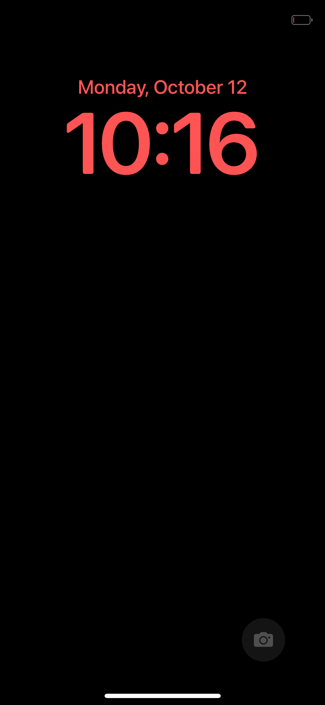
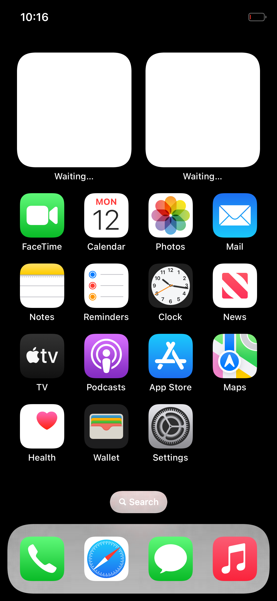
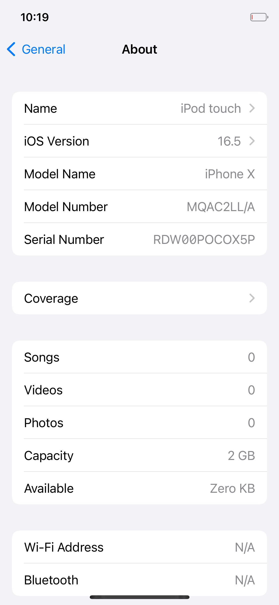

# Darwin на redwood

Открытое ядро Apple XNU (xnu-8796.121.2 — ядро iOS 16.5), свой загрузчик и свои замены закрытых драйверов,
под которыми работает **немодифицированный userland iOS 16.5** от iPhone X: launchd → backboardd → SpringBoard →
приложения. Работает в двух местах:

- **POCO X5 Pro 5G (redwood, Snapdragon 778G)** — ничего не прошивается: UEFI грузится через `fastboot boot`,
  вся система живёт в ОЗУ, после перезагрузки телефон снова в Android;
- **QEMU** (`virt`, aarch64) — то же самое на любом Linux-компьютере, без телефона.

Графика по умолчанию — программный рендер CoreAnimation, поэтому всё небыстро: на телефоне 15–40 кадров/с на
четырёх ядрах. Отрисовка самим Adreno телефона уже работает в опытном виде — см. раздел «GPU».

<p>



</p>

## Что работает и чего нет

| Работает | Не работает |
|---|---|
| Экран блокировки, разблокировка свайпом, домашний экран с полным набором значков (две страницы) | Звук, сеть (Wi-Fi/сотовая), Bluetooth, камера |
| Системные жесты: свайп снизу — «домой» и переключатель приложений, свайп от левого края — «назад», Пункт управления | Обои (чёрный фон) |
| Запуск приложений: Настройки (вглубь), Часы, Календарь, Фото, Заметки и др. | Metal (приложения, рисующие через него сами); отрисовка самим Adreno есть, но пока опытная — см. «GPU» |
| Сенсорный экран телефона (Goodix GT9916), мультитач, пробуждение касанием | Без `cpus=N` работает одно ядро процессора |
| Несколько ядер процессора (`cpus=4`: четыре больших ядра телефона) | |
| Кнопки «Домой»/«Блокировка»/громкость (в QEMU — клавишами) | Зарядка под нашим ядром (телефон только разряжается) |
| Большое ядро на 2,4 ГГц, загрузка до экрана блокировки ~20 с (телефон) | Safari (лежит в отдельном «App cryptex», которого у нас нет) |
| Снимки экрана и запись экрана с телефона | Сохранение данных: /private/var в памяти, каждая загрузка — «новое устройство» |

Это стенд для исследования, а не прошивка: сеанс длится заданное число секунд, потом ядро возвращается в загрузчик
и отдаёт журнал.

## Быстрый старт: QEMU, без сборки ядра

В `prebuilt/` лежат собранные из этого же репозитория ядро, загрузчик и наши программы, так что нужен только
образ системы. **Файлов iOS в репозитории нет** — скрипт сам скачивает их с серверов Apple (из IPSW iOS 16.5
для iPhone X) и раскладывает.

Нужно: Linux x86-64, ~12 ГБ свободного места (готовое занимает ~8 ГБ), от 4 ГБ свободной памяти. Пакеты (Arch):

```sh
sudo pacman -S --needed git python 7zip lz4 gcc qemu-system-aarch64 qemu-ui-gtk edk2-aarch64
```

(7-Zip нужен версии 23 или новее — он читает APFS; `lz4` — библиотека `liblz4`.)

```sh
git clone git@github.com:vcvkk/darwin-redwood.git
cd darwin-redwood
ios165/fetch.sh               # скачивает 7,4 ГБ с CDN Apple и распаковывает нужное (минут 5–15)
REST=1 userland/build.sh      # собирает образы: userland/root.packfs и userland/system.packfs (2,5 ГБ)
mkdir -p logs
qemu/run-ios.sh 1200 -display gtk > logs/qemu.log     # сеанс на 20 минут
```

Через 2–3 минуты в окне появится экран блокировки.

- **Мышь с зажатой левой кнопкой — палец.** Разблокировка и выход из приложения — свайп вверх от самого
  нижнего края (как на iPhone X), «назад» — свайп от левого края.
- Клавиши: `H` — «Домой», `L` — блокировка/питание, `↑`/`↓` — громкость, `F11` (держать) — пять пальцев.
- То же из скрипта (без окна, `-display gtk` можно не указывать):
  `qemu/touch.py swipe 0.5 0.985 0.5 0.3 250`, `qemu/touch.py tap 0.615 0.71`, `qemu/touch.py key home`
  (координаты — доли экрана), снимок экрана — `qemu/screendump.sh shot.png`.
- Первый аргумент `run-ios.sh` — длительность сеанса в секундах; по её истечении ядро возвращается в загрузчик
  и QEMU завершается. Журнал ядра и демонов идёт в stdout.
- Несколько ядер процессора: `QEMU_SMP=4 CMDLINE="cpus=4" qemu/run-ios.sh 1200 …` (`QEMU_SMP` — сколько ядер у
  машины, `cpus=` — сколько из них берёт ядро системы; без `cpus=` оно работает на одном). До экрана блокировки
  тогда полторы минуты вместо двух с половиной, и всё заметно отзывчивее. Программа `cpu_test` (из
  `userland/rc.jobs`) пишет в журнал число процессоров и, через четыре минуты, сколько из них на деле работало
  одновременно.
- Сразу после появления SpringBoard система ещё занята (регистрирует приложения): подождите секунд 30–40,
  иначе жесты «растягиваются» и не распознаются.

Замечания:

- Память гостя — 7 ГБ (ядру достаётся то же окно 4,2 ГБ, что и на телефоне), отображённые из разрежённого файла
  `qemu/ram.img` (образ системы лежит в нём по нужному смещению). На btrfs/xfs это reflink и места не занимает,
  на ext4 образ копируется (ещё 2,5 ГБ). Один запущенный QEMU занимает 2,5–3 ГБ памяти компьютера.
- Несколько QEMU сразу: `QEMU_INSTANCE=1 qemu/run-ios.sh …` (у каждого номера свои порты; `touch.py`,
  `screendump.sh`, `stop.sh` понимают ту же переменную). `qemu/stop.sh` завершает QEMU досрочно.
- Прошивка UEFI для aarch64 ищется там, куда её кладёт Arch. В Debian/Ubuntu (пакет `qemu-efi-aarch64`):
  `QEMU_EFI=/usr/share/AAVMF/AAVMF_CODE.fd QEMU_VARS=/usr/share/AAVMF/AAVMF_VARS.fd qemu/run-ios.sh …`
  (проверялось только на Arch).
- QEMU без KVM эмулирует ARM программно: всё заметно медленнее, чем на телефоне.

## На телефоне

Нужен именно **POCO X5 Pro 5G (redwood)** с разблокированным загрузчиком, `adb` и `fastboot` на компьютере
(`sudo pacman -S android-tools`), и образы из предыдущего раздела (`ios165/fetch.sh`, `REST=1 userland/build.sh`).

```sh
./xl enter            # Android → fastboot → наш загрузчик в ОЗУ (fastboot boot), он поднимает свой USB-канал
./xl ramdisk          # залить образ системы в ОЗУ телефона (2,5 ГБ, ~80 с) — один раз на сеанс загрузчика
XL_SECS=900 XL_CMDLINE="touchscreen=1 cpufreq=1 bootcpu=7 cpus=4" ./xl run     # 15 минут iOS
./xl screenshot shot.png      # что осталось на экране после возврата
./xl reboot                   # обратно в Android
```

Для телефона стоит собрать образ системы со сжатием Zstandard: `SYSTEM=1 ZSTD=1 REST=1 userland/build.sh`
(нужна `libzstd`, сборка идёт пару минут). Он на 0,5 ГБ меньше — ровно столько памяти дополнительно достаётся
самой системе, и заливается на 17 секунд быстрее; iOS при этом стартует секунды на две-три дольше.

`./xl run` ждёт конца сеанса и кладёт журнал в `logs/`; запускать можно сколько угодно раз, образ системы в ОЗУ
остаётся. `./xl` без аргументов печатает все команды. Пока идёт сеанс, из другого терминала работают
`./xl screenshot` (снимок экрана на ходу), `./xl log` (журнал ядра на данный момент), `./xl state` и
**`./xl stop`** — завершить сеанс сейчас. `XL_FOLLOW=5 ./xl run` каждые 5 секунд сохраняет журнал в
`logs/…-run.log.live`: если телефон сбросится без единого слова, останется всё, что ядро успело сказать.

Управление как на iPhone X: свайп вверх от нижнего края — разблокировка и «домой», погасший экран будится
касанием. **Закончить сеанс раньше времени — приложить к экрану пять пальцев на полторы секунды** (или
`./xl stop` с компьютера): ядро вернётся в загрузчик (кнопки телефона под нашим ядром не опрашиваются).
На экране при этом остаётся последний кадр.

**Прочитайте до запуска:**

- В постоянную память ничего не прошивается, с одним исключением: загрузчик пишет свой текстовый журнал в начало
  сырого раздела **`logdump`** (отладочный раздел Xiaomi; Android им в обычной жизни не пользуется). Если есть root —
  сохраните его заранее: `adb shell su -c 'dd if=/dev/block/by-name/logdump of=/sdcard/logdump.img'`.
- UEFI собран из драйверов прошивки `OS1.0.3.0.UMSMIXM`. С другой версией xbl он может не завестись — тогда
  телефон просто не выйдет на связь; выход — зажать питание на 10–15 секунд.
- Ядро напрямую трогает железо (регуляторы через RPMh, GPIO, частоту процессора). Проверено ровно на одном
  экземпляре. **На свой риск.**
- Под нашим ядром телефон **не заряжается** и греется (одно ядро на 2,4 ГГц постоянно рисует). Между длинными
  сеансами возвращайте его в Android (`./xl reboot`).
- Сенсоры в redwood бывают двух видов: Goodix GT9916 и FocalTech FT3680. Драйвер есть только для Goodix.
- Если ядро зависло, сторожевой таймер гипервизора сам перезагрузит телефон в Android (до минуты). Если нет —
  питание на 10–15 секунд.

Параметры ядра (`XL_CMDLINE`, в QEMU — переменная `CMDLINE`):

| Параметр | Что делает |
|---|---|
| `touchscreen=1` | включить сенсорный экран телефона (`touch_flip=1\|2\|3` — отразить оси) |
| `bootcpu=7` | запустить ядро на самом большом ядре процессора (загрузчик остаётся на нулевом и наблюдает) |
| `cpus=N` | использовать N ядер процессора: то, на котором ядро запущено, и ещё N−1 ближайших к нему по номеру (после 7 — 6, 5, 4, потом малые 3, 2, 1); их запускает само ядро через PSCI. `cpumask=M` — выбрать по позиции в этом порядке (бит 0 — загрузочное). Без параметра — одно ядро. **На телефоне не проверено**, порядок проверки — в конце раздела |
| `cpufreq=1` | поднять частоту до максимума (иначе 300 МГц) всем группам ядер, в которых есть наши |
| `rec_secs=N` | записывать экран N секунд (`rec_start=S`, `rec_mb=M`, не больше 640); потом `./xl recording out.mp4` |
| `-v` | текст загрузки на экране (по умолчанию у `xl run`, если `XL_CMDLINE` не задана) |
| `applog=1` / `applog=2` | stderr приложений в журнал / плюс os_log всех процессов |
| `systrace=1` | печатать неудачные системные вызовы и аварии процессов (`systrace_name=ИМЯ` — только процессов с этим именем) |
| `fbscale=2` | рисовать в 2 пикселя на точку вместо 3 и растягивать на панель: в 2,25 раза меньше работы программному рендеру (на телефоне пик 28 кадров/с вместо 19), картинка мягче, сверху появляется красная служебная полоса SpringBoard |
| `machine_name=0` | сообщать `hw.machine = arm64` вместо iPhone10,3 (как было раньше; тогда iOS не находит ни одного ресурса с суффиксом `~iphone`, и, например, Пункт управления теряет раскладку) |
| `wfi=0 wfe_mode=0` | простаивающее ядро процессора не засыпает, а крутится в цикле, как всегда было с одним ядром (с `cpus=N` простой — это WFI; на случай, если под гипервизором телефона он поведёт себя плохо) |
| `return_cpu=N`, `return_panic=1` | для проверки возврата в загрузчик с несколькими ядрами: вернуться по таймеру с процессора N (по номеру в ядре: 0 — загрузочный) и/или через панику |
| `adreno=N` | опыт с GPU телефона: первые N шагов его пробуждения (питание, такты, первые регистры), каждый шаг пишет в журнал, что собирается тронуть и что прочёл; шаги и остальные параметры описаны в начале `bsd/dev/redwood_adreno.c` |

Несколько ядер на телефоне проверены (2, 4 и 7 ядер запускаются и чисто возвращаются в загрузчик). Лучший
вариант — **`cpus=4`**: четыре больших ядра (7, 6, 5, 4). На одном и том же сценарии: 929 кадров вместо 671,
пики 35 кадров/с вместо 19, SpringBoard готов на 7 секунд раньше. `cpus=7` хуже четырёх: планировщик не знает,
что ядра 1–3 малые, и сажает на них интерфейс. Паника «Ticket spinlock … timeout» значила бы, что ядрам тесно
во времени (в QEMU загрузчик сам увеличивает эти сроки в 20 раз): помогает `ml-timeout-global-scale=4`.

## GPU

**iOS на телефоне может рисовать графический процессор** — Adreno 642L, через открытый драйвер Mesa freedreno
и наш драйвер в ядре (`docs/adreno-springboard.png`: треугольник, экран блокировки, домашний экран).

Как это устроено:

- ядро (`bsd/dev/redwood_adreno.c`, `iokit/Kernel/RedwoodGPU.cpp`) поднимает Adreno — прошивка управляющего
  процессора (GMU), питание 3D-ядра, zap-шейдер через TrustZone, микрокод — и отдаёт его userland'у через
  клиент IOKit с подмножеством интерфейса msm DRM (буферы, отправка команд, ожидание);
- `tools/mk-mesa.sh` собирает Mesa 25.0.7 под userland iOS (freedreno и программный softpipe, минута сборки);
- `userland/src/eagl.c` встаёт за системный `EAGLContext`: в QuartzCore 16.5 есть рендер через OpenGL ES, на
  который сервер окон переходит сам, если нет Metal.

Запуск (прошивки GPU один раз снять со своего телефона:
`adb pull /vendor/firmware/a660_{gmu.bin,sqe.fw,zap.mdt,zap.b00,zap.b01,zap.b02}` в каталог `fw-gpu/`; в git они
не попадают):

```sh
tools/mk-mesa.sh
GL=1 REST=1 userland/build.sh
XL_CMDLINE="touchscreen=1 cpufreq=1 bootcpu=7 cpus=4 adreno=21 adreno_skip=0x1c00 adreno_pause=0 adreno_keep=1" ./xl run
```

При втором и следующих запусках за одну загрузку телефона добавлять `adreno_zap=0`. Без параметров `adreno…`
тот же образ рисует программным драйвером Mesa (в QEMU — всегда так).

Состояние — первый рабочий вариант, не режим по умолчанию: проверены экран блокировки и домашний экран; кадр
рисуется за 16–17 мс, но 14 из них — копирование готовой картинки (память кадра пока не общая с GPU); прерываний
нет (ожидание опросом); сеанс, оборванный паникой или `./xl stop`, оставляет GPU включённым — после него
`./xl reboot`. Приложения, использующие Metal сами, от этого ничего не получают.

## Сборка из исходников

Готовые бинарники в `prebuilt/` собраны из этого репозитория; пересобрать всё можно самому.

### Ядро

Нужны [theos](https://theos.dev/docs/installation-linux) в `~/theos` (cctools и `iPhoneOS16.5.sdk`) и пакеты
`base-devel git curl clang lld python perl xz`. Дальше три команды, вместе около двух минут:

```sh
xnu/apply.sh             # исходники XNU (тег xnu-8796.121.2) с GitHub Apple + наши правки → xnu-src/
xnu-deps/setup.sh        # зависимости, инструменты и SDK для сборки на Linux стоковым clang
./xnu-build.sh -j8 -k    # → xnu-src/xnu-8796.121.2/BUILD/obj/DEVELOPMENT_ARM64_BCM2837/mach.development.bcm2837
```

Подробности, подводные камни и обзор того, что добавлено в ядро, — в `xnu/README.md`.

### Загрузчик

```sh
xnuloader/build.sh        # clang + lld-link → xnuloader/loader.efi (EFI-приложение без EDK2)
```

`xnuloader/identity.h` сгенерирован `mkidentity.py` из дерева устройств iPhone X (так система узнаёт, «какой она
iPhone»); перегенерировать: `python3 ios165/fetch-from-ipsw.py Firmware/all_flash/DeviceTree.d22ap.im4p dt.im4p`,
`ipsw img4 im4p extract dt.im4p -o dt.bin`, `xnuloader/mkidentity.py dt.bin > xnuloader/identity.h`.

### Userland и образы

```sh
REST=1 userland/build.sh
```

Без кросс-компилятора (см. раздел про ядро — он тот же) скрипт берёт наши программы из `prebuilt/userland`,
с ним — компилирует `userland/src`. Получаются два образа в своём формате packfs (`mkpackfs.py`):

- `userland/root.packfs` — маленький (наш init, библиотеки-вставки, задания launchd); едет вместе с ядром,
  пересобирается за секунды;
- `userland/system.packfs` — корень: отобранная часть iOS 16.5 (`ios165/select-system.py`), кэш dyld. Сжат
  кусками по 64 КБ, которые ядро читает прямо из ОЗУ: LZ4 (по умолчанию) или Zstandard (`ZSTD=1`).
  Пересобирается только при изменении входных данных или с `SYSTEM=1`.

`REST=1` добавляет ~350 штатных служб iOS «по требованию» (без них часть приложений зависает на старте);
список исключений — `DENY` в `userland/mkjobs.py`, пропустить службу из него для опыта: `ALLOW="слово"`.
Остальные переменные (`JOBS`, `OSLOG`, `INJECT`, `RC_JOBS`) описаны в начале `userland/build.sh`.

`GL=1 REST=1 userland/build.sh` — образ, в котором оконный сервер рисует через OpenGL ES, а не программным
растеризатором CoreAnimation: за `EAGLContext` встаёт Mesa (прослойка — `userland/src/eagl.c`). На телефоне с
параметрами ядра `adreno=21 adreno_skip=0x1c00 adreno_pause=0 adreno_keep=1` рисует сам Adreno: драйвер freedreno
из Mesa говорит с ядром (`iokit/Kernel/RedwoodGPU.cpp`) на языке линуксового msm DRM. Без этих параметров и в
QEMU — программный softpipe. После первого запуска с момента включения телефона добавляйте `adreno_zap=0`.
Mesa в репозитории нет: `tools/mk-mesa.sh` один раз скачивает и собирает её (нужны meson, ninja, bison, flex).
`GL=test RC_JOBS=rc.jobs.gltest` — только библиотека и `gl_test`: один треугольник на экран.

После пересборки ядра/загрузчика/программ `tools/update-prebuilt.sh` обновляет `prebuilt/`.

### UEFI для телефона

См. `uefi/README.md` (порт Project Silicium на redwood). Для запуска пересобирать не нужно: `mkxnuimg.py` берёт
готовое из `prebuilt/uefi`.

## Как это устроено

```
fastboot boot ──► UEFI (Mu-Silicium, redwood) ──► xnuloader (EFI-приложение)
                                                    │  остаётся резидентным: USB-канал (протокол fastboot),
                                                    │  сторожевой таймер, приём журнала от ядра
                                                    ▼
                         XNU (конфигурация BCM2837 как основа + своя платформа)
                           ├─ GICv3, таймер, видеоконсоль, возврат в загрузчик
                           ├─ packfs (корень, сжатый образ в ОЗУ), ramfs (/private/var, /tmp)
                           ├─ minicrypto вместо corecrypto, заглушки AMFI и Sandbox (MAC-политики)
                           ├─ замены драйверов: IOSurface, IOMobileFramebuffer, AppleKeyStore
                           └─ ввод: /dev/redwood-touch ◄─ Goodix GT9916 (телефон) / virtio-input (QEMU)
                                                    ▼
              launchd iOS 16.5 → logd, notifyd, cfprefsd, runningboardd, backboardd, SpringBoard, приложения
                           └─ в backboardd и SpringBoard внедряются наши библиотеки (libredwood*.dylib):
                              виртуальные HID-службы (сенсор, кнопки) и подмена нескольких ObjC-методов
```

Userland не изменён ни в одном байте: всё, чего ему не хватает, либо делает ядро (замены драйверов), либо
библиотека, которую ядро подсовывает через `DYLD_INSERT_LIBRARIES` (sysctl `kern.exec_inject`).

## Что где лежит

| Путь | Что |
|---|---|
| `xl` | управление телефоном по USB: загрузчик, запуск ядра, журнал, снимки экрана |
| `xnuloader/` | загрузчик: `loader.c` (UEFI-приложение), `mkpayload.py` (контейнер «ядро + образ + аргументы») |
| `xnu/` | наши правки XNU: патч, новые файлы, `apply.sh`/`export.sh` |
| `xnu-deps/` | всё для сборки XNU на Linux: `setup.sh`, обёртки инструментов, заглушки |
| `xnu-build.sh`, `xnu-env.sh` | сборка ядра |
| `userland/` | наш init, вставки (`src/inject.c` — backboardd, `src/inject_sb.c` — SpringBoard), тесты, сборка образов |
| `ios165/` | добыча файлов iOS из IPSW и выбор того, что идёт в образ |
| `mkpackfs.py` | сборщик образов packfs (формат описан в `bsd/miscfs/packfs/packfs.h` ядра) |
| `qemu/` | запуск в QEMU, касания, снимки экрана, разбор стеков |
| `uefi/`, `mkxnuimg.py` | порт UEFI на redwood и упаковка загрузочного образа для `fastboot boot` |
| `tools/` | `recording.py` (запись экрана → mp4), `update-prebuilt.sh`, `new-workspace.sh` (вторая рабочая копия со своим ядром и QEMU), `mk-zstddec.sh`, `mk-mesa.sh` (Mesa для `GL=1`) |
| `prebuilt/` | собранные ядро, загрузчик, наши программы и куски UEFI |

Скрипты не зависят от того, куда склонирован репозиторий.

## Отладка

- Журнал сеанса: stdout QEMU или `logs/ЧЧММСС-run.log` с телефона. Драйвер экрана раз в 5 с пишет частоту кадров,
  драйвер сенсора раз в минуту — сводку касаний, ядро раз в минуту — строку `memory:` (куда ушла память и при
  каком остатке оно начнёт убивать процессы).
- `RC_JOBS=rc.jobs.tour REST=1 userland/build.sh` — образ со сценарием: сам разблокирует экран и по очереди
  открывает все приложения первой страницы (проверка стабильности и памяти, сеанс ~9 минут).
- `userabort:` в журнале — стек процесса, вызвавшего `abort()`; `usertrap:` (с `systrace=1`) — аварии.
- Стеки зависшего процесса на лету (QEMU): `qemu/touch.py stacks ИМЯ`, затем `qemu/symstack.py ЖУРНАЛ ИМЯ`
  (нужен [`ipsw`](https://github.com/blacktop/ipsw)). `qemu/touch.py stacks top` — кто занимал процессор с прошлого
  такого запроса (строки `top:` в журнале): «тормозит» система или чего-то ждёт, на экране не отличить.
- `userland/jobinfo.py [-s СЛУЖБА | МЕТКА…]` — штатные задания launchd и кто даёт Mach-службу.
- `OSLOG=all userland/build.sh` — os_log всех заданий на консоль (очень многословно).

## Про файлы Apple и лицензии

- Файлов iOS в репозитории нет: `ios165/fetch.sh` скачивает их из IPSW с CDN Apple на вашу машину.
- `xnu/` — производная работа от XNU, распространяется на условиях APSL 2.0, как и сам XNU; `prebuilt/mach.*` —
  ядро, собранное из этих исходников.
- `xnu/files/bsd/miscfs/packfs/zstddeclib.c` — декодер Zstandard (Meta, BSD), сгенерирован `tools/mk-zstddec.sh`;
- Mesa (лицензия MIT) в репозитории нет: `tools/mk-mesa.sh` берёт выпуск 25.0.7 с archive.mesa3d.org,
  `tools/mesa/*.patch` — наши правки к нему;
- `xnu-deps/build/lzbitmap/libzbitmap.*` — libzbitmap (Corellium, GPL-2.0+ OR MIT);
  `xnu-deps/hostinc/mach-o/{loader,nlist,fat}.h` — заголовки из XNU (APSL 2.0).
- `uefi/files/Binaries/redwood` и `prebuilt/uefi/SILICIUM_UEFI.fd` содержат драйверы UEFI из прошивки Xiaomi
  (так же, как их распространяет Project Silicium для других устройств); `prebuilt/uefi/mkbootimg.py` — AOSP, Apache-2.0.
